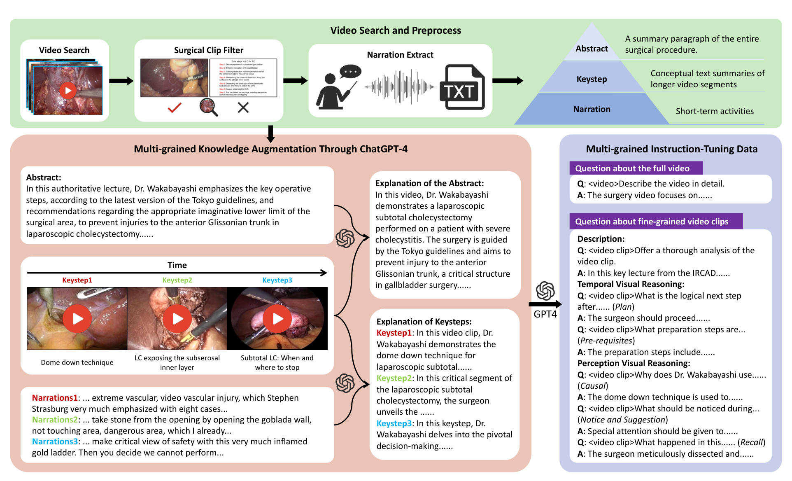
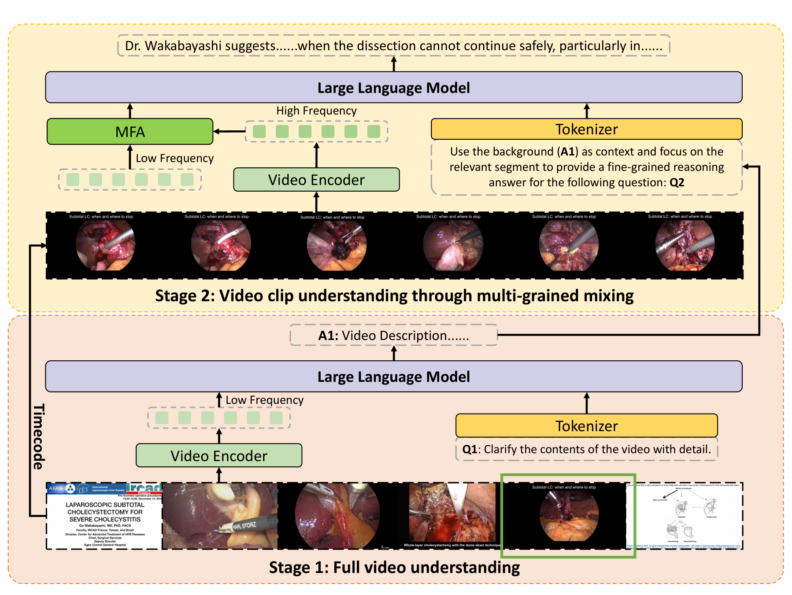
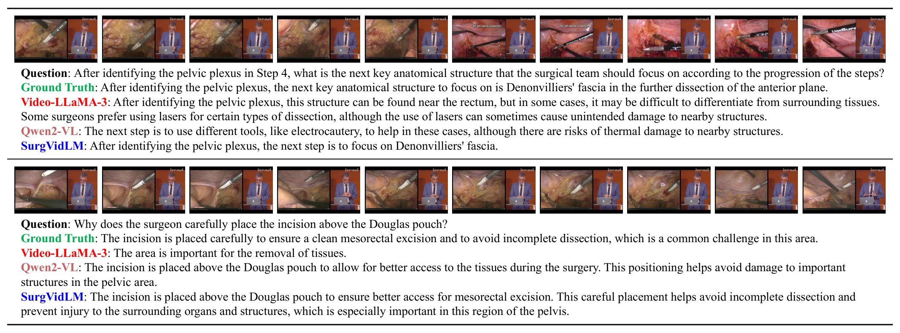

## 1. 背景与动机

**外科医生关心"这一步之后做什么、为什么这么做",答案往往藏在视频的某个短片段里。** 图像级手术大模型只看单帧;通用视频大模型受显存限制,对整段视频稀疏抽帧,短时操作容易被跳过。

数据也是瓶颈。LLaVA-Surg 的 Surg-QA 有 102K 视频问答对但未公开,Surgical-LLaVA 用图像级标注微调。论文要同时补数据和模型两块。

:::highlights
- 问题不在于模型不会看视频,而在于看全片时帧太稀、看片段时缺全局。
:::

## 2. 核心观点速览

- 数据:1882 个讲解视频,用自带的关键步骤时间码切片,由 GPT-4 生成 1.8K 个全视频问答和 29.4K 个片段问答。
- 推理:第一阶段每秒 1 帧看全片并写描述;第二阶段按时间码在片段内每秒 2 帧采样,并把第一阶段描述当背景文本。
- 融合:多频融合注意力 MFA 让片段词元从全片词元中取回上下文。
- 结果:细粒度任务全部指标领先微调后的基线,全视频描述与基线持平。

**边界:片段时间码由标注给出,基线是否拿到同一片段论文未说明。**

:::data
- 1882 个视频,1.8K 全视频问答,29.4K 片段问答
- 感知推理 ROUGE-L 37.51 对微调 Qwen2-VL 34.48
:::

## 3. 数据从哪里来

**多粒度监督来自讲解视频自带的结构。** 每个视频有摘要和带时间码的关键步骤,按关键步骤切片。讲者画面和幻灯片用 ResNet-50 过滤:帧级准确率 94%,片段中至少 80% 的帧判为手术才保留。音频用 Whisper 转写,再由 GPT-4 纠错。

这样得到摘要、关键步骤、讲解三级文本。GPT-4 用关键步骤重组摘要,把讲解细节并入关键步骤,再生成问答:全视频描述、片段描述、时序推理(下一步、前置步骤)和感知推理(因果、注意事项、回忆)。

*论文原图编号：Fig 1。SVU-31K 构建流程:检索预处理、三级文本、GPT-4 知识增强、多粒度问答。*

**已发布数据核查:** 全视频问答 1505 条训练、377 条测试;片段问答 22766 条训练、6004 条测试,比论文的 29.4K 少约 600 条;按视频划分,训练测试不重叠。测试片段中感知推理 4200 条,时序推理只有 404 条。

:::highlights
- 片段边界来自视频作者的标注,问答和参考答案来自 GPT-4。
:::

接下来看模型怎么用这些时间码。

## 4. 两阶段推理与 MFA

**核心矛盾是显存:全片高频太贵,全片低频丢细节。** 两阶段把这两件事分开:

1. 第一阶段:每秒 1 帧抽全片,沿用 Qwen2-VL 原结构生成描述 A1。
2. 第二阶段:按问题对应的时间码在片段内每秒 2 帧采样得到高频词元,提示词要求以 A1 为背景回答问题。
3. MFA 融合后送入大语言模型生成答案。

$$E(X_C, X_F) = \mathrm{softmax}\left(\frac{X_C X_F^{T}}{\sqrt{d}}\right) X_F,\quad X_{fuse} = X_C + E(X_C, X_F)$$

$X_C$ 是片段高频词元,作查询;$X_F$ 是全片低频词元,作键和值。每个片段词元按相似度取回全局上下文,再加回自身。MFA 是否有可学习投影论文未说明。

*论文原图编号：Fig 2。SurgVidLM 结构:下方第一阶段看全片,上方第二阶段按时间码放大片段并经 MFA 融合。*

## 5. 训练怎么做

- 从 Qwen2-VL-7B-Instruct 初始化,视觉编码器全程冻结。
- 第一阶段只用全视频问答做 LoRA 微调,批大小 4,约 3 小时。
- 第二阶段用片段问答训练大语言模型和 MFA,批大小 16,约 15 小时。
- AdamW,学习率 $1\times10^{-4}$,1 个 epoch,224×224,6 张 H100。

训练成本不高,一个实验室规模的集群就能复现。

## 6. 结果说了什么

| 任务 | 微调 Qwen2-VL | 微调 Qwen2.5-VL | SurgVidLM |
|---|---|---|---|
| 全视频描述 CU | 2.69 | 2.76 | 2.69 |
| 片段描述 CU | 1.98 | 2.66 | 3.06 |
| 时序推理 ROUGE-L | 29.76 | 20.63 | 31.58 |
| 感知推理 ROUGE-L | 34.48 | 33.34 | 37.51 |

**细粒度 12 项指标全部最高,全视频描述与微调 Qwen2-VL 完全相同。** 后者说明第一阶段没有方法增益,增益全在片段任务上。

正文增益与表格部分不符:感知推理 ROUGE-L 按表应为 3.03,正文写 4.03;片段描述的 CI、DO、TU 增益在表中找不到对应差值。

*论文原图编号：Fig 3。两个细粒度推理样例,SurgVidLM 答出 Denonvilliers 筋膜和直肠系膜切除的理由。*

:::data
- 时序推理 BLEU-4 10.10,CIDEr 3.83
- 零样本基线描述分多在 1 到 2.5 之间(满分 5)
:::

## 7. 消融拆开了什么

| 配置 | CU | ROUGE-L |
|---|---|---|
| 两者都无 | 1.98 | 33.06 |
| 仅 StageFocus | 3.04 | 36.95 |
| 两者都有 | 3.06 | 36.97 |

**增益几乎都来自 StageFocus,MFA 主要提升描述细节。** 但 StageFocus 同时带来了标注时间码、片段高频帧和背景文本三样东西,消融没有拆开。

采样频率从 0.5 到 2 fps 持续上升,4 fps 在 CI、TU、BLEU-4、ROUGE-L 上反而更高。作者以成本为由选 2 fps,但不同帧率下的显存和时延论文未说明。

## 8. 为什么有效:三种替代解释

**分数高不等于学会了细粒度推理。** 下面三种更简单的解释论文都没有排除:

| 替代解释 | 区分实验 |
|---|---|
| 标注时间码直接指向答案 | 给基线同一片段,或改用预测片段 |
| 背景文本与参考答案词汇重叠 | 只给背景文本,不给高频帧 |
| GPT-4 偏好 GPT-4 风格的回答 | 外科医生人工评分 |

我的判断是,第一种解释的权重最大:片段问答本来就是按该关键步骤文本生成的,时间码等于告诉模型去哪里找答案。

## 9. 复现与使用要注意什么

- 数据在 Hugging Face 公开、无需申请,但视频很大:测试集约 157 GB,训练视频三个分卷约 826 GB。
- 代码仓库仍写训练集"接收后公开",以 Hugging Face 实际文件为准。
- 有 2006 条片段的结束时间码不大于起始值,使用前要处理。
- 对比 SurgVidLM 时给基线同样的片段时间码。

## @takeaways
- SVU-31K 是少数公开、按视频划分、同时有全视频和片段级问答的手术视频指令数据。
- "先全片、再按时间码放大片段"在 7B 模型上能显著提高片段级指标,但收益与标注时间码绑定。
- 正文增益数字要以表格为准。

## @strengths
- 数据与权重都已公开,训练脚本完整。
- 用讲解视频自带的时间码与字幕构造多粒度监督,成本低、可扩展。
- 对照组包括同数据微调的基线,而不只是零样本模型。

## @weaknesses
- 片段位置来自标注,模型不会自己定位。
- 问答生成与描述评分都用 GPT-4,没有人工核验或人工评分。
- 单次运行无方差,正文与表格数字有出入,补充材料未随 arXiv 发布。

## @questions
- 用预测片段代替标注时间码后性能掉多少?
- 只给背景文本、不给高频帧时结果如何?
- 外科医生评分与 GPT-4 评分的排序是否一致?
