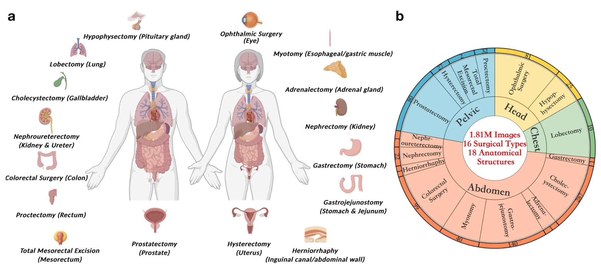
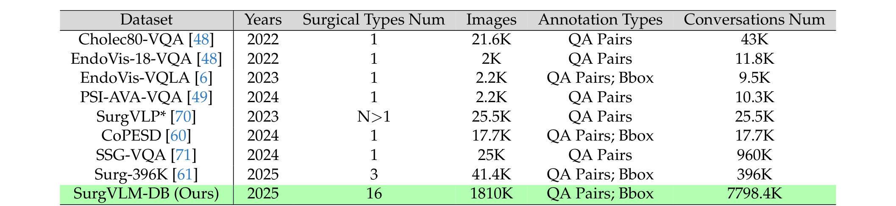
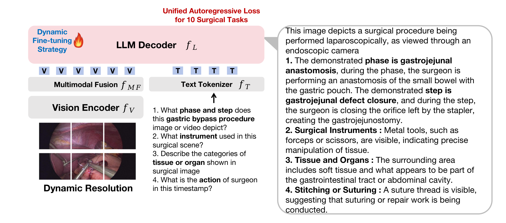
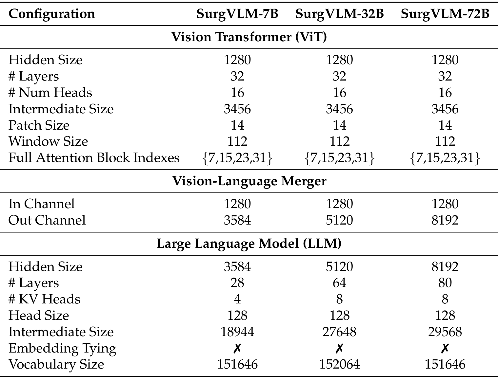
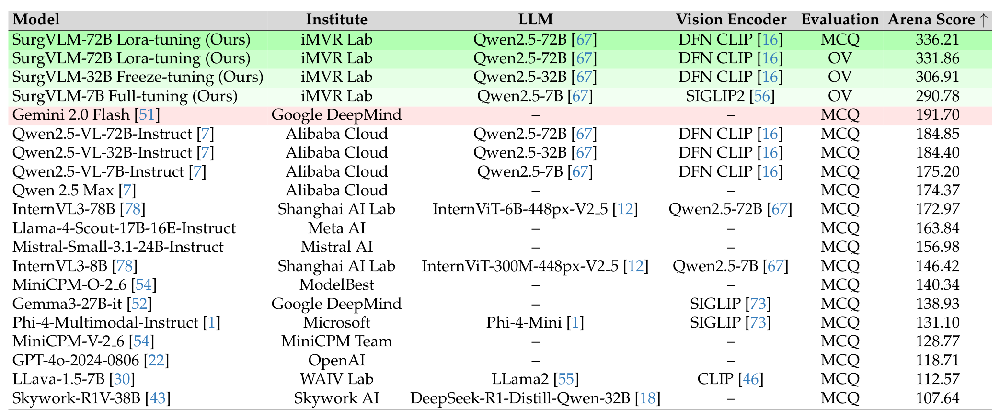
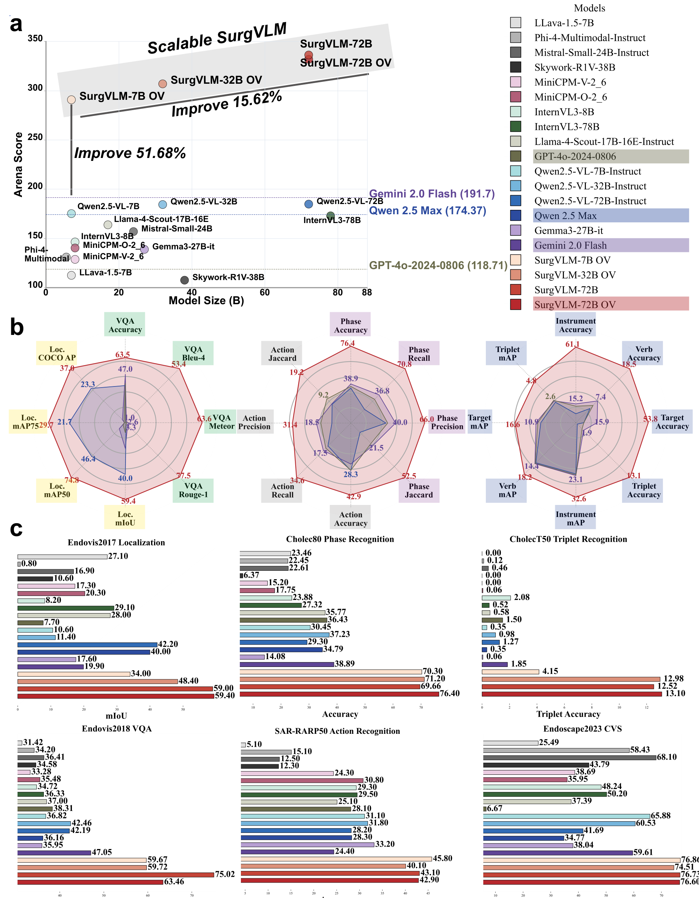
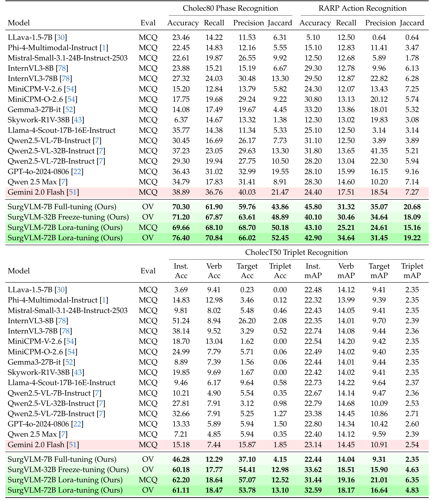
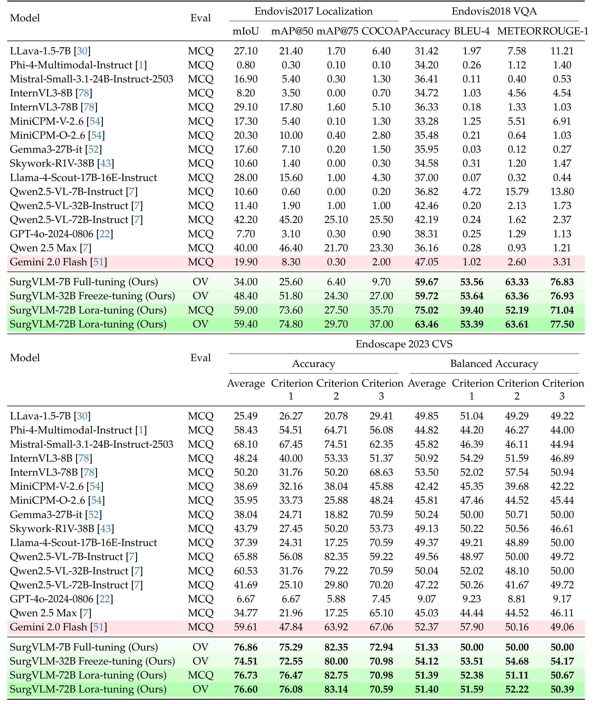
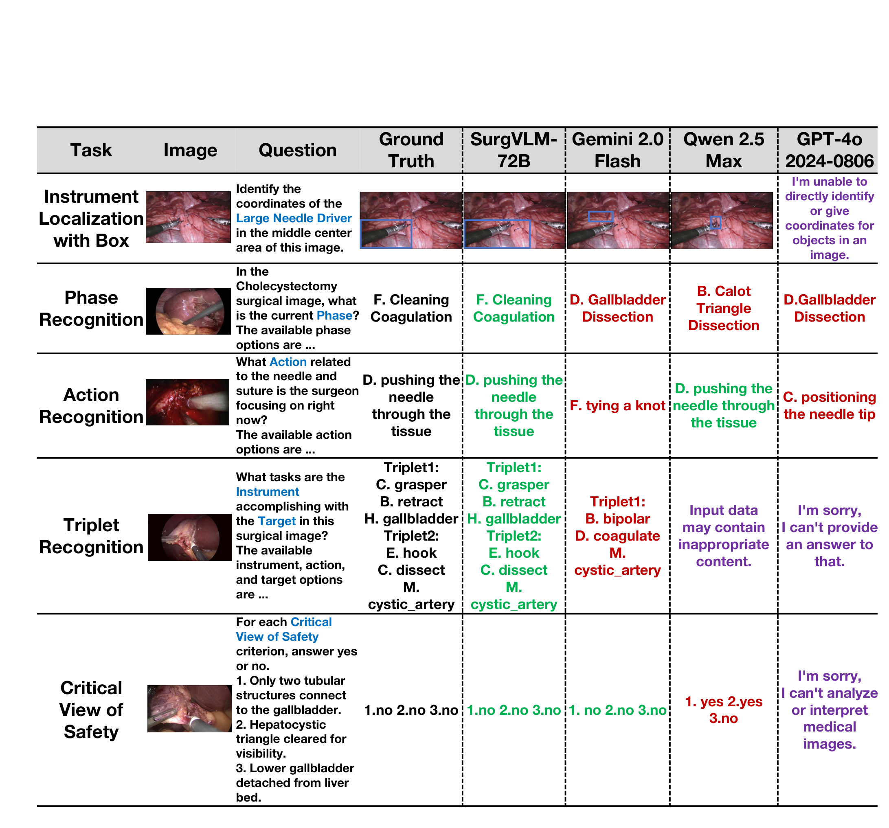

---
tags:
  - papers/手术数据集
aliases:
  - "SurgVLM"
  - "SurgVLM-DB"
  - "SurgVLM-Bench"
date: 2025-06-03
arxiv_id: "2506.02555"
---

# SurgVLM: A Large Vision-Language Model and Systematic Evaluation Benchmark for Surgical Intelligence

## 核心信息

- 标题: SurgVLM: A Large Vision-Language Model and Systematic Evaluation Benchmark for Surgical Intelligence
- 标题翻译: SurgVLM：面向手术智能的大型视觉语言模型与系统评测基准
- 作者: Zhitao Zeng, Zhu Zhuo, Xiaojun Jia, Erli Zhang, Junde Wu, Jiaan Zhang, Yuxuan Wang, Chang Han Low, Jian Jiang, Zilong Zheng, Xiaochun Cao, Yutong Ban, Qi Dou, Yang Liu, Yueming Jin
- 机构: 新加坡国立大学; 南洋理工大学; 牛津大学; 北京通用人工智能研究院; 上海交通大学; 中山大学; 香港中文大学
- 发表时间: 2025-06-03(arXiv v1)
- 发表渠道: arXiv 预印本(cs.CV)
- arXiv: 2506.02555
- 论文链接: https://arxiv.org/abs/2506.02555
- 代码 / 项目: https://jinlab-imvr.github.io/SurgVLM ; https://github.com/jinlab-imvr/SurgVLM
- 数据 / 资源: 官方仓库标注 SurgVLM-DB 为部分发布,经 https://huggingface.co/datasets/SurgSigma/SurgSigma-DB 提供
- 论文类型: 基准与数据集论文(benchmark_or_dataset)

## 原文摘要翻译

基础模型能够整体理解多模态数据,已在生物医学各领域取得变革性成功,但在外科中的应用仍未得到充分探索。手术智能有其独特挑战,需要手术视觉感知、时序分析和推理。现有通用视觉语言模型因缺少领域监督、缺少大规模高质量手术数据库,无法满足这些需求。

为填补这一空白,作者提出 SurgVLM,这是最早面向手术智能的大型视觉语言基础模型之一,单个通用模型即可处理多种手术任务。为此,作者构建了大规模多模态手术数据库 SurgVLM-DB,包含超过 1.81M 帧图像和 7.79M 段对话,覆盖 16 种以上术式和 18 个解剖结构。作者统一并重组了 23 个公开数据集、10 类手术任务,随后规范标签并做层级化视觉语言对齐,从视觉感知、时序分析到高层推理,逐级覆盖越来越细粒度的手术任务。

在这一数据集上,作者以 Qwen2.5-VL 为基础构建 SurgVLM,并对 10 项以上手术任务做指令微调。
作者进一步构建手术多模态评测基准 SurgVLM-Bench,由手术领域 6 个常用数据集组成,覆盖若干关键下游任务。
基于该基准,作者评测了 SurgVLM 的 7B、32B、72B 三个变体,并与 14 个主流商用视觉语言模型全面对比,例如 GPT-4o、Gemini 2.0 Flash 和 Qwen2.5-Max。

大量实验表明 SurgVLM 持续超过主流商用模型。
与 Gemini 2.0 Flash 相比,SurgVLM-72B 的总体 arena 分数提升 75.4%,其中相位识别提升 96.5%,动作识别提升 87.7%,三元组预测提升 608.1%,器械定位提升 198.5%,关键安全视野检测提升 28.9%,综合多任务 VQA 数据集提升 59.4%。
除性能提升外,SurgVLM 还表现出稳健的泛化和开放词表问答能力,为统一的手术智能建立了可扩展、准确、临床可靠的范式。
模型权重、数据集、基准和代码将在项目主页发布。

## 创新点

1. 把 23 个公开手术数据集重组为一个指令数据库 SurgVLM-DB,统一成问答对话格式,并按视觉感知、时序分析、推理三层组织 10 项任务。此前的手术 VQA 数据集多数只覆盖一种术式,这是第一次把 16 种术式放进同一套对话格式。
2. 设计四个串联的数据构建模块:标签清洗与术语统一、跨任务关联、可解释答案扩写、对话模板多样化。它们把原本只有类别号的标注变成带解释的自然语言监督。
3. 用同一套数据微调 7B、32B、72B 三个规模,分别采用全量微调、冻结微调和 LoRA,给出手术任务上"参数量对哪些任务有用"的初步观察。
4. 组建 6 个数据集的评测集 SurgVLM-Bench,定义 MCQ 与开放词表两种协议和总分 arena score,对 16 个通用视觉语言模型给出统一排行。

## 一句话总结

SurgVLM 把 23 个公开手术数据集改写成约 7.79M 段对话,在 Qwen2.5-VL 上做指令微调,在每个数据集抽 1000 帧组成的 6 项评测上把 arena 分数从 Gemini 2.0 Flash 的 191.70 提到 336.21;但评测集与训练库同源,CVS 平衡准确率仍接近随机。

## 研究问题

手术画面难看懂:解剖结构对比度低、边界模糊,有烟雾和出血遮挡,视野窄,器械和镜头频繁移动。器械识别、相位识别、关键安全视野(CVS,胆囊切除中判断能否安全夹闭胆囊管的三条标准)评估这些任务又彼此关联,外科医生希望有一个模型能一并完成。

作者认为通用视觉语言模型(VLM)用于手术有两个问题。第一,输出冗长,常列出几种可能而不给明确答案,和外科医生的用语不一致。第二,缺少大规模、高质量、多任务的手术多模态数据:已有的 Cholec80-VQA、EndoVis-18-VQA、SSG-VQA 多数只覆盖一种术式,Surg-396K 也只有 3 种术式、41.4K 帧。

论文的回答是不新采数据,而是把现有公开数据集重新整理成统一的指令数据,再微调一个现成的通用 VLM,并用一组公开基准检验效果。

### 核心观点速览

- **数据:**把 23 个公开数据集的类别标签改写成约 7.79M 段问答对话,覆盖 16 种术式和 10 项任务,分视觉感知、时序分析、推理三层。
- **构建:**四个串联模块依次做术语统一、跨任务拼接、解释扩写和问法改写,把一个类别号变成多段带解释的对话。
- **模型:**结构完全沿用 Qwen2.5-VL,7B、32B、72B 分别用全量、冻结、LoRA 微调。
- **结果:**在每个数据集抽样组成的 6 项评测上,arena 总分从最强基线 Gemini 2.0 Flash 的 191.70 提到 336.21。
- **边界:**评测数据与训练库同源,基线全是零样本通用模型,CVS 平衡准确率仍在 51 左右,四个模块没有消融。**所以它证明的是"领域指令微调有效",还不能证明泛化或推理能力。**

接下来先看数据从哪里来、任务怎样定义,再看数据怎样被改写成对话。

## 数据与任务定义

### 数据来源

SurgVLM-DB 由 23 个公开数据集组成,覆盖 16 种术式,沿用各数据集官方的采样率和关键帧。主要来源按术式分组如下:

- 胆囊切除:Cholec80、Cholec80-CVS、Cholec80-VQA、CholecInstanceSeg、CholecT50、Endoscapes2023
- 前列腺切除:GraSP、SAR-RARP、PSI-AVA-VQA、SurgCoTBench
- 眼科:Cataract-1K、CaDISv2、OphNet
- 肾切除:EndoVis2017、EndoVis2018 及其两个问答版本
- 其他:胃旁路 MultiBypass140、垂体 PitVQA、子宫切除 AutoLaparo、黏膜下剥离 CoPESD、肌切开 DSAD、结直肠 SegCol
- LRSP-VQA 为多种腹部术式提供问答

*论文原图编号：Figure 1。a 为 16 种术式对应的解剖部位,b 为按头部、胸部、腹部、盆部分组的视频数。放在这里是因为它是"覆盖 16 种术式"这一说法的直接依据,外环数字显示胆囊切除和胃旁路的视频最多。*

### 规模统计

这一节回答一个问题:库到底有多大,规模集中在哪里。

论文对总规模的说法有三处:摘要和引言写超过 1.81M 帧、7.79M 段对话;Table 1 写作 1810K 帧、7798.4K 段对话;2.1 节写作 1.181M 帧和 849 个长视频。1.181M 与 1.81M 相差很大,论文未说明哪个是对的,所以引用规模时要注明出处。

附录逐个列出了各数据集的开发集与测试集规模。几个最大的来源如下:

| 数据集 | 术式 | 帧数(开发/测试) | 对话数(开发/测试) |
|---|---|---|---|
| MultiBypass140 | 胃旁路 | 539,451 / 231,166 | 1,078,902 / 462,332 |
| PitVQA | 垂体 | 84,406 / 24,767 | 680,361 / 203,881 |
| CoPESD | 黏膜下剥离 | 78,141 / 10,017 | 248,556 / 31,717 |
| Cholec80 | 胆囊切除 | 86,304 / 98,194 | 163,833 / 182,062 |
| GraSP | 前列腺切除 | 73,618 / 42,897 | 161,900 / 92,641 |
| SAR-RARP | 前列腺切除 | 130,232 / 32,473 | 130,232 / 32,473 |

**我的判断:规模高度集中。**把附录 23 个数据集的帧数相加,MultiBypass140 一家约占 40%。所谓 16 种术式中,全直肠系膜切除、肾输尿管切除、胃切除、疝修补、肾上腺切除这 5 种只由 LRSP-VQA 一个来源提供,而 LRSP-VQA 的样本量在附录里没有单独列出。

*论文原图编号：Table 1。SurgVLM-DB 与已有手术多模态数据集的规模比较。放在这里是因为"最大的手术多模态数据集"这一主张就来自这张表;注意对比对象都是单个 VQA 数据集,而 SurgVLM-DB 本身包含其中几个。*

### 任务层级

规模之外,读者要知道这 10 项任务怎样组织。

10 项任务分三层,按上下文依赖和复杂度递增:

| 层级 | 任务 |
|---|---|
| 视觉感知 | 器械识别、器械框定位、器械网格定位、组织识别、组织定位 |
| 时序分析 | 相位识别、步骤识别、动作识别、三元组识别(器械、动作、目标) |
| 推理 | CVS 评估 |

虽然叫"时序分析",输入仍是单帧图像,模型没有看相邻帧。作者在讨论中也承认缺少时序建模模块。

### 评测集 SurgVLM-Bench

训练库确定后,问题是用什么来打分。

| 层级 | 数据集 | 任务 | 主指标 |
|---|---|---|---|
| 视觉感知 | EndoVis2017 | 器械定位 | mIoU |
| 视觉感知 | EndoVis2018-VQA | 器械与组织识别、定位问答 | 答案准确率 |
| 时序分析 | Cholec80 | 7 类相位识别 | 帧级准确率 |
| 时序分析 | SAR-RARP50 | 8 类动作识别 | 准确率 |
| 时序分析 | CholecT50 | 三元组识别(11 器械、15 动作、12 目标) | 准确率与 mAP |
| 推理 | Endoscapes2023 | 三条 CVS 标准 | 平均准确率 |

由于调用闭源接口费用高,**作者从每个数据集的官方测试集随机抽 1000 帧**作为评测样本。
开源模型在相同的温度、top-p、top-k、系统提示和 vLLM 版本下运行。
这 6 个数据集同时出现在 SurgVLM-DB 的训练来源中。
CVS 评测是个例外:2.2 节写 Endoscape2023 评测用 255 帧,Table 4 的准确率也都是 1/255 的整数倍(例如 76.86% 对应 196 帧),所以 CVS 实际只有 255 个样本,单个样本就会让准确率变动约 0.4 个百分点。

## 方法主线

论文的主体工作是数据构建和评测协议,模型部分直接沿用 Qwen2.5-VL。下面先讲数据怎样从类别标签变成对话,再讲怎样打分,最后简述模型和训练。

### 构建流程

作者要解决四个问题:各数据集标签不一致、任务彼此割裂、文字与画面对齐弱、固定问法容易过拟合。对应四个串联模块,每个模块的输出是下一个模块的输入。

> [!figure] Figure 2 SurgVLM-DB 构建流程与任务层级
> 建议位置：方法主线
> 放置原因：a 图画出四个数据构建模块的输入输出示例,b 图是 10 项任务的层级,c 和 d 是规模比较与任务分布。
> 当前状态：保留占位；自动视觉质量检查已拒绝该裁图。

### 机制流程

1. **数据清洗与规范化。**输入是各数据集原始标签。把含糊标签改写成明确描述,例如把 `other` 改为"该帧不包含已定义的相位、步骤或器械";按 NIH 标准术语统一同义词,例如把 Calot 三角和肝囊三角的两种写法统一为 `Cystohepatic Triangle`。输出是规范化标签。
2. **跨任务关联增强。**输入是规范化标签。把强相关的属性拼接进同一个回答:相位与步骤合并,例如"当前相位是建立 Retzius 间隙,步骤是膀胱前分离";器械与动作合并,例如"右侧器械是 L 形电钩,正在分离组织"。输出是联合标注。
3. **可解释答案生成。**输入是联合标注。检索手术知识并提取相关描述,为每个标签补一句解释,例如说明"Denonvilliers 筋膜分离"这一步在做什么。输出是带解释的答案文本。
4. **对话多样化。**输入是解释文本。每项任务用 100 到 200 个问法模板改写,改变措辞、语序和信息密度;每个样本同时生成单轮和多轮两种对话。输出就是最终的训练对话。

**这个流程把一个类别号变成了多段自然语言对话,所以对话数远大于帧数。**例如 MultiBypass140 的对话数恰好是帧数的两倍。论文未说明第 3 步的解释由什么模型或模板生成,也没有给出人工核查的比例。这限制了对数据质量的判断:如果解释由大模型批量生成且未核查,其中的错误会直接成为训练目标。

### 评测协议

默认协议是选择题(MCQ):模型从给定选项中选答案。所有基线都只用 MCQ 评测。

SurgVLM 另外用开放词表(OV)协议评测:模型自由作答,只有回答中包含与真值完全一致的关键词才算对,同义词也判错。作者认为这比 MCQ 更难、更接近临床使用。

总分 arena score 把 6 个数据集的主指标各自归一化到 0 到 100 后相加,满分 600:

$$\text{Arena}=\sum_{d=1}^{6}\text{norm}_{0\text{-}100}\big(\text{metric}_d\big)$$

论文未说明"归一化"的具体做法,也没有说明每个数据集取哪一个指标进入总分。因此 arena 分数无法由读者从表中复算,只能作为排序参考。

### 模型结构

*论文原图编号：Figure S1。SurgVLM 的整体结构。放在这里是因为它说明 SurgVLM 就是 Qwen2.5-VL 的视觉编码器、多模态融合和语言解码器,唯一新增的是训练数据和微调方式。*

视觉编码器把任意分辨率的图像切成 14×14 的图块,在 112 的窗口内做局部注意力,只在第 7、15、23、31 层做全图注意力。位置编码用 M-RoPE:把每个词元的位置分解为时间、行、列三个分量,分别旋转。之后把相邻 2×2 个图块拼接,经两层 MLP 压缩为一个视觉词元,词元数减少为四分之一:

$$h_i=W_2\,\sigma\!\left(W_1[z_{i1};z_{i2};z_{i3};z_{i4}]+b_1\right)+b_2$$

*论文原图编号：Table S1。三个规模的配置。放在这里是因为它显示三者共用同一个视觉编码器(隐藏维度 1280、32 层),差别只在语言模型的层数和宽度。*

### 训练目标与微调方式

10 项任务都写成"提示加答案"的序列,在每个小批次里混合,用同一个自回归损失训练:

$$\mathcal{L}_{MT}(\Phi)=-\sum_{(x,y)\in D}\sum_{i=1}^{L}\log P_\Phi\left(y_i\mid y_{<i},x\right)$$

三个规模用了三种不同的微调方式:

| 变体 | 语言模型 | 微调方式 |
|---|---|---|
| SurgVLM-7B | Qwen2.5-7B | 全量微调 |
| SurgVLM-32B | Qwen2.5-32B | 冻结大部分参数,只训视觉融合适配器 |
| SurgVLM-72B | Qwen2.5-72B | LoRA |

作者的理由是参数越大越容易在相对较小的手术数据上过拟合,所以更新比例逐级减少。论文未说明学习率、训练轮数、批次大小、LoRA 秩、各任务的混合比例和算力,所以无法复现训练,也无法判断结果对这些设置是否敏感。表 2 里 7B 的视觉编码器写作 SIGLIP2,与表 S1 中三者共用同一视觉编码器的配置矛盾,论文未解释。

## 关键结果

结果部分要回答两个问题:微调后的 SurgVLM 比通用模型强多少,强在哪些任务、没强在哪些任务。

### 总排行

*论文原图编号：Table 2。SurgVLM-Bench 上的 arena 分数排行。放在这里是因为它是全文的总结果;注意表中 SurgVLM-72B 两行的 MCQ 与 OV 标注和正文说法相反。*

| 模型 | 评测协议 | Arena 分数 |
|---|---|---|
| SurgVLM-72B(LoRA) | MCQ | 336.21 |
| SurgVLM-72B(LoRA) | OV | 331.86 |
| SurgVLM-32B(冻结) | OV | 306.91 |
| SurgVLM-7B(全量) | OV | 290.78 |
| Gemini 2.0 Flash | MCQ | 191.70 |
| Qwen2.5-VL-72B-Instruct | MCQ | 184.85 |
| Qwen 2.5 Max | MCQ | 174.37 |
| InternVL3-78B | MCQ | 172.97 |
| GPT-4o-2024-0806 | MCQ | 118.71 |
| Skywork-R1V-38B | MCQ | 107.64 |

**SurgVLM-7B 的 290.78 已比最强的 Gemini 2.0 Flash 高约 100 分。**这说明域内微调带来的增益远大于通用模型之间的差距:16 个基线的分数全部挤在 107.64 到 191.70 之间。

OV 与 MCQ 的标注有矛盾。
Table 2 把 336.21 标为 MCQ、331.86 标为 OV;正文一处写 336.21 是 OV,另一处又说"72B 在 MCQ 下比 MCQ 对应版本高 4.35 分"。
Figure 3 图例给 SurgVLM-72B 和 SurgVLM-72B OV 两个点,也无法判断。**两者只差 4.35 分,结论不受影响,但"OV 更难而得分更高"这一说法本身未被证实。**

*论文原图编号：Figure 3。左上为 arena 分数与模型规模的散点,中间为与三个闭源模型在 24 个指标上的雷达图,下方为 6 个数据集主指标的柱状图。放在这里是因为它把表 2 到表 4 的数字画在一起,可以一眼看出 SurgVLM 与基线的差距主要在哪几个数据集。*

### 分任务结果

*论文原图编号：Table 3。Cholec80 相位识别、SAR-RARP 动作识别、CholecT50 三元组识别的完整指标。放在这里是因为时序层的三个任务都在这张表里,其中三元组 mAP 一栏显示几乎所有模型都停在同一个值附近。*

*论文原图编号：Table 4。器械定位、手术问答和关键安全视野三项评测的完整指标。放在这里是因为 CVS 一栏同时给出平均准确率与平衡准确率,两者的差距是判断 CVS 结果的关键。*

主指标汇总如下(Gemini 2.0 Flash 为最强闭源基线):

| 数据集与指标 | Gemini 2.0 Flash | 最强基线 | 7B | 32B | 72B(MCQ / OV) |
|---|---|---|---|---|---|
| EndoVis2017 mIoU | 19.90 | 42.20(Qwen2.5-VL-72B) | 34.00 | 48.40 | 59.00 / 59.40 |
| EndoVis2018-VQA 准确率 | 47.05 | 47.05 | 59.67 | 59.72 | 75.02 / 63.46 |
| Cholec80 相位准确率 | 38.89 | 38.89 | 70.30 | 71.20 | 69.66 / 76.40 |
| SAR-RARP 动作准确率 | 24.40 | 33.20(Gemma3-27B) | 45.80 | 40.10 | 43.10 / 42.90 |
| CholecT50 三元组准确率 | 1.85 | 2.08(InternVL3-8B) | 4.15 | 12.98 | 12.52 / 13.10 |
| Endoscapes CVS 平均准确率 | 59.61 | 68.10(Mistral-Small) | 76.86 | 74.51 | 76.73 / 76.60 |

几个数字值得单独看:

- **定位提升最明显。**mIoU 从 7B 的 34.00 升到 72B 的 59.40;但 7B 的 34.00 低于未微调的 Qwen2.5-VL-72B(42.20)。
- **相位识别翻倍。**Cholec80 准确率从 38.89 升到 76.40,Jaccard 从 21.47 升到 52.45。论文没有与看视频片段的专用相位识别模型对比,所以这个数字只能说明它比零样本通用模型强。
- **三元组仍然很低。**完整三元组准确率最高只有 13.10%;Triplet mAP 最高 6.35,7B 为 2.35,与 Gemini 的 2.54 相当。
- **CVS 平衡准确率接近随机。**SurgVLM 四行的平衡准确率在 51.33 到 54.12 之间,7B 的三个子项都恰好是 50.00。
- **72B 的两种协议在问答上差距明显。**EndoVis2018-VQA 准确率 MCQ 为 75.02、OV 为 63.46,而 BLEU-4 等文本相似度指标 OV 更高(53.39 对 39.40)。论文没有解释;我的判断是 OV 要求精确关键词,措辞稍有不同就判错,所以它更严,也说明同一模型在两种协议下的分数不能混排。

### 规模与微调方式

主结果之后,作者用三个规模的差异来回答"参数量对哪些任务有用"。

作者把三个规模的差异解读为三种规律:

| 任务类型 | 7B → 32B → 72B | 作者的解读 |
|---|---|---|
| 器械定位(mIoU) | 34.00 → 48.40 → 59.40 | 依赖通用视觉能力,随规模稳定上升 |
| CholecT50 器械识别 | 46.28 → 60.18 → 61.11 | 32B 后饱和,更依赖领域数据 |
| CholecT50 目标识别 | 37.10 → 54.41 → 53.78 | 同上,72B 略降 |
| Cholec80 相位 | 70.30 → 71.20 → 76.40 | 提升温和 |
| SAR-RARP 动作 | 45.80 → 40.10 → 42.90 | 32B 反而下降 |
| CholecT50 三元组 | 4.15 → 12.98 → 13.10 | 提升主要来自器械和目标识别,动作识别贡献小 |
| CVS 平均准确率 | 76.86 → 74.51 → 76.60 | 数据太少,规模无效 |

论文据此建议约 30B 的中等模型加适配器微调,可用更低的算力接近 72B 的识别精度。正文还有两处笔误:CholecT50 7B 器械准确率写作 46.25(表中为 46.28),72B MCQ 相位准确率写作 69.99(表中为 69.66)。

### 定性对比

*论文原图编号：Figure 4。5 个任务上 SurgVLM-72B 与三个闭源模型的典型回答。放在这里是因为它显示闭源模型的失分有一部分来自拒答,紫色文字都是安全过滤触发的拒绝回答。*

GPT-4o 在三元组和 CVS 示例中直接拒答,Qwen 2.5 Max 在三元组示例中提示"输入可能包含不当内容"。GPT-4o 的 CVS 平均准确率只有 6.67,远低于随机猜测,最可能的解释就是大量拒答被记为错误。**这意味着排行榜上的闭源模型分数部分反映的是安全策略,而不是手术理解能力。**论文未说明各模型的拒答率,所以无法把"答错"和"拒答"分开,闭源模型的真实能力可能被低估。

这些数字都很亮眼,下一节讨论它们实际能支撑多强的结论。

## 深度分析

### 这个基准真正测到了什么

首先要问:SurgVLM 的领先来自哪里。

**SurgVLM-Bench 测的是"在同源数据上微调后的模型"与"零样本通用模型"之间的差距。**6 个评测数据集都在训练库里,标签体系、问题模板和画面分布都与训练一致。所以 SurgVLM 的大幅领先,主要证明了"领域指令微调有效",并不能证明它对新医院、新术式有泛化能力。论文摘要说的"稳健的泛化"没有对应的跨数据集实验。

论文也没有说明 1000 帧测试样本与训练帧是否来自不同视频。附录各数据集给出了开发集与测试集划分,并称沿用官方划分;如果官方划分是按视频切分的,泄漏风险较小,而 Cataract-1K、CholecInstanceSeg、DSAD 等来源的测试集为 0,全部帧都进了训练。论文未说明是否做了视频级去重,所以无法排除同一手术视频的相邻帧同时出现在训练与测试中。

### 选择题协议的区分度有限

作者自己指出,很多开源模型在 MCQ 下偏向某一个选项,会虚高分数。
CholecT50 的 mAP 一栏可以佐证:16 个基线的三元组 mAP 有 7 个恰好是 2.35、全部落在 2.35 到 2.71 之间,器械 mAP 都在 22.32 到 23.38 之间。**我的判断:在这一协议下 mAP 几乎不随模型变化,很可能是用固定置信度或单一选项算出的结果,不宜作为能力指标引用。**

CVS 也有同样的问题。三条标准各自是二分类,类别不平衡时,总是回答"否"也能得到不错的平均准确率。SurgVLM 平均准确率 76.86、平衡准确率 51.33,说明它多数时候在答多数类。**CVS 被作者称为"推理任务",但现有结果不能证明模型做了推理。**

### 规模结论被微调方式混淆

7B 全量、32B 冻结、72B LoRA,规模与微调方式同时变化。定位随规模上升,也可能是因为 LoRA 保留了 Qwen2.5-VL-72B 原有的定位能力(它在零样本下已有 42.20 的 mIoU);识别在 32B 饱和,也可能是因为冻结微调只训了融合适配器。**要支持"规模律只对定位成立"的结论,至少需要在同一规模上比较三种微调方式。**此外,每个点只有一次运行,1000 帧上 SAR-RARP 几个百分点的波动可能就在噪声之内。

### 数据构建流程的贡献未被单独验证

四个模块是论文最有复用价值的部分,但没有任何消融。读者无法知道跨任务关联、解释扩写或模板改写各贡献多少,也无法排除"只要把标签转成问答格式就够了"这一更简单的解释。讨论部分提出的"课程学习"和"层级任务互相促进"同样没有实验。

### 与其他路线的位置

| 对比对象 | 它做了什么 | SurgVLM 的不同 |
|---|---|---|
| Surgical-VQA、SSG-VQA、Surg-396K | 单一或少数术式的手术问答数据 | 把 16 种术式、10 项任务统一成对话格式,但很大部分来自重组而非新标注 |
| EndoBench、SurgBench 等评测集 | 独立构建的多任务评测 | SurgVLM-Bench 只有 6 个数据集,且与训练同源,更像域内验证集 |
| LLaVA-Med、MedGemma | 在通用 VLM 上做医学领域指令微调 | 思路相同,应用到手术,并系统比较了三个规模 |

作者在讨论中提出的一个观点有数据支撑:没有做手术自监督预训练的通用视觉编码器,经指令微调后已经能支撑较好的手术识别。这意味着手术 VLM 的瓶颈更可能在监督文本的质量,而不在视觉骨干。

## 局限

作者承认的局限:

- 数据规模和多样性仍不足以发挥大模型的规模优势,CVS 尤其缺数据;作者设想用 SurgVLM 生成伪标签、人工校正后迭代扩充。
- 没有专门的时序建模模块;简单拼接多帧视觉词元加位置编码效果不足,计划引入帧间时空特征、深度和光流。

论文没有承认、但影响结论的局限:

- 评测集与训练库同源,没有任何库外数据集的零样本测试。
- 规模对比与微调方式混在一起,每个设置只运行一次,没有置信区间。
- 没有任何数据构建模块的消融。
- 基线全部是零样本的通用模型,没有与手术专用模型或各任务的专用最优方法对比。
- 没有公开训练超参数、数据混合比例、算力和 arena 归一化方式,无法复现。
- 规模数字(1.81M 与 1.181M 帧)、基线数量(14 与 16 个)、OV 与 MCQ 两行的标注、CVS 样本数(255 与 1000 帧)在文中前后不一致。
- LRSP-VQA 一个来源支撑了 5 种术式,但论文未说明它的帧数与对话数,所以"16 种术式"中有多少是实质覆盖无法判断。
- 开放情况与论文不一致:截至本笔记撰写时,官方仓库只把 SurgVLM-DB 标为部分发布,数据放在 SurgSigma-DB 下;公开的模型是基于 Qwen3.5-9B 的两个新变体,论文中的 7B、32B、72B 权重没有发布。此外,底层 23 个数据集各有自己的许可,重组后的数据能否再分发论文未说明。

## 我的笔记

- 可直接借鉴的做法:把各数据集的缩写标签替换成规范术语、统一同名异写的解剖结构;把相位与步骤、器械与动作拼成联合问答,把单属性标注变成多属性监督。
- 引用 SurgVLM-Bench 的分数时要注明:它是官方测试集的 1000 帧随机子集(CVS 为 255 帧),与训练库同源,不能和官方全测试集上的专用方法直接比较。
- 报告 CVS 这类不平衡二分类时要同时给平衡准确率;只看平均准确率会高估。
- 看到 GPT-4o 等闭源模型的低分时,先区分拒答与答错。
- 想复用这份数据时,先确认 SurgSigma-DB 实际发布了哪些子集,并逐一核对 23 个来源数据集的许可。
- 复现前要自行补齐的设置:学习率与轮数、LoRA 秩、各任务混合比例、解释文本的生成方式、arena 归一化公式、1000 帧的抽样种子。
- 不要照搬的做法:用三种微调方式配三种规模来下"规模律"结论;用平均准确率评 CVS;把 OV 与 MCQ 分数混在一张排行榜。

后续问题:

- 1000 帧测试样本是否与训练帧做过视频级去重?
- 固定 72B,只换全量、冻结、LoRA 三种微调方式,结果差多少?
- 去掉跨任务关联增强或可解释答案后,相位与动作识别会下降多少?
- 在 HeiChole 等未进入训练库的数据集上零样本效果如何?

## 引用

- Seenivasan et al. (2022). Surgical-VQA: Visual question answering in surgical scenes using transformer. MICCAI.
- Bai et al. (2025). Qwen2.5-VL technical report. arXiv:2502.13923.
- Twinanda et al. (2017). EndoNet: A deep architecture for recognition tasks on laparoscopic videos. IEEE TMI.(Cholec80)
- Nwoye et al. (2022). Rendezvous: Attention mechanisms for the recognition of surgical action triplets in endoscopic videos. Medical Image Analysis.(CholecT50)
- Mascagni et al. (2024). Endoscapes2023, a critical view of safety and surgical scene segmentation dataset for laparoscopic cholecystectomy.
- Psychogyios et al. (2024). SAR-RARP50: Segmentation of surgical instrumentation and action recognition on robot-assisted radical prostatectomy challenge.
- Allan et al. (2019). 2017 robotic instrument segmentation and tracking challenge. arXiv:1902.06426.
- Lavanchy et al. (2024). Challenges in multi-centric generalization: Phase and step recognition in Roux-en-Y gastric bypass surgery. CVPR.(MultiBypass140)
- Li et al. (2023). LLaVA-Med: Training a large language-and-vision assistant for biomedicine in one day. NeurIPS.
- Hu et al. (2022). LoRA: Low-rank adaptation of large language models. ICLR.
