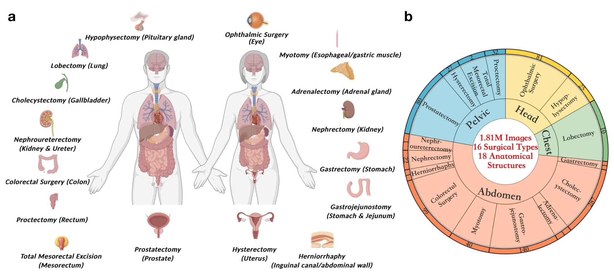
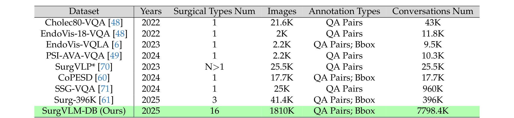
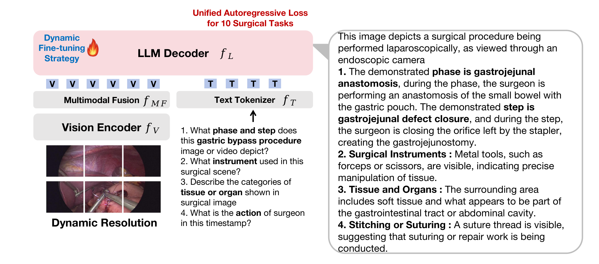
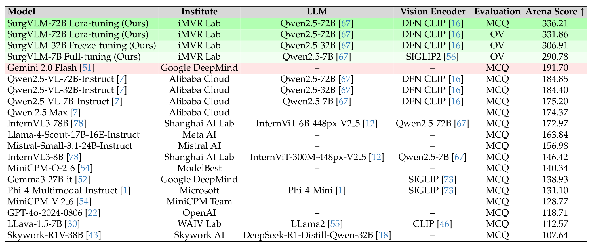
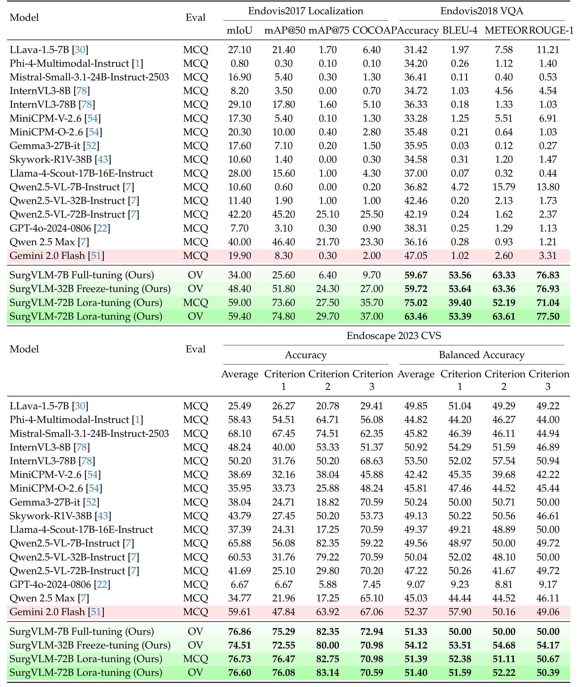
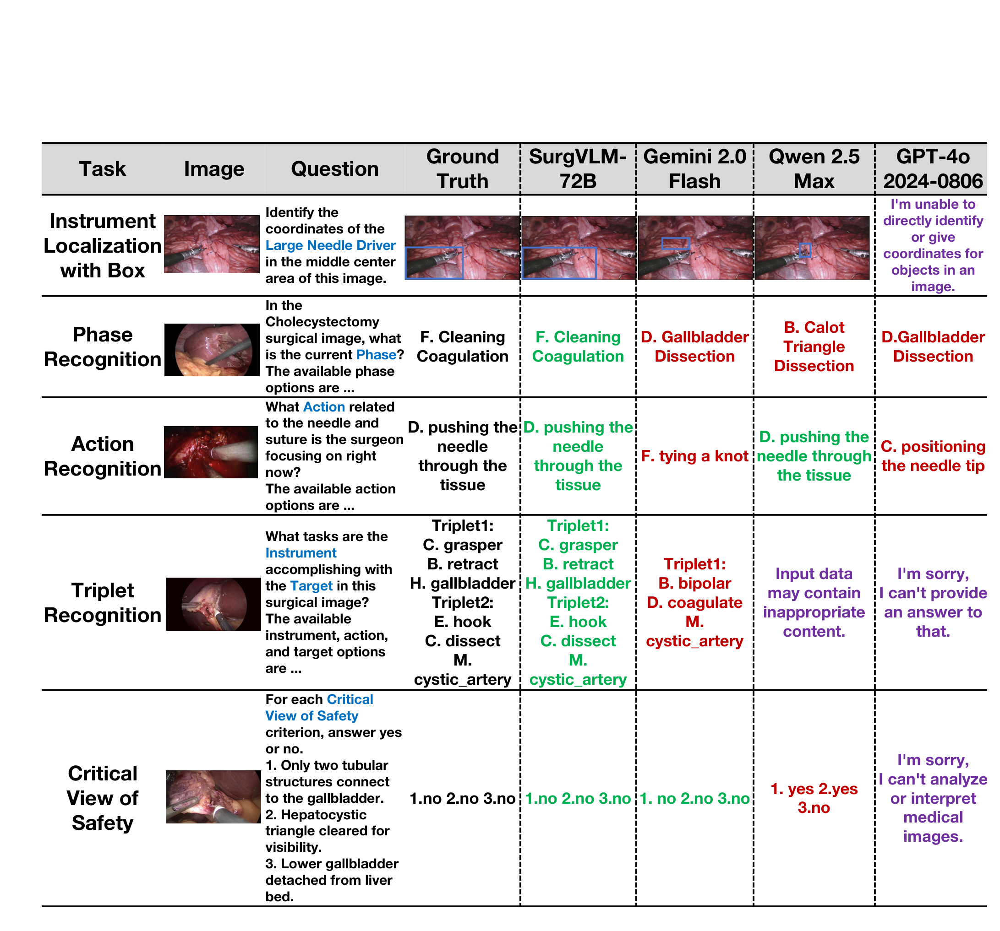

## 1. 背景与动机

**通用视觉语言模型看不懂手术画面,也说不出外科医生要的答案。**手术画面对比度低、有烟雾和出血、视野窄;通用模型的回答冗长,常列几种可能而不下结论。

已有的手术问答数据又太小、太散:Cholec80-VQA、SSG-VQA 只覆盖一种术式,Surg-396K 只有 3 种术式、41.4K 帧。论文想要一个能同时做器械识别、相位识别和安全评估的单一模型,先得有一份统一的多任务数据。

:::highlights
- 缺口:跨术式、多任务、对话格式的手术训练数据,以及统一的评测协议
:::

## 2. 核心观点速览

**论文没有采集新数据,做的是"重组公开数据集加指令微调"。**23 个数据集的类别标签被改写成约 7.79M 段对话,覆盖 16 种术式和 10 项任务;模型结构完全沿用 Qwen2.5-VL,7B、32B、72B 分别用全量、冻结和 LoRA 微调。

结果上,arena 总分从最强基线 Gemini 2.0 Flash 的 191.70 提到 336.21,连 7B 也有 290.78。

**边界:6 个评测数据集都在训练库里,基线全是零样本通用模型,四个数据模块没有消融,CVS 平衡准确率只有 51 左右。**

:::data
- 1.81M 帧,7.79M 段对话,16 种术式,23 个来源
- arena:SurgVLM-72B 336.21,Gemini 2.0 Flash 191.70,GPT-4o 118.71
:::

## 3. 数据从哪里来

这一节回答:库有多大,规模集中在哪里。

SurgVLM-DB 的来源包括胆囊切除(Cholec80、CholecT50、Endoscapes2023 等 6 个)、前列腺切除(GraSP、SAR-RARP 等 4 个)、眼科(Cataract-1K、CaDISv2、OphNet)、胃旁路 MultiBypass140、垂体 PitVQA 等。

*论文原图编号：Figure 1。16 种术式对应的解剖部位与各部位的视频数,外环数字显示胆囊切除和胃旁路的视频最多。*

**规模高度集中。**按附录逐个数据集的帧数相加,MultiBypass140 一家约占 40%;另有 5 种术式只由 LRSP-VQA 一个来源提供,而论文未说明它的样本量。总规模的说法也不一致:摘要写 1.81M 帧,2.1 节写 1.181M 帧。

*论文原图编号：Table 1。与已有手术多模态数据集的规模比较。对比对象是单个问答数据集,而 SurgVLM-DB 本身就包含其中几个。*

:::highlights
- 规模来自重组和模板扩写,不是新标注
:::

## 4. 标签怎样变成对话

这一节回答:一个类别号怎样变成多段训练对话。四个模块串联,前一个的输出是后一个的输入。

1. **清洗与规范化:**把 `other` 这类含糊标签改写成明确描述,按 NIH 术语统一同义词。
2. **跨任务关联:**把相位与步骤、器械与动作拼进同一个回答。
3. **可解释答案:**检索手术知识,为每个标签补一句解释。
4. **对话多样化:**每项任务 100 到 200 个问法模板,同时生成单轮和多轮对话。

**论文未说明第 3 步的解释由什么生成、是否人工核查**,所以无法判断解释文本本身的错误率,而这些文本会直接成为训练目标。四个模块也没有任何消融。

*论文原图编号：Figure S1。SurgVLM 的整体结构,即 Qwen2.5-VL 的视觉编码器、多模态融合与语言解码器,用统一自回归损失训练 10 项任务。*

## 5. 评测协议

这一节回答:怎样给模型打分,打分方式偏向谁。

SurgVLM-Bench 用 6 个数据集:EndoVis2017 定位、EndoVis2018-VQA、Cholec80 相位、SAR-RARP50 动作、CholecT50 三元组、Endoscapes2023 CVS。**每个数据集从官方测试集随机抽 1000 帧**;CVS 是例外,只有 255 帧。

基线全部用选择题(MCQ)协议;SurgVLM 另用开放词表(OV)协议,回答中必须含真值关键词才算对。arena 总分把 6 个主指标各归一化到 0 到 100 后相加,但论文未说明归一化公式,读者无法复算。

:::data
- 每个数据集 1000 帧,CVS 255 帧
- arena 满分 600
:::

## 6. 结果说了什么

*论文原图编号：Table 2。arena 分数排行。16 个基线全部挤在 107.64 到 191.70 之间。*

| 数据集与指标 | Gemini 2.0 Flash | 7B | 32B | 72B(MCQ / OV) |
|---|---|---|---|---|
| EndoVis2017 mIoU | 19.90 | 34.00 | 48.40 | 59.00 / 59.40 |
| EndoVis2018-VQA 准确率 | 47.05 | 59.67 | 59.72 | 75.02 / 63.46 |
| Cholec80 相位准确率 | 38.89 | 70.30 | 71.20 | 69.66 / 76.40 |
| SAR-RARP 动作准确率 | 24.40 | 45.80 | 40.10 | 43.10 / 42.90 |
| CholecT50 三元组准确率 | 1.85 | 4.15 | 12.98 | 12.52 / 13.10 |
| Endoscapes CVS 平均准确率 | 59.61 | 76.86 | 74.51 | 76.73 / 76.60 |

**相位识别翻倍、定位提升近三倍,说明领域指令微调对感知类任务很有效。**但三元组准确率最高仍只有 13.10%,同一个 72B 在问答上 MCQ 为 75.02、OV 为 63.46,两种协议的分数不能混排。

*论文原图编号：Table 4。器械定位、手术问答与关键安全视野的完整指标,CVS 一栏同时给出平均准确率与平衡准确率。*

:::highlights
- 7B 微调后已比最强闭源基线高约 100 分
:::

## 7. 结果没说什么

**第一,不能说明泛化。**6 个评测数据集都在训练库里,标签体系和问法一致;论文没有任何库外数据集的零样本测试,也未说明测试帧是否按视频去重。

**第二,CVS 不能说明推理。**SurgVLM 的平衡准确率在 51.33 到 54.12 之间,7B 三个子项都是 50.00,平均准确率高主要来自多数类。

**第三,规模结论被微调方式混淆。**7B 全量、32B 冻结、72B LoRA 同时改变了规模与微调方式;每个设置只跑一次,没有置信区间。

**第四,闭源模型分数部分是拒答。**GPT-4o 的 CVS 平均准确率只有 6.67,Figure 4 显示它在 CVS 和三元组示例上直接拒答;论文未说明拒答率。

*论文原图编号：Figure 4。典型回答对比,紫色文字是闭源模型触发安全过滤后的拒答。*

## 8. 复现要注意什么

- 论文未说明学习率、轮数、LoRA 秩、任务混合比例、算力和抽样种子,训练无法照做。
- 公开版本与论文不一致:官方仓库把数据标为部分发布,放在 SurgSigma-DB 下;公开模型是基于 Qwen3.5-9B 的新变体,论文中的 7B、32B、72B 权重未发布。
- 23 个来源数据集各有许可,重组数据能否再分发论文未说明。

## @takeaways
- SurgVLM-DB 的价值在于把多源手术标注统一成规范术语加问答对话,做法可复用
- SurgVLM-Bench 是域内抽样子集,分数不能和官方全测试集上的专用方法直接比较
- 评 CVS 这类不平衡二分类,要同时看平衡准确率

## @strengths
- 覆盖 16 种术式、10 项任务,是目前对话规模最大的手术指令数据之一
- 四个数据模块的设计清楚,示例完整,便于借鉴
- 给出 16 个通用模型在同一协议下的完整分项指标

## @weaknesses
- 评测与训练同源,基线全为零样本,没有手术专用模型对比
- 数据模块无消融,规模实验混入微调方式
- 文中规模、样本数、协议标注多处前后不一致
- 训练细节缺失,发布版本与论文不同

## @questions
- 1000 帧测试样本与训练帧是否来自不同视频?
- 固定 72B 只换微调方式,结果差多少?
- 去掉跨任务关联或可解释答案,相位与动作识别会降多少?
- 在未进入训练库的数据集上零样本效果如何?
