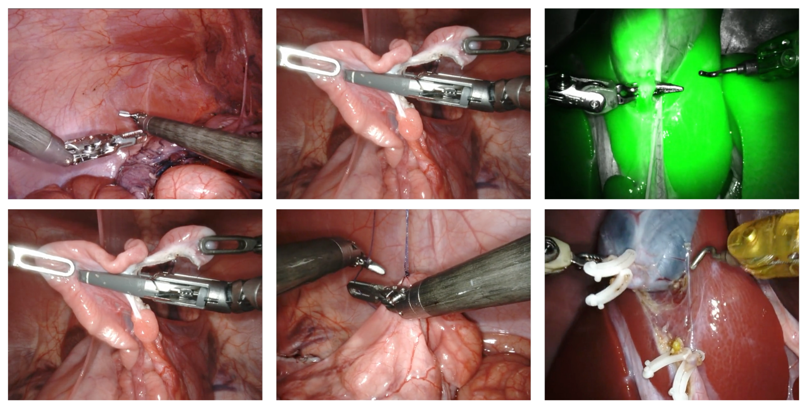
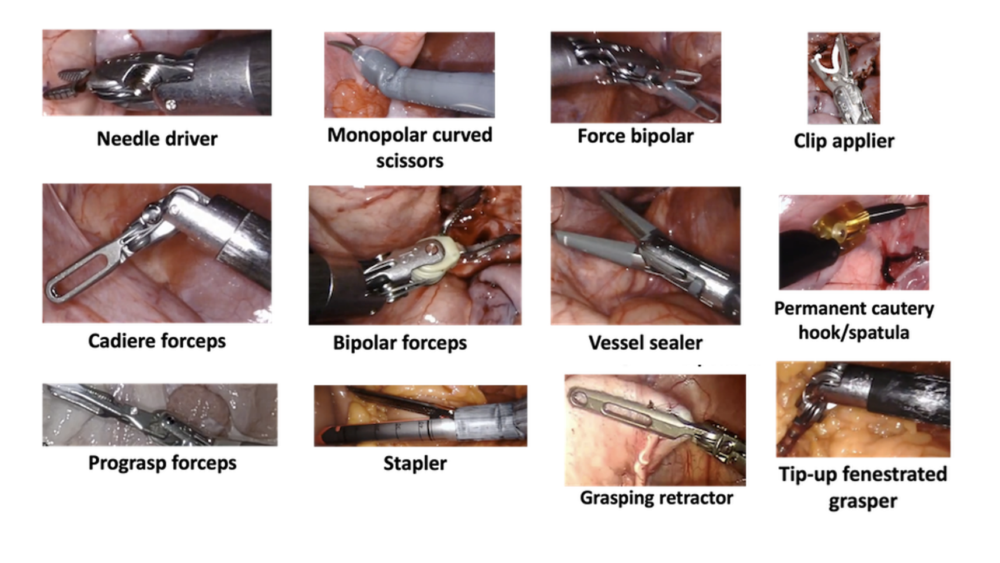
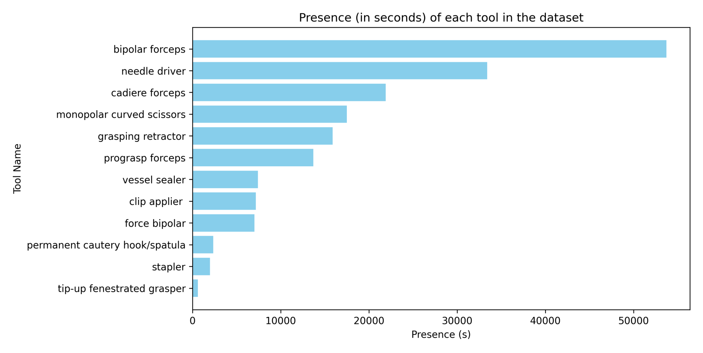
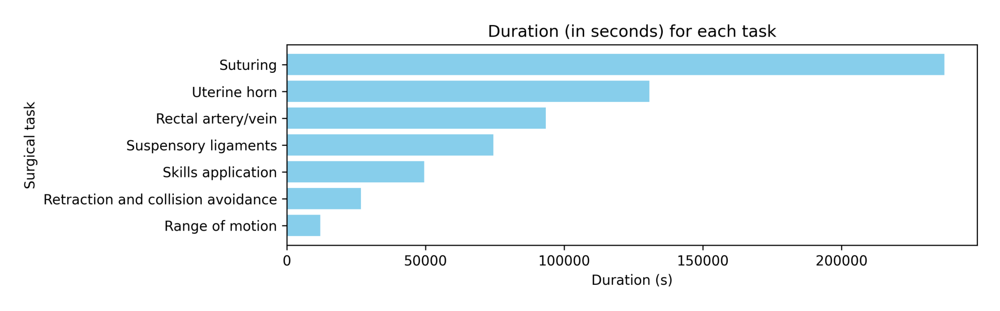
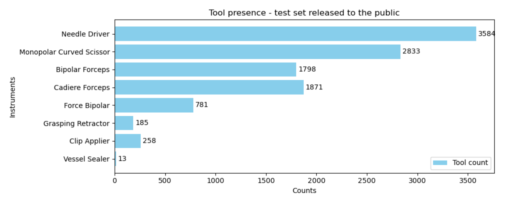
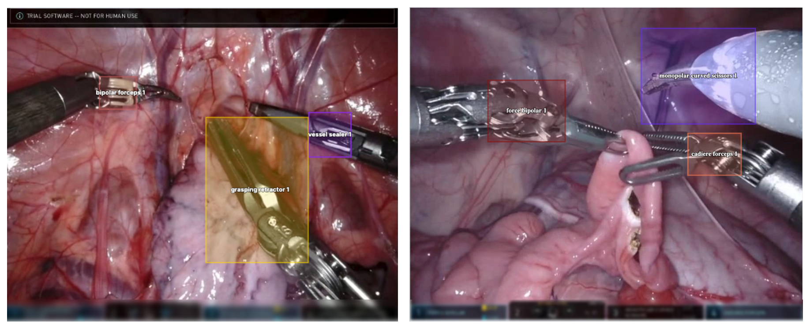

---
tags:
  - papers/手术数据集
aliases:
  - "SurgVU"
  - "SurgVU Dataset"
  - "Surgical Visual Understanding Dataset"
date: 2025-01-16
arxiv_id: 2501.09209
---

# Surgical Visual Understanding (SurgVU) Dataset

## 核心信息

- 标题: Surgical Visual Understanding (SurgVU) Dataset
- 标题翻译: 手术视觉理解（SurgVU）数据集
- 作者: Aneeq Zia, Max Berniker, Rogerio Nespolo, Xiaorui Zhang, Conor Perreault, Ziheng Wang, Benjamin Mueller, Ryan Schmidt, Kiran Bhattacharyya, Xi Liu, Anthony Jarc
- 机构: Intuitive Surgical, Inc.
- 发表时间: 2025-01-16（arXiv v1）；本笔记依据 2026-05-08 的 v2
- 发表渠道: arXiv 预印本（cs.CV）
- arXiv: 2501.09209
- 论文链接: https://arxiv.org/abs/2501.09209
- 数据 / 资源: 视频 https://storage.googleapis.com/isi-surgvu/surgvu24_videos_only.zip ；标签 https://storage.googleapis.com/isi-surgvu/surgvu24_labels_updated_v2.zip ；工具检测验证集 https://storage.googleapis.com/isi-surgvu/cat1_test_set_public.zip ；问答样例集 https://storage.googleapis.com/isi-surgvu/SURGVU25_cat_2_sample_set_public.zip
- 论文类型: 数据集论文（benchmark_or_dataset）

## 原文摘要翻译

得益于机器学习的最新进展，以及在机器人辅助手术中采集大量数据的能力，手术数据科学已经具备开展基础性工作的条件。为此，我们提出一个大规模手术视频数据集及其配套标签。

我们描述了数据的采集方式和它的一些独特属性，并概述了多个示例问题。虽然这个数据集是为一组特定的科学挑战赛（见配套论文）整理的，但它足够通用，可用于广泛的机器学习问题。

我们希望这个数据集让更广泛的机器学习社区接触到手术数据科学中的难题，并成为未来研究的试金石。视频、标签、工具检测问题的验证集，以及手术视觉问答的问答对样例集，分别可从论文给出的四个链接下载。

## 创新点

1. 规模。280 个视频片段、155 次培训、超过 840 小时视频，60 帧每秒、1280×720，作者称这是最大的公开手术视频数据集。以小时计，它比以几十到几百个病例计的腹腔镜数据集大一个量级。
2. 标签几乎零人工成本。器械存在标签直接取自达芬奇系统记录的器械装卸事件，按机械臂给出装上和卸下的时间区间。这让上千小时视频都有标签，代价是标签带噪声。
3. 同一份视频叠加了四种监督信号：器械存在、8 类训练步骤、每个步骤的文字描述，以及视觉问答样例。文字描述和问答样例是 v2 新增的，面向视频语言模型。
4. 单独发布带框的工具检测验证集，并规定框标在夹钳关节（clevis）而不是整把器械上，给弱监督检测提供了一个人工标注的评测基准。

## 一句话总结

SurgVU 把 Intuitive Surgical 在猪模型上的达芬奇培训录像整理成一个以小时计的大数据集，用系统自动记录的器械装卸事件当噪声存在标签，再加上专家标注的步骤、模板化的步骤描述和一个人工框标注的小验证集；论文只描述数据，不提供划分、基线或评测指标。

## 研究问题

机器人辅助手术每年已超过一百万例，并且还在增长。和传统开放或腔镜手术不同，机器人平台在手术过程中自然产生大量数据：高分辨率内镜视频、术者手部动作和器械运动学。这些数据过去很难采集，现在几乎是手术的副产品。

作者认为手术数据科学因此具备了做“基础性工作”的条件，但机器学习社区接触手术数据的门槛仍然很高。已有公开数据集（论文引用了 EndoVis 2017/2018、Cholec80、JIGSAWS、HeiChole、SurgVisDom、SimSurgSkill 等）规模有限，多数以几十到几百个病例计。

论文要做的事很直接：把 Intuitive Surgical 每年在 MICCAI EndoVis 上举办的 SurgToolLoc / SurgVU 挑战赛所用的视频和标签整理成文档，说明数据怎么采集、标签是什么格式、类别怎么分布、可以拿来研究什么。它不回答任何模型问题，也不定义评测协议，评测细节留给配套的挑战赛论文。

### 核心观点速览

- 规模以小时计：280 个片段、155 次培训、超过 840 小时，60 帧每秒、720p，作者称其为最大的公开手术视频数据集。
- 全部来自猪模型上的达芬奇培训，不是真实患者手术，单一机构、单一平台。
- 训练标签是系统记录的器械装卸区间和专家标注的 8 类步骤，器械标签“装上即存在”，论文承认有噪声但没有量化。
- 唯一的人工精细标注是工具检测验证集：每秒 1 帧、众包框标注、8 种器械，框落在夹钳关节。
- 论文没有划分、基线和指标；文中几个规模数字（840 小时、约 1800 万帧、分布图的总时长）彼此对不上。

## 数据与任务定义

这一节回答：视频从哪来，每种标签怎么定义、存在哪里、覆盖多少。读之前先记住，**训练集只有自动或粗粒度标签，精细的框标注只存在于一个小验证集里**。

### 数据来源

视频录自 Intuitive Surgical 主办的机器人手术培训。学员和专家术者使用达芬奇系统，在猪组织上完成一系列标准化训练步骤。录像是术者在控制台看到的画面，取自内镜的一个通道，同时记录了系统数据。

部分画面是荧光成像模式，整幅画面呈绿色（图 1 右上）。这一点对训练有影响：荧光帧的颜色分布与白光帧完全不同，混在训练集里会形成一个单独的视觉域。

*论文原图编号：Figure 1。多个训练步骤的样例帧，右上为荧光成像帧。放在这里是因为它展示了猪模型组织、达芬奇器械和荧光模式三种关键视觉特征。*

整体统计：280 个视频片段，来自 155 次培训，超过 840 小时；60 帧每秒，分辨率 1280×720，约 1800 万帧。这几个数字之间有矛盾，见关键结果。

### 器械存在标签

视野中同一时刻最多出现 3 件机器人器械，整个数据集共装过 12 种：持针器、Cadiere 镊、Prograsp 镊、单极弯剪、双极镊、吻合器、力反馈双极、血管闭合器、永久电凝钩/铲、施夹器、可上翻开窗抓钳和抓持牵开器。

*论文原图编号：Figure 2。12 种器械的示例图。放在这里是因为它给出类别定义，几种镊类的外观差别很小，是检测与分类的主要难点之一。*

标签来自机器人系统并行记录的器械安装信息，存在 tools.csv 中，每行六列：安装所在片段、安装时间、卸下所在片段、卸下时间、机械臂编号、器械名。也就是说，**一行标签是一个机械臂上一件器械的装卸区间**，而不是逐帧的可见性标注。

器械装上后可能被组织遮挡或暂时移出视野，此时标签仍为“存在”。论文因此称这些标签是噪声标签。另一个问题是类别不均衡：常用器械出现得多，少用器械出现得少（图 3）。

*论文原图编号：Figure 3。训练集中各器械的出现时长（秒）。放在这里是因为它显示了长尾分布：双极镊最多，可上翻开窗抓钳最少。*

按图 3 估读，双极镊约 5.4 万秒，持针器约 3.3 万秒，而可上翻开窗抓钳不足 1 千秒，头尾相差约 90 倍。**长尾意味着按频率训练的分类器会忽略尾部器械**，评测时宏平均指标会被尾部类拖低。

### 训练步骤标签

临床专家标注了 8 个训练步骤：缝合、子宫角、直肠动静脉处理、悬韧带、综合技能应用、牵拉与避碰、活动范围，以及“其他”。标签存在 tasks.csv 中，列格式与 tools.csv 相同，最后一列换成步骤名。

*论文原图编号：Figure 4。训练集中各步骤的时长（秒）。放在这里是因为它给出步骤分布：缝合远多于其他步骤，图中没有画出“其他”类。*

按图 4 估读，缝合约 23.7 万秒，活动范围约 1.2 万秒。步骤分布同样极不均衡，图中只有 7 个步骤，“其他”类的时长论文未说明。

### 步骤描述与问答样例

v2 在每个 csv 文件中加了 matched description 列，为每个步骤附上详细的文字描述，内容包括术中动作、涉及的解剖结构、术者行为和使用的器械。表 1 给了缝合和子宫角两个例子，比如缝合步骤描述了把内镜切到 30 度向下、用第三臂抓持乙状结肠下段、用单极剪标出六排每排两个目标点，再换持针器完成连续缝合。

> [!figure] Table 1 步骤描述示例
> 建议位置：数据与任务定义
> 放置原因：它展示 matched description 列的实际内容，是判断文字监督信息量的直接依据。
> 当前状态：保留占位；自动提取没有得到这张表的独立裁剪候选，上文已转述两条示例。

列名叫 matched description，从示例看，描述是按步骤名对应的标准流程说明，而不是针对每段视频单独撰写的。**同一步骤的所有片段很可能共享同一段描述**，是否如此，论文未说明。如果确实共享，文字监督的信息量上限就是 8 段模板，模型学到的只是步骤分类的另一种写法。

问答样例集展示了 SurgVU25 挑战赛第 2 类（视觉问答）怎么评测：每个 30 秒视频块给一组问答，每个问题有 5 个参考答案。例如问题“手术中是否使用了大号持针器？”的参考答案是“否”“没有，未使用大号持针器”等 5 种说法。样例集包含 10 个视频片段。5 个参考答案意味着评测按语义匹配而非精确字符串匹配，但具体打分方法论文未说明。

### 工具检测验证集

这是数据集里唯一的人工精细标注。它来自配套 MICCAI 挑战赛的工具检测问题，视频片段降采样到每秒 1 帧，由经验丰富的众包标注员画框。12 种器械中只有 8 种出现在验证集里（图 5）。

*论文原图编号：Figure 5。公开验证集中 8 种器械的框计数。放在这里是因为它给出评测集的类别分布，血管闭合器只有 13 个实例。*

| 器械 | 计数 |
|---|---|
| 持针器 | 3584 |
| 单极弯剪 | 2833 |
| Cadiere 镊 | 1871 |
| 双极镊 | 1798 |
| 力反馈双极 | 781 |
| 施夹器 | 258 |
| 抓持牵开器 | 185 |
| 血管闭合器 | 13 |

框标注规则是：多数器械框住夹钳关节（clevis，即夹持或切割部件根部的旋转腕关节）。有两个例外：关节不明确的器械（如单极弯剪）连尖端一起框；器械很大、关节不在视野内时（如可上翻开窗抓钳、吸引冲洗器、吻合器、抓持牵开器）只框尖端。注意吸引冲洗器不在 12 种器械列表里，论文未说明。

*论文原图编号：Figure 6。带框的样例帧，界面区域被刻意模糊。放在这里是因为它直观展示了框的位置定义：框落在关节附近，而不是覆盖整把器械。*

画面底部的系统界面会显示当前装在各臂上的器械名称，作者把这块区域模糊掉，以防模型直接读界面文字。图 6 左图顶部仍可见“TRIAL SOFTWARE”字样。

数据讲清之后，下一节看这些标签是怎么生成的，以及论文缺了哪些评测要素。

## 方法主线

论文没有模型，也没有评测协议。这一节把数据构建拆成可复现的链路，并指出哪些环节论文没有交代。**标签的生成方式决定了它能支撑哪类研究**，所以先看生成方式。

### 机制流程

1. 采集。输入是达芬奇系统在猪模型培训中的录像和系统日志。录制控制台画面（内镜单通道，60 帧每秒、1280×720），同时导出器械装卸事件。输出是按培训和片段（case part）切开的视频文件与系统事件流。
2. 自动生成存在标签。输入是系统事件流。从中提取器械装卸事件，按机械臂把“装上”和“卸下”事件配对，得到每件器械的时间区间，写入 tools.csv。输出是覆盖全部视频、无人工成本但含正向噪声的器械存在标签。
3. 人工补充语义标签。输入是视频。临床专家标出 8 类训练步骤的起止区间写入 tasks.csv；再按步骤名匹配标准描述，填入 matched description 列；另外为 10 个片段按 30 秒块编写问答对。输出是步骤标签、文字描述和问答样例。
4. 构建评测用的验证集。输入是挑战赛测试视频的片段。降采样到每秒 1 帧，众包标注员按夹钳关节规则画框，界面区域模糊。输出是公开的工具检测验证集（8 种器械）。

### 各类标签的监督强度

| 标签 | 来源 | 时间粒度 | 空间信息 | 人工成本 | 已知噪声 |
|---|---|---|---|---|---|
| 器械存在 | 系统装卸日志 | 区间 | 无 | 零 | 装上不等于可见 |
| 训练步骤 | 临床专家 | 区间 | 无 | 中 | 论文未说明一致性 |
| 步骤描述 | 按步骤名匹配 | 步骤 | 无 | 低 | 很可能每步骤共享 |
| 问答样例 | 人工编写 | 30 秒块 | 无 | 高，仅 10 个片段 | 论文未说明 |
| 检测框 | 众包标注 | 每秒 1 帧 | 框 | 高 | 论文未说明质检 |

这张表说明了一件事：训练集上的监督全部是区间级、无空间信息的。想在 SurgVU 上训练检测器，只能走弱监督或伪标签路线，带框的验证集只能用来评测。这正是配套挑战赛的设定。

### 论文没有给出的协议要素

数据集论文通常要交代划分、指标和基线，本文三者都没有：

- 没有训练、验证、测试划分的定义，也没有说明验证集视频与训练视频是否来自同一批培训。
- 没有评测指标。检测的指标、问答的打分方式都留给配套论文。
- 没有基线结果，读者无法判断任务难度。
- 步骤标签的标注者人数、标注规则和一致性统计都论文未说明。
- 众包框标注的质检流程论文未说明。

缺了这些要素，SurgVU 本身不构成一个可直接比较的基准。下一节只能从分布图和统计数字里找对使用者有用的信息。

## 关键结果

论文没有实验结果。这一节回答：从已给出的分布图和统计数字中，能读出哪些对使用者有用的信息，哪些数字彼此冲突。

### 类别分布

| 分布 | 头部 | 尾部 | 头尾比 |
|---|---|---|---|
| 训练集器械出现时长（图 3） | 双极镊，约 5.4 万秒 | 可上翻开窗抓钳，不足 1 千秒 | 约 90 倍 |
| 训练集步骤时长（图 4） | 缝合，约 23.7 万秒 | 活动范围，约 1.2 万秒 | 约 20 倍 |
| 验证集器械框数（图 5） | 持针器，3584 | 血管闭合器，13 | 约 276 倍 |

三个分布都是长尾，而且训练集和验证集的头部类别不同：训练集以双极镊最多，验证集以持针器和单极弯剪最多。**训练集与验证集的类别先验不一致**，直接用训练集频率做先验会在验证集上偏向双极镊。

验证集的 8 种器械不含 Prograsp 镊、吻合器、永久电凝钩/铲和可上翻开窗抓钳。这 4 类无法在公开验证集上评测检测性能。

### 规模数字之间的不一致

论文给出的几个规模数字互相对不上：

| 口径 | 论文数字 | 换算 |
|---|---|---|
| 视频总时长 | 超过 840 小时 | 840 × 3600 × 60 ≈ 1.8 亿帧 |
| 帧数 | 约 1800 万帧 | 1800 万 ÷ 60 ÷ 3600 ≈ 83 小时 |
| 图 4 七个步骤时长合计（估读） | 约 62 万秒 | 62 万 ÷ 3600 ≈ 173 小时 |
| 图 3 十二种器械出现时长合计（估读） | 约 18 万秒 | 18 万 ÷ 3600 ≈ 51 小时 |
| 讨论部分 | 超过 800 小时，约 1800 万个标签 | 与上面同样矛盾 |

840 小时与 1800 万帧相差约 10 倍。可能的解释有几种：1800 万指的是某种降采样后的帧数，或者 840 小时包含了大量无步骤标签的时段，或者其中一个数字有误。论文未说明。器械时长合计只有约 51 小时也很反常：同一时刻最多 3 件器械，存在区间的合计本应接近甚至超过视频总时长。**这些数字说明论文的规模统计不能直接引用**，使用者应以下载后实际统计为准。

数字上的问题看清后，下一节讨论这个数据集究竟能用来研究什么。

## 深度分析

### 这个数据集真正测到了什么

SurgVU 的核心资产是**大量带噪声区间标签的机器人手术视频**。它最适合测的是：

- 弱监督器械检测与定位：训练只有存在区间，评测有人工框。这是配套挑战赛连续多年的主题。
- 噪声标签下的器械存在分类与步骤识别：标签来源明确，噪声类型明确（装上但不可见）。
- 视频自监督预训练：上千小时同平台视频，域内一致性高。

它不能直接测的是：像素级分割（没有掩码）、器械跟踪（没有轨迹标注）、技能评估（没有技能分数、术者等级或运动学数据），尽管论文在潜在研究方向中都列了这些。

### 噪声存在标签的性质

装卸区间作为标签，噪声是单向的：标签说“不存在”时器械一定不在视野中（没装上），标签说“存在”时器械可能被遮挡或移出视野。所以负标签干净，正标签有假阳性。这对弱监督方法的设计有直接影响：多示例学习式的“包内至少一帧为正”假设比逐帧硬标签更合适。论文没有给出假阳性比例，复现者需要在验证集上自行估计。

另一个隐患是界面泄漏。系统界面会显示器械名，作者在验证集样例里做了模糊，但训练视频是否同样处理，论文未说明。如果训练视频的界面未遮挡，模型可能学会读界面文字而不是识别器械外观，存在分类的分数会虚高。

### 与已有数据集的定位

| 数据集 | 场景 | 平台 | 规模 | 精细标注 |
|---|---|---|---|---|
| JIGSAWS | 台式模型基础任务 | 达芬奇 | 数十段试验 | 手势、技能分数、运动学 |
| Cholec80 | 真实患者胆囊切除 | 腹腔镜 | 80 个病例 | 阶段、器械存在 |
| HeiChole | 真实患者胆囊切除 | 腹腔镜 | 33 个病例 | 阶段、动作、器械、技能 |
| SurgVU | 猪模型多步骤培训 | 达芬奇 | 280 片段，超过 840 小时 | 仅验证集有框 |

表中其他数据集的规模取自它们各自的原论文，SurgVU 论文只在引言中引用了它们，没有给出对比表。SurgVU 用场景真实性和标注精度换来了规模。它比 JIGSAWS 更接近真实手术，但没有 JIGSAWS 的运动学和技能分数；它比 Cholec80 大得多，但组织是猪的、没有病理变化。

### 划分泄漏风险

同一次培训被切成多个片段，同一术者、同一只猪、同一套器械会出现在多个片段里。**如果按片段随机划分，测试集会和训练集共享术者与组织外观**，分数会虚高。应按培训划分，验证集与训练视频是否重叠论文未说明，使用前要核对。

### 适用边界

- 适合：弱监督器械检测；噪声标签学习；机器人手术视频的自监督预训练；以步骤描述为文字监督的粗粒度视频语言对齐。
- 不适合直接用作：真实临床手术的性能证据；分割、跟踪、技能评估的基准；多中心或多平台泛化研究。
- 复现时要注意：自行定义划分并避免同一次培训的片段跨训练和测试；先统计实际时长和帧数；检查界面区域是否已遮挡；检测框按夹钳关节定义对齐。

## 局限

- 全部数据来自猪模型培训，组织无病理、无真实出血与粘连，外推到真实患者未验证。
- 单一机构、单一机器人平台，没有设备或中心多样性。
- 器械存在标签的噪声率没有量化；步骤标签的标注规则和一致性论文未说明。
- 没有官方划分、评测指标和基线结果。
- 验证集只覆盖 12 种器械中的 8 种，血管闭合器仅 13 个实例。
- 规模数字自相矛盾：840 小时对应约 1.8 亿帧，而论文写约 1800 万帧；图 4 的步骤时长合计约 173 小时，图 3 的器械时长合计约 51 小时，原因论文未说明。
- 步骤标签有“其他”类，但图 4 没有画出，其占比论文未说明。
- 框标注规则提到吸引冲洗器，它不在 12 种器械列表中，论文未说明。
- 论文未说明：数据许可证和使用条款；伦理审批与动物实验说明；学员与专家的比例；片段如何从培训录像中切出；训练视频的界面区域是否遮挡；问答评测的打分方法；存在标签的噪声比例；步骤标注者人数与一致性；验证集的片段数与来源。

## 我的笔记

- 这篇是数据说明文档而非完整的数据集论文，引用时最好同时引用配套的挑战赛结果论文（arXiv 2305.07152 及 2022 到 2025 年的结果汇总），后者才有任务定义和方法对比。
- 做弱监督检测时，把装卸区间当作包级标签，验证集当作唯一的框评测；先在验证集上估计“装上但不可见”的比例，再决定正标签的置信权重。
- 下载后第一件事是自己统计总时长、帧数和每类时长，不要直接引用论文里的 840 小时或 1800 万帧。
- 训练前检查画面底部界面区域，必要时自己裁掉或遮挡，避免文字泄漏。
- 后续值得问的问题：840 小时与 1800 万帧哪个准确；存在标签假阳性比例；“其他”步骤的时长；验证集片段与训练集是否来自同一次培训。

## 引用

- Zia, A., Berniker, M., Nespolo, R., Zhang, X., Perreault, C., Wang, Z., Mueller, B., Schmidt, R., Bhattacharyya, K., Liu, X., & Jarc, A. Surgical Visual Understanding (SurgVU) Dataset. arXiv:2501.09209 (2025). https://arxiv.org/abs/2501.09209
