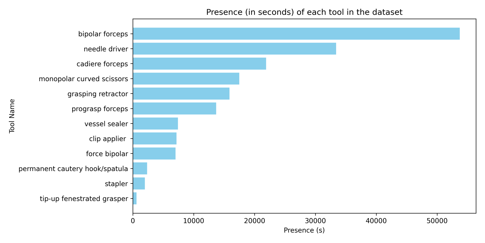
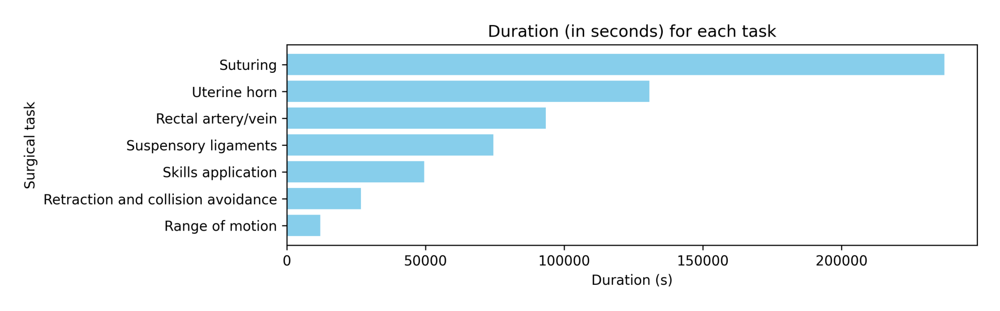
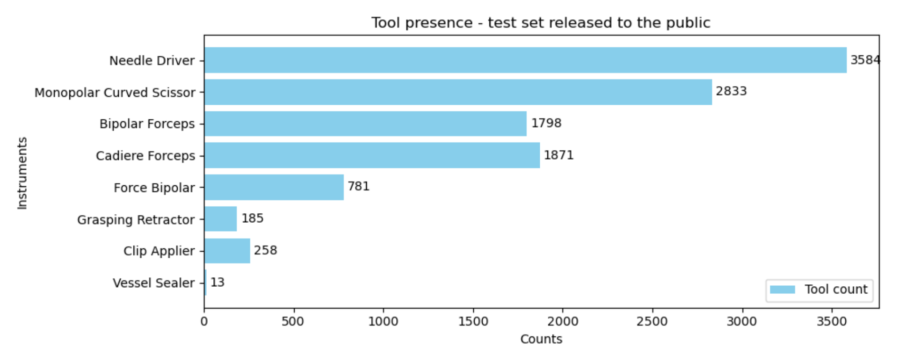
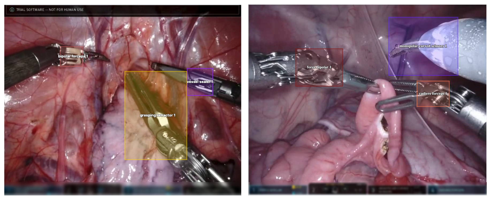

## 1. 背景与动机

**机器人手术天然产生大量视频和系统数据，但机器学习社区接触这类数据的门槛很高。** 机器人辅助手术每年已超过一百万例，每台手术都留下高分辨率内镜视频和器械记录。

已有公开手术数据集多以几十到几百个病例计，比如 Cholec80、HeiChole、JIGSAWS。Intuitive Surgical 每年在 MICCAI EndoVis 上办 SurgToolLoc / SurgVU 挑战赛，本文就是这些挑战赛所用数据的说明文档。

**它只描述数据，不做实验。** 任务定义和方法比较在配套的挑战赛论文里。

:::highlights
- 缺口：大规模、公开的机器人手术视频
- 本文角色：挑战赛数据的说明文档
:::

## 2. 核心观点速览

数据来自猪模型上的达芬奇培训：280 个片段、155 次培训、超过 840 小时，60 帧每秒、1280×720。

**标签分两层。** 训练集只有区间级标签：系统日志给出的器械装卸区间（12 种器械）和专家标注的 8 类训练步骤，外加每步骤的文字描述和 10 个片段的问答样例。唯一的空间标注是工具检测验证集：每秒 1 帧、众包画框、8 种器械。

**边界同样明显。** 没有划分、指标和基线；全部是猪模型、单中心、单平台；840 小时与约 1800 万帧相差约 10 倍。

:::data
- 280 片段 / 155 次培训 / 超过 840 小时
- 12 种器械，最多 3 件同时在视野
- 8 类训练步骤
- 验证集 8 种器械，持针器 3584 个框，血管闭合器 13 个
:::

## 3. 器械存在标签是怎么来的

达芬奇系统会记录每个机械臂何时装上、何时卸下哪件器械。作者把这些事件配对成区间，写进 tools.csv，每行是片段号与时间组成的起止点、机械臂编号和器械名。

**这种标签几乎零成本，但“装上”不等于“看得见”。** 器械被组织遮挡或移出视野时，标签仍是存在。所以负标签干净，正标签有假阳性。论文承认有噪声，但没有给比例。

*论文原图编号：Figure 3。训练集各器械出现时长（秒），长尾明显。*

按图估读，双极镊约 5.4 万秒，可上翻开窗抓钳不足 1 千秒，相差约 90 倍。宏平均指标会被尾部类拖低。

:::highlights
- 装卸区间是包级标签，适合多示例学习，不适合当逐帧真值
:::

## 4. 步骤、描述与问答

临床专家标了 8 类训练步骤，存在 tasks.csv，格式与 tools.csv 相同。缝合时长最长，按图 4 估读约 23.7 万秒，活动范围约 1.2 万秒。图 4 只画出 7 类，“其他”类的时长论文未说明。

*论文原图编号：Figure 4。训练集各步骤时长（秒）。*

v2 新增的 matched description 列给每个步骤附上标准流程描述。**从列名和示例看，同一步骤的片段很可能共享同一段文字**，论文未说明。如果是这样，文字监督只有 8 段模板。

问答样例集有 10 个片段，每个 30 秒块一组问答，每题 5 个参考答案。打分方法论文未说明。

## 5. 唯一的人工框：验证集

验证集来自挑战赛的工具检测问题：降采样到每秒 1 帧，众包标注员画框。12 种器械里只有 8 种出现。

*论文原图编号：Figure 5。公开验证集各器械框计数。*

**框不覆盖整把器械，而是落在夹钳关节（clevis）上。** 关节不明确时连尖端一起框，器械太大时只框尖端。规则中提到的吸引冲洗器不在 12 种器械列表里，论文未说明。

*论文原图编号：Figure 6。带框样例帧，界面区域被模糊。*

界面会显示器械名，作者在样例里模糊了它。训练视频是否同样处理，论文未说明；若未处理，模型可能靠读字分类。

:::data
- 持针器 3584，单极弯剪 2833，Cadiere 镊 1871，双极镊 1798
- 力反馈双极 781，施夹器 258，抓持牵开器 185，血管闭合器 13
:::

## 6. 规模数字对不上

| 口径 | 论文数字 | 换算 |
|---|---|---|
| 视频总时长 | 超过 840 小时 | 约 1.8 亿帧 |
| 帧数 | 约 1800 万帧 | 约 83 小时 |
| 图 4 步骤时长合计（估读） | 约 62 万秒 | 约 173 小时 |
| 图 3 器械时长合计（估读） | 约 18 万秒 | 约 51 小时 |

**这四个口径最多相差十几倍。** 同一时刻最多 3 件器械，器械时长合计本应接近或超过视频总时长，实际只有约 51 小时。原因论文未说明，引用规模前应下载后自己统计。

## 7. 它真正能测什么

**最适合的是弱监督器械检测**：训练只有存在区间，评测有人工框，这正是挑战赛连续几年的设定。其次是噪声标签下的步骤识别，以及同平台视频的自监督预训练。

论文在潜在方向里列了分割、跟踪、技能评估和视频语言模型，但前三者没有对应标注，视频语言只有模板化描述。这些只是可能的用途，不是数据集已支撑的任务。

| 数据集 | 场景 | 平台 | 精细标注 |
|---|---|---|---|
| JIGSAWS | 台式模型基础任务 | 达芬奇 | 手势、技能分数、运动学 |
| Cholec80 | 真实患者胆囊切除 | 腹腔镜 | 阶段、器械存在 |
| SurgVU | 猪模型多步骤培训 | 达芬奇 | 仅验证集有框 |

SurgVU 用场景真实性和标注精度换来了规模。

## 8. 复现要注意什么

- 自己统计时长、帧数和每类时长，不直接引用论文数字。
- 按培训划分，避免同一术者与同一只猪的片段跨训练和测试；验证集来源论文未说明。
- 检查训练视频的界面区域，必要时遮挡。
- 检测框按夹钳关节定义对齐。
- 先在验证集上估计“装上但不可见”的比例，再定正标签权重。

## @takeaways
- 训练集只有区间级标签，空间监督只在验证集
- 存在标签的噪声是单向的：负干净、正有假阳性
- 规模数字自相矛盾，以实测为准
- 全部来自猪模型培训，单中心单平台

## @strengths
- 时长规模远超常见的病例级手术数据集
- 标签来源透明，噪声类型明确
- 验证集框定义清楚，并处理了界面文字泄漏

## @weaknesses
- 没有划分、指标、基线
- 存在标签噪声率和步骤标注一致性都没有量化
- 规模统计不一致，“其他”步骤与吸引冲洗器等细节缺失
- 许可证与伦理说明论文未说明

## @questions
- 840 小时与约 1800 万帧哪个准确？
- 存在标签中不可见时段占多少？
- 验证集片段与训练视频是否来自同一次培训？
- 步骤描述是否逐片段不同？
