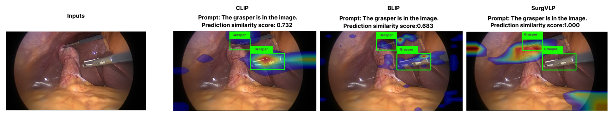
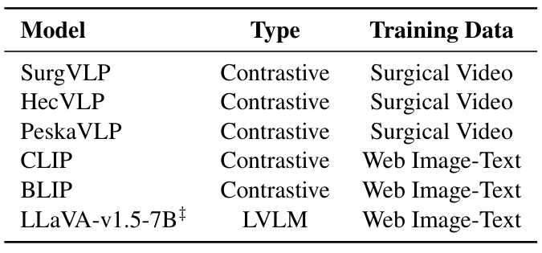
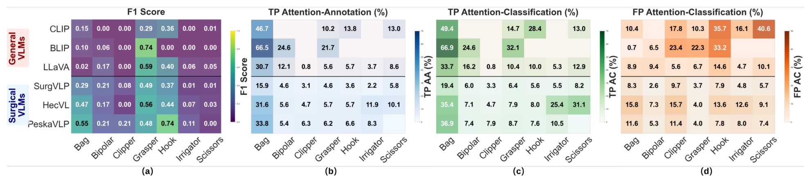
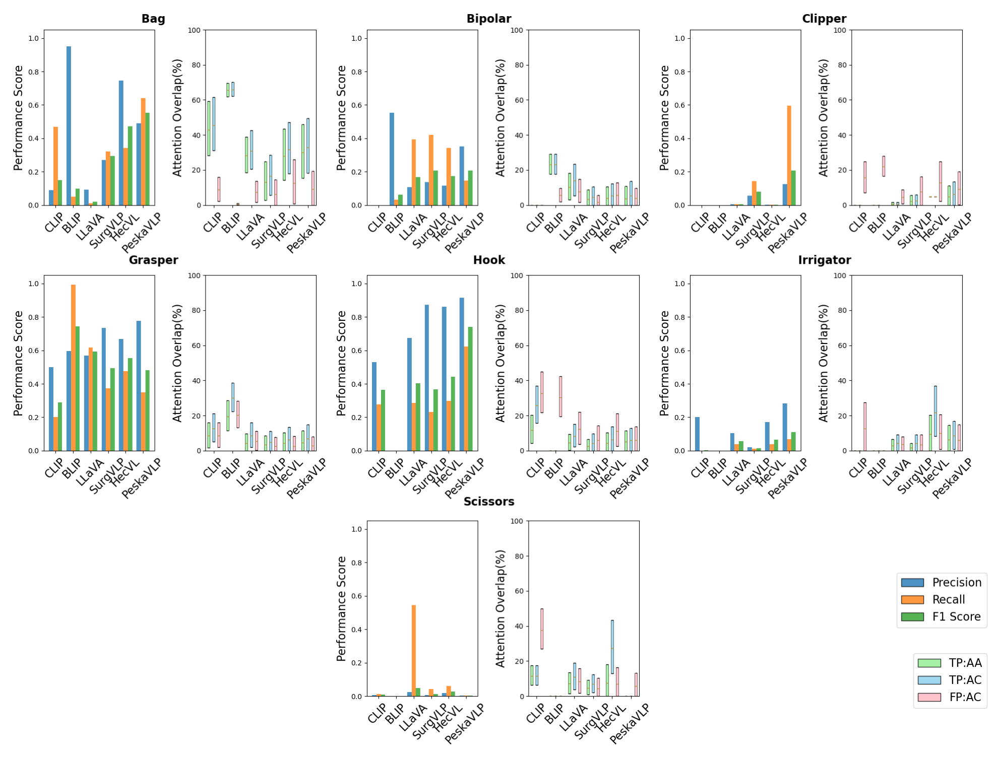
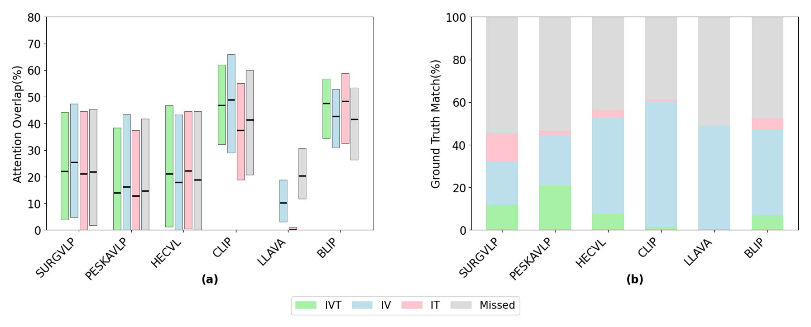
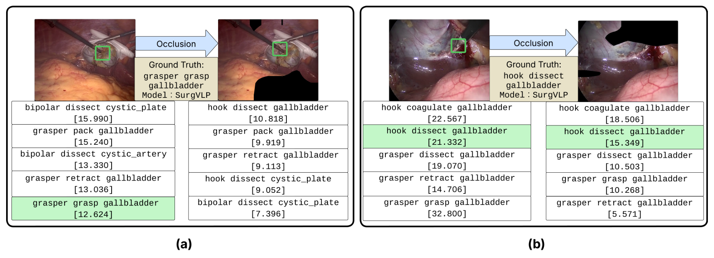
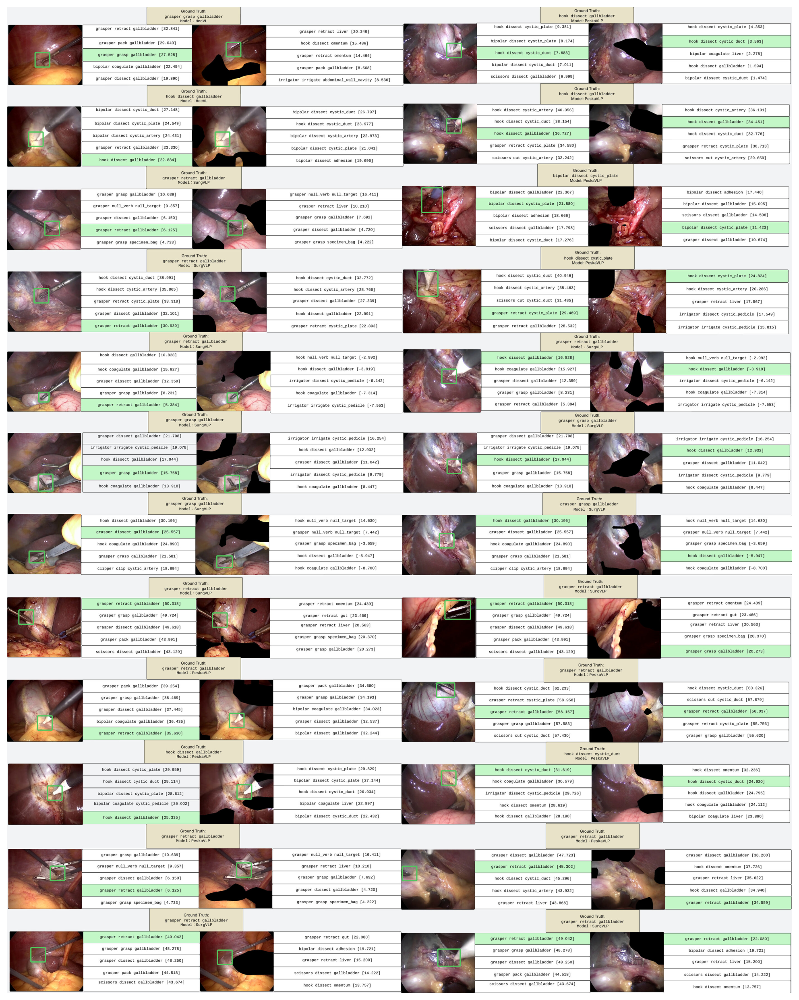
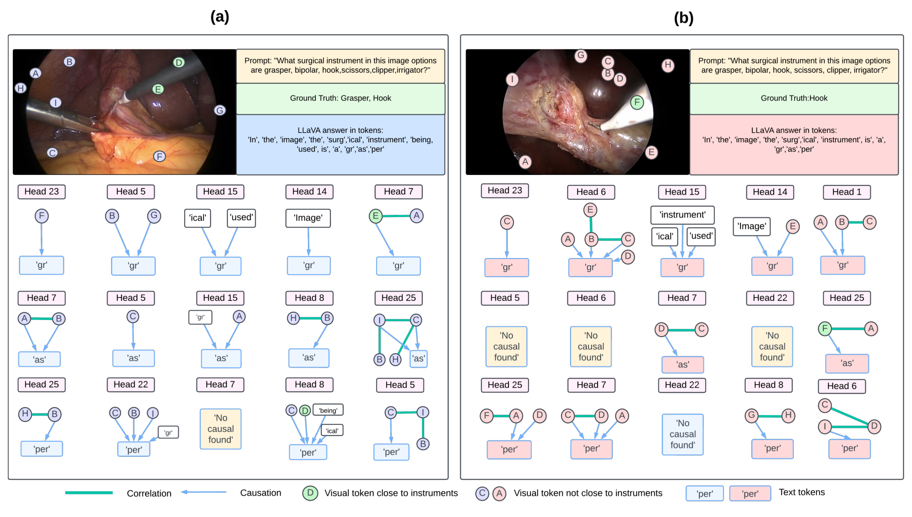
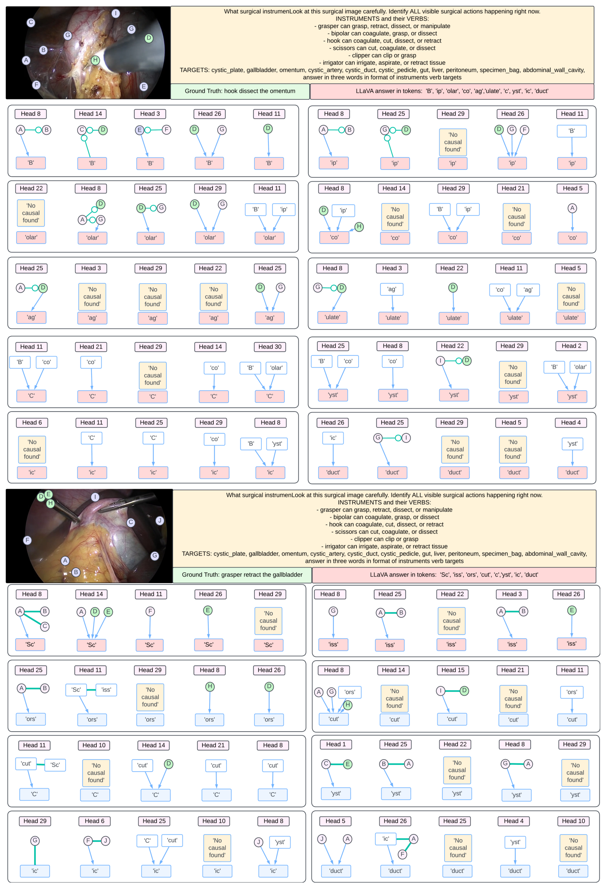

---
tags:
  - papers/手术数据集
aliases:
  - "SurgXBench"
  - "手术视觉语言模型可解释性基准"
date: 2025-05-16
arxiv_id: 2505.10764
---

# SurgXBench: Explainable Vision-Language Model Benchmark for Surgery

## 核心信息

- 标题: SurgXBench: Explainable Vision-Language Model Benchmark for Surgery
- 标题翻译: SurgXBench:面向手术的可解释视觉语言模型基准
- 作者: Jiajun Cheng, Xianwu Zhao, Sainan Liu, Xiaofan Yu, Ravi Prakash, Patrick J. Codd, Jonathan Elliott Katz, Shan Lin
- 机构: 亚利桑那州立大学; 英特尔实验室; 杜克大学; 迈阿密大学; 加州大学默塞德分校
- 发表时间: 2025-05-16(arXiv v1);v4 为 2026-06-25
- 发表渠道: arXiv 预印本(cs.CV);项目主页标注 WACV 2026 接收,论文正文未写
- arXiv: 2505.10764
- 论文链接: https://arxiv.org/abs/2505.10764
- 代码 / 项目: https://github.com/jiajun344/SurgXBench-Explainable-Vision-Language-Model-Benchmark-for-Surgery;项目主页 https://jiajun344.github.io/SurgXBench-Explainable-Vision-Language-Model-Benchmark-for-Surgery-Project-Website/
- 数据 / 资源: 未发布新数据;评测用已有的 Cholec80BBox 与 CholecT45(CholecT45 需填表申请,https://github.com/CAMMA-public/cholect45)
- 论文类型: 基准论文(benchmark_or_dataset)

## 原文摘要翻译

数字智能的创新正在让机器人手术做出更有依据的决策。对手术器械的出现及其动作(例如切割组织)的实时感知,是这类系统的关键。然而尽管经过数十年研究,这一任务上的多数机器学习模型仍在小数据集上训练,泛化困难。近来,视觉语言模型(VLM)在视觉与文本两种模态间的推理上取得了变革性进展。它们前所未有的泛化能力,显示出推动智能机器人手术的巨大潜力。但手术 VLM 仍研究不足,现有模型表现有限,需要基准研究来评估其能力与局限,并指导后续发展。

为此,我们在两个公开的机器人辅助腹腔镜数据集上,评测了若干先进 VLM 在器械分类和动作分类上的零样本表现。在标准评测之外,我们引入可解释人工智能,可视化 VLM 的注意力,并揭示其预测背后的因果解释。这为评估模型预测的可靠性提供了该领域此前很少探索的视角。我们还提出了若干基于可解释性分析的指标,作为标准评测的补充。分析表明,手术 VLM 尽管经过领域专门训练,仍常依赖弱的上下文线索,而不是有临床意义的视觉证据,这说明手术应用需要更强的视觉监督和推理监督。代码见公开仓库:https://jiajun344.github.io/SurgXBench-Explainable-Vision-Language-Model-Benchmark-for-Surgery-Project-Website/。

## 创新点

1. 把可解释性方法放进手术 VLM 评测。对对比学习模型用 Grad-CAM 或梯度加权注意力回传画热图,对 LLaVA 用 Grad-CAM 和 CLEANN 因果图。这样评测不只看对错,还看模型凭什么做出判断。
2. 提出注意力对齐指标。器械分类用 AA 和 AC,衡量热图前 20% 区域落在标注框里的比例;三元组识别用 RAS,把运动区域也算进参考区域。这些指标把"热图看着对不对"变成可比较的数字。
3. 自动生成器械与组织交互区域。用 RAFT 光流减去相机平移、俯仰、缩放、旋转的运动,再取阈值得到运动掩码。CholecT45 原本没有动作发生位置的标注,这一步补上了评测所需的参考区域。
4. 设计反事实遮挡实验。遮住模型注意力最高的区域,看正确预测是否消失,用来检验"答对但没看对地方"是否只是巧合。

## 一句话总结

本文在两个胆囊切除术数据集上零样本评测三个通用和三个手术视觉语言模型,发现手术模型分类更准(PeskaVLP 的电钩 F1 为 0.7410),注意力却几乎不落在器械上(电钩 TP_AA 只有 6.6%);BLIP 注意力最贴近器械(标本袋 TP_AC 66.9%),却认不准器械类别。

## 研究问题

**难点在于:手术视觉语言模型的准确率已经被评测过,但没人检查它答对时看的是不是器械本身。** 器械和动作识别是机器人手术辅助决策的基础,现有专用模型多在小规模人工标注数据上训练,换一批视频就掉点。

视觉语言模型(VLM)从海量图文对中学习,泛化更强,代表是 CLIP 和 LLaVA。手术领域的 SurgVLP、HecVL、PeskaVLP 改用手术讲解视频做预训练。

此前唯一的手术 VLM 基准是 Rau 等人的工作。它覆盖器械与解剖识别、动作与阶段识别、技能评估,结论是手术 VLM 表现仍差,器械识别精度在零样本和 5 样本下都低于 60%,有时还不如通用 VLM。但它只报告标准指标,说明了"差",没有说明"为什么差、该改哪里"。

作者把要回答的问题拆成两组:

- 答对时:(A-i)注意力或因果推理是否落在临床相关的视觉线索上;(A-ii)是否存在没看对区域却答对的情况,即预测可能是巧合。
- 答错时:(B-i)是不是看错了区域;(B-ii)还是看对了区域,但缺少领域知识而认不出器械类型。

Figure 1 是这组问题的直观例子。同一帧、同一句"抓钳在图中"的提示下,SurgVLP 的归一化相似度最高(1.000),热图大片落在两把抓钳的框外;CLIP(0.732)和 BLIP(0.683)分数较低,热图更贴近器械。

*论文原图编号：Figure 1。输入帧与 CLIP、BLIP、SurgVLP 三个模型的 Grad-CAM 热图,绿框是抓钳真值。放在这里是因为它就是 A-ii 问题的样例:分数最高的模型注意力最不对位。*

### 核心观点速览

论文的答案是:在标准指标旁边,再量一量模型答对时注意力落在哪里。

- 做法:用热图和因果图看模型依据什么做判断,把注意力与器械框、运动区域的重合比例算成 AA、AC、RAS 三个指标。
- 数据:不采集新数据,在 Cholec80BBox 的 5 个视频和 CholecT45 的两个带框视频上零样本评测六个模型。
- 结果:手术模型分类更准但注意力对齐更差,PeskaVLP 电钩 F1 0.7410 而 TP_AA 只有 6.6%;遮挡 SurgVLP 的高注意力区域后 28.2% 的帧失去正确三元组。
- 边界:**没有框面积的随机基线,没有随机遮挡对照,热图方法随主干不同,三个主要结论都还没把替代解释排除。**

下一节先看评测用了哪些数据、问了什么。

## 数据与任务定义

这一节回答:评测用的是谁的数据,实际用了多少,两类任务各问什么。

### 数据来源

论文没有采集新视频,也没有发布新的数据集。评测完全建立在两个已有的胆囊切除术腹腔镜数据集上:

| 数据集 | 原始规模 | 本文实际使用 | 用途 |
|---|---|---|---|
| Cholec80BBox | 5 个视频,51.7K 帧,器械框与类别 | 全部 | 器械分类;框用于计算 AA、AC |
| CholecT45 | 45 个视频,90.5K 帧,帧级三元组 | VID42、VID43 共 5,957 帧 | 三元组识别;只有这两个视频带器械框 |

论文称两者为"机器人辅助腹腔镜数据集"。三元组评测只用两个视频,原因是局部 RAS 需要器械框,而 CholecT45 中只有这两个视频有框。**这意味着三元组结论只建立在两台手术上。**

### 任务拆分

- 器械分类:判断图中出现了哪些器械,共 7 类:抓钳、双极电凝、电钩、剪刀、施夹钳、冲洗器、标本袋。
- 三元组识别:预测"器械-动作-目标"三元组,例如(scissors, cut, tissue)。

### 标注/筛选协议

本文新增的标注只有一种:用光流自动生成的器械-组织交互区域掩码,详见方法主线。器械框直接沿用 Cholec80BBox 和 CholecT45 的已有标注。

提示词采用模板。器械分类的提示询问"看到了哪些手术器械",并列出全部 7 类供选择。三元组提示列出每种器械能做的动作(如抓钳可抓、牵拉、分离、操作组织)和全部目标(胆囊床、胆囊、网膜等),要求按"器械 动作 目标"输出三个词。

### 被评测模型

*论文原图编号：Table 1。六个被评测模型的类型与训练数据。放在这里是因为后面所有对比都按"通用对手术""对比学习对生成式"两条轴展开。*

三个手术 VLM 都是对比学习模型,用手术视频训练;CLIP、BLIP 是网页图文训练的对比学习模型;LLaVA-v1.5-7B 是生成式大视觉语言模型(LVLM),语言主干为 LLaMA2。全部为零样本评测。

数据和模型都是现成的,本文的贡献集中在怎么量注意力,下一节展开。

## 方法主线

这一节回答:热图怎么来,三个指标怎么算,交互区域从哪里来。

### 构建流程

**热图生成。** 三类模型用三种方法得到空间注意力图:

- ResNet 主干的对比模型(三个手术 VLM):对预测提示的余弦相似度求特征图梯度,做标准 Grad-CAM。
- ViT 主干的 CLIP:用梯度加权的注意力回传,把各层自注意力与其梯度逐元素相乘后累积,取 [CLS] 到各图像块的相关度。
- LLaVA:对生成的某个输出词元的 logit 求视觉特征梯度,再做 Grad-CAM;另用 CLEANN 学习词元之间的因果结构。

对比模型的预测规则是:提示相似度超过第 90 百分位(δ=0.9)的类别都算预测。三元组组合太多,改为取相似度最高的前 5 个。

**器械分类指标。** 先从热图中取注意力最高的一部分像素作为注意力区域,论文设阈值 τ=0.8,附录说明这表示保留最高的 20%。正文公式写的是取 1-τ 分位数以上,与附录方向相反,这里以附录为准。下式中,注意力区域与所有器械框的并集求交得到 AC,与预测类别的框求交得到 AA:

$$AC=\frac{|\mathcal{A}_\tau\cap\mathcal{G}_{all}|}{|\mathcal{A}_\tau|},\qquad AA=\begin{cases}\dfrac{|\mathcal{A}_\tau\cap\mathcal{G}_{\hat c}|}{|\mathcal{A}_\tau|}, & \hat c\in C\\[4pt] 0, & \hat c\notin C\end{cases}$$

AC 问"注意力有多少落在任何一把器械上",AA 问"有多少落在预测的那把器械上"。真阳性预测两个都算,假阳性只算 AC,用来区分看错区域和认错类别。

**三元组指标。** 动作发生在器械与组织接触处,组织会形变,单靠器械框不够。作者用运动区域补充参考区域,定义 RAS:局部 RAS 的参考区域是运动掩码加预测器械的框,全局 RAS 把后者换成所有器械框:

$$RAS_{local}=\frac{|\mathcal{A}_{\tau^v}\cap(\mathcal{M}_{raft}\cup\mathcal{G}_s)|}{|\mathcal{A}_{\tau^v}|},\qquad RAS_{global}=\frac{|\mathcal{A}_{\tau^v}\cap(\mathcal{M}_{raft}\cup\mathcal{G}_{all})|}{|\mathcal{A}_{\tau^v}|}$$

每个真值三元组按匹配程度分档。三项全对、只有器械和动作对、只有器械和目标对,这三档用局部 RAS;器械都没对上的记为漏检,用全部预测的平均全局 RAS。

### 机制流程

1. 输入 CholecT45 相邻两帧,用 RAFT 估计并提取前向与后向稠密光流,输出逐像素运动向量。
2. 输入光流,把相机运动建模为平移、俯仰、缩放、旋转四种原型流的线性组合,用双向最小二乘拟合参数并从前向流中减去,输出只含器械与组织自身运动的校正流。
3. 输入校正后的运动幅度热图,取阈值 $\gamma=0.8$ 得到二值运动掩码,输出 $\mathcal{M}_{raft}$,与器械框合并成动作参考区域。
4. 输入各模型对预测类别的热图,与参考区域求交得到 AA、AC、RAS,输出与 F1、三元组匹配率并列的可解释性指标。

相机运动校正的目标函数是前向与后向误差之和:

$$E=\sum_{(x,y)\in\Omega}\|f_{cam}-f_{fwd}\|^2+\sum_{(x,y)\in\Omega}\|f_{cam}+f_{bwd}\|^2,\quad f_{cam}=P\,p+T\,t+Z\,z+R\,r$$

求出参数后,$f_{corrected}=f_{fwd}-f_{cam}$。**生成的掩码没有人工核验,它是否真对应器械与组织交互区域,论文未说明,这限制了 RAS 的可信度。**

> [!figure] Figure 2 交互区域提取流程
> 建议位置：机制流程
> 放置原因：它展示从相邻帧到光流、相机校正、阈值化掩码的四步,是 RAS 指标的来源。
> 当前状态：保留占位；自动视觉质量检查拒绝了该裁剪,属 visual_defect,流程已用上方四步文字描述。

### 评测协议

**反事实遮挡(回答 A-ii)。** 在 CholecT45 的两个带框视频上取前 5 个提示为预测。对含完全匹配三元组的帧求热图,保留注意力最高的区域并涂黑,再看 IVT 匹配是否保留、相似度变化多少。逻辑是:如果遮住的是模型最关注的区域,而这些区域并不在器械上,预测却因此消失,说明模型依赖的是背景。

**因果图分析(LLaVA)。** 用 CLEANN 在视觉注意力最强的前 5 个注意力头上建因果图(半径 3),看哪些词元直接导致生成某个输出词元。头的重要性按 max(图像注意力)/max(文本注意力) 排序。关键参数:注意力阈值 κ=0.01,条件独立检验 p 值阈值 α=10^-5,样本量 n=128,每次最多分析 50 个图像词元。

有了这套协议,下一节看六个模型在各项上的实际数字。

## 关键结果

这一节回答:模型答对时看的是不是器械(A-i),答错时是看错还是认错(B-i、B-ii),以及答对是否可能是巧合(A-ii)。

### 基线表现

Figure 3 是器械分类的主结果,四个面板依次是 F1、TP_AA、TP_AC、FP_AC。

*论文原图编号：Figure 3。六个模型在七类器械上的 F1、真阳性 AA、真阳性 AC、假阳性 AC 热力表。放在这里是因为准确率与注意力对齐的背离全在这张图里。*

从图中转写三类代表器械(F1 为 0 到 1,AA、AC 为百分比,空格表示该模型该类没有真阳性):

| 模型 | 标本袋 F1 | 标本袋 TP_AC | 抓钳 F1 | 抓钳 TP_AC | 电钩 F1 | 电钩 TP_AA |
|---|---|---|---|---|---|---|
| CLIP | 0.15 | 49.4 | 0.29 | 14.7 | 0.36 | 13.8 |
| BLIP | 0.10 | 66.9 | 0.74 | 32.1 | 0.00 | 空 |
| LLaVA | 0.02 | 33.7 | 0.59 | 10.4 | 0.40 | 5.7 |
| SurgVLP | 0.29 | 19.4 | 0.49 | 6.4 | 0.37 | 3.6 |
| HecVL | 0.47 | 35.4 | 0.56 | 7.9 | 0.44 | 5.7 |
| PeskaVLP | 0.55 | 36.9 | 0.48 | 8.7 | 0.74 | 6.6 |

**手术模型在标本袋、电钩上 F1 更高,但注意力对齐普遍更低。** PeskaVLP 的电钩 F1 为 0.7410,与图中 0.74 一致;正文还写它双极电凝为 0.7899、冲洗器为 0.7962,但图中这两格是 0.21 和 0.11(见局限)。它答对电钩时 AA 只有 6.6%、AC 只有 7.6%,即前 20% 注意力里只有不到一成落在电钩框内。

BLIP 正好相反:标本袋真阳性 AC 达 66.9%,抓钳 32.1%,但电钩 F1 为 0.00。作者据此回答问题 B-ii:通用模型能定位器械但缺手术知识;对 A-i 的回答是手术模型答对时多半没看器械,可能依赖视觉捷径。

抓钳一列不符合这个叙述:BLIP 的抓钳 F1 0.74 是六个模型中最高的。附录 Figure 7 显示 BLIP 对抓钳的召回接近 1.0、精度约 0.6,说明它几乎每帧都预测抓钳。抓钳在胆囊切除术中几乎一直在画面里,这个高 F1 更像是类别先验,而不是识别能力。

*论文原图编号：Figure 7。七类器械的精度、召回、F1 柱状图与 AA、AC 箱线图。放在这里是因为它展示了 F1 背后的精度与召回分解,是判断抓钳高 F1 来自几乎全预测的依据。*

### 三元组识别

*论文原图编号：Figure 4。左图是各匹配档的 RAS 箱线图,右图是真值三元组各匹配档与漏检的比例。放在这里是因为它把"注意力对位"和"答对目标组织"放在同一组模型上对照。*

| 模型 | IVT 匹配 | IV 匹配 | 正文报告的 RAS |
|---|---|---|---|
| PeskaVLP | 20.8% | 正文未给 | 正文未给 |
| SurgVLP | 11.9% | 正文未给 | 22.1% |
| HecVL | 7.6% | 正文未给 | 正文未给 |
| CLIP | 1.4% | 59.1% | 正文未给 |
| LLaVA | 0.0% | 48.9% | 低于对比模型 |
| BLIP | 正文未给 | 正文未给 | 47.5% |

47.5% 与 22.1% 是局部还是全局 RAS、是中位数还是均值,论文未说明;从 Figure 4 左图看,它们与两个模型完全匹配档的箱线中位线接近。

**通用对比模型的 RAS 更高,但几乎答不对目标组织。** CLIP 的器械-动作匹配有 59.1%,三项全对只有 1.4%;LLaVA 器械-动作匹配 48.9%,三项全对为 0.0%。手术模型三项全对更高,PeskaVLP 以 20.8% 领先,但对位分数更低。器械和动作可以从器械外形猜,目标组织要靠手术知识,这与器械分类上的分化一致:通用模型的问题是认不出(B-ii),手术模型的问题是没看对地方(A-i)。

### 遮挡与因果分析

*论文原图编号：Figure 6。SurgVLP 上的两个遮挡样例,绿底提示为与真值 IVT 一致的预测。放在这里是因为 28.2% 这个数字只有配合样例才看得懂遮了什么。*

在 SurgVLP 上遮挡高注意力区域后,原本含完全匹配三元组的帧中有 28.2% 在前 5 个预测里失去了匹配;仍保留匹配的帧,对应提示的相似度平均下降 9.87。左侧样例遮住的区域不含器械,正确的"抓钳抓持胆囊"却掉出前 5;右侧样例的正确预测在遮挡后仍在前 5,分数从 21.332 降到 15.349。**作者的解读是:决定 SurgVLP 预测的,常常是器械以外的背景组织,这是对 A-ii 的回答。** 但论文未说明同面积随机遮挡的对照结果,所以 28.2% 还不能和"任意涂黑都会扰乱预测"区分开。

*论文原图编号：Figure 8。SurgVLP、HecVL、PeskaVLP 的更多遮挡样例。放在这里是因为它说明遮挡现象在三个手术模型上都有个例,但只有 SurgVLP 给了定量统计。*

*论文原图编号：Figure 5。LLaVA 两个样例的因果图:左例正确识别抓钳,右例把电钩误判为抓钳。放在这里是因为它是"LLaVA 靠文本决策"这一结论的直接证据。*

CLEANN 因果图中,大量文本词元(如 surgical、image、instrument)直接指向预测词元,而进入因果图的视觉词元多不在器械附近,位置也无一致规律。

*论文原图编号：Figure 9。LLaVA 两个三元组样例的因果图。放在这里是因为它显示 LLaVA 在三元组任务上输出的是断裂的子词序列,而真值分别是电钩分离网膜与抓钳牵拉胆囊。*

附录用两种方法统计子词词元的文本占比:

| 词元 | 注意力法 文本 / 视觉 | CLEANN 文本 / 视觉 |
|---|---|---|
| cut | 0.922 / 0.078 | 0.328 / 0.672 |
| yst(来自 cystic) | 0.920 / 0.080 | 0.133 / 0.967 |
| plate | 0.918 / 0.082 | 0.240 / 0.946 |
| re(来自 retract) | 0.924 / 0.076 | 0.195 / 0.805 |
| cutting | 0.913 / 0.087 | 0.776 / 0.224 |
| gr(来自 grasper) | 0.917 / 0.083 | 0.000 / 1.000 |

**注意力法在六个词元上都给出 91% 以上的文本主导,CLEANN 只在 cutting 上给出文本主导(77.6%),其余五个都是视觉主导。** 附录正文却写"两种方法都检测到显著的文本过度依赖",与表中数字不符。另外 plate 一行 0.240 与 0.946 之和超过 1,yst 一行也是,计算口径论文未说明。**所以"LLaVA 主要靠文本决策"只得到注意力法的支持,CLEANN 的结果大多指向相反方向。**

这些数字说明了现象,下一节讨论它们能证明到哪一步。

## 深度分析

这一节回答:AA、AC、RAS 的高低,有多少来自模型行为,有多少来自指标和热图方法本身。

### benchmark 真正测到了什么

我的判断是,**AA 和 AC 测的是"前 20% 热图像素落在框内的比例",它同时受模型行为和框大小影响。** 框越大,随机落进去的概率越高。标本袋在画面中通常占很大面积,六个模型的标本袋 TP_AC 最低也有 19.4%,BLIP 达到 66.9%;施夹钳、冲洗器框小,有真阳性的模型 TP_AA 只在 0.8% 到 11.9% 之间。各类框占图像面积的比例论文未说明,也没有给出"热图均匀分布"时的期望值作为下限,所以无法判断 6.6% 的电钩 TP_AA 是低于随机,还是只是电钩框本来就小。

**热图本身是否忠实于模型决策,论文没有验证。** 三类模型用了三种热图方法:残差网络主干用标准梯度热图,视觉变换器主干用注意力回传,LLaVA 用词元级梯度热图。不同方法的空间分辨率和平滑程度不同,残差网络最后一层特征图分辨率低,上采样后更容易铺开到背景。手术模型恰好都是残差网络主干,通用的 CLIP 是视觉变换器。因此"手术模型对齐差"有一部分可能来自热图方法差异,论文没有用同一方法在同一主干上对照。作者自己也在附录承认,LVLM 上的 Grad-CAM 只是"软的可解释性度量"。

**遮挡实验能说明"高注意力区域对预测重要",但还不能说明"模型依赖背景"。** 被遮挡的是注意力最高的区域,而不是器械以外的区域;如果注意力本就落在背景上,遮挡后预测变化正说明背景被用上了。但 28.2% 缺少两个对照:遮挡同样面积的随机区域时掉多少,遮挡器械框时掉多少。没有这两个数,无法区分"背景是捷径"和"任何大面积涂黑都会扰乱一个分布外的输入"。定量结果也只有 SurgVLP 一个模型。

### 与已有基准的定位

| 工作 | 评什么 | 与本文的差别 |
|---|---|---|
| Rau 等(2025) | 多任务零样本、少样本准确率 | 只有标准指标;本文补上注意力与因果解释,但任务只有两项 |
| SurgVLP、HecVL、PeskaVLP 原文 | 自身模型在阶段、器械等任务上的零样本准确率 | 不检查预测依据;本文把三者放在同一可解释性协议下 |
| Zhang 等(2022)医学可解释性综述 | 指出手术任务缺统一的可解释性评测 | 本文给出一个具体可算的指标方案 |

本文的新意在评测视角,而不在数据。它没有新视频、新类别或新人工标注,唯一新增的参考区域是光流自动生成的掩码,且没有人工核验。

### 适用边界

- 场景只有胆囊切除术,两个数据集都来自 Cholec80 体系,器械 7 类。换到泌尿、妇科等术式,器械种类和画面构成都不同。
- 三元组评测只覆盖 VID42、VID43 两个视频,5,957 帧之间高度相关,统计意义上的独立样本数远小于帧数。
- 所有阈值都固定:τ=0.8、γ=0.8、δ=0.9、前 5 个预测。论文没有做阈值敏感性分析,模型排序是否随 τ 改变未知。
- 结果都是单次零样本运行,没有置信区间或显著性检验。

这些边界决定了下面哪些问题是作者承认的,哪些是我从图表里读出来的。

## 局限

作者承认的局限:

- 只做了器械分类和三元组识别两项任务;组织或器官识别、阶段识别、流程分析留待以后。
- 为新任务定义"临床相关线索"并提取成真值,仍是开放问题,需要临床专家参与。

我从正文和图表中发现的问题:

- 正文数字与图不一致。正文写 PeskaVLP 的双极电凝 F1 为 0.7899、冲洗器为 0.7962,Figure 3 中对应格子是 0.21 和 0.11;只有电钩的 0.7410 与图一致。
- 附录表 2 的 CLEANN 结果在六个词元中有五个是视觉主导,与附录正文"两种方法都检测到文本过度依赖"的结论相反;plate、yst 两行文本与视觉比例之和超过 1,口径未说明。
- 注意力阈值方向前后矛盾:正文公式写 $\mathrm{Quantile}_{1-\tau}$,附录说 τ=0.8 选前 20%。
- 没有随机遮挡、器械框遮挡的对照,也没有热图均匀分布下的 AA、AC 期望值作为下限。
- 手术模型全是残差网络主干,通用的 CLIP 是视觉变换器,热图方法不同,"手术模型对齐差"与"热图方法不同"没有分开。
- 论文称两个数据集是机器人辅助腹腔镜数据集。我的判断是,Cholec80 体系记录的是常规腹腔镜胆囊切除术,这一称呼与数据来源不符,结论能否推广到机器人手术需要另行验证。
- 运动掩码由 RAFT 自动生成,没有人工核验其是否真对应器械与组织交互区域。
- 本文没有发布新数据,也没有发布生成好的运动掩码文件,代码仓库提供的是生成脚本。

## 我的笔记

可以照搬的做法:

- 在分类准确率之外,报告"答对时注意力落在目标框内的比例",能发现靠背景答对的模型。
- 用光流减去相机运动来生成动作发生区域,在没有交互区域标注的数据集上成本很低。
- 把真值三元组按 IVT、IV、IT、漏检分档,能看出模型卡在器械、动作还是目标组织。

使用前要检查的:

- 先算每类器械框的平均面积占比,作为 AA、AC 的随机基线,否则不同类别不可比。
- 用同一热图方法在同一主干上比较通用与手术模型。
- 数据获取:Cholec80BBox 的框标注来自 Alshirbaji 等人的工作,论文参考文献标注为待投稿,没有给下载地址。CholecT45 需在 CAMMA 官方仓库填表申请,许可为非商用署名相同方式共享 4.0。我核查了作者代码仓库(2026-11-08),只有热图、光流掩码和因果图脚本,没有数据文件;在 Hugging Face 上也搜不到这个基准的数据集。

不要做的:

- 不要把 28.2% 当作"手术模型依赖背景"的定量证据,缺随机遮挡对照。
- 不要引用附录"两种方法都检测到文本主导"的结论,表中 CLEANN 数字不支持。
- 不要拿抓钳 F1 比较模型,BLIP 的高分来自几乎全预测。

后续问题:

- τ 从 0.5 到 0.9 变化时,通用与手术模型的 AA 排序是否稳定?
- 随机遮挡同面积区域时,SurgVLP 的 IVT 丢失率是多少?
- 换成 ViT 主干的手术 VLM,对齐差距是否还在?

## 引用

- Rau et al. (2025). Systematic evaluation of large vision-language models for surgical artificial intelligence. arXiv:2504.02799.
- Yuan et al. (2023). Learning multi-modal representations by watching hundreds of surgical video lectures. arXiv:2307.15220.
- Yuan et al. (2024). HecVL: Hierarchical video-language pretraining for zero-shot surgical phase recognition. arXiv:2405.10075.
- Yuan et al. (2024). Procedure-aware surgical video-language pretraining with hierarchical knowledge augmentation. NeurIPS.
- Nwoye et al. (2022). Rendezvous: Attention mechanisms for the recognition of surgical action triplets in endoscopic videos. Medical Image Analysis.
- Selvaraju et al. (2017). Grad-CAM: Visual explanations from deep networks via gradient-based localization. ICCV.
- Rohekar et al. (2023). Causal interpretation of self-attention in pre-trained transformers. NeurIPS.
- Teed and Deng (2020). RAFT: Recurrent all-pairs field transforms for optical flow. ECCV.
