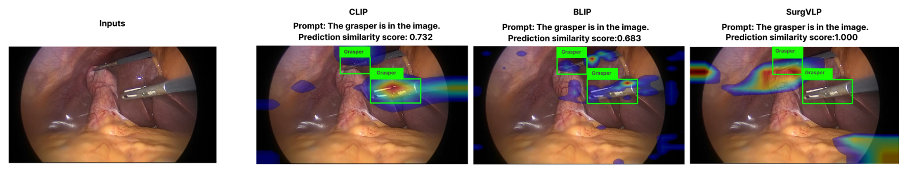
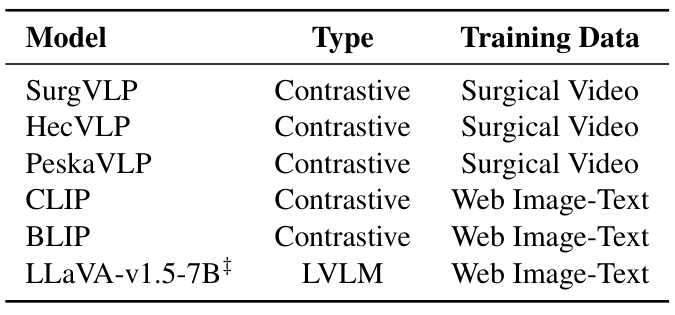
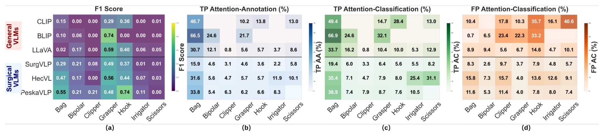
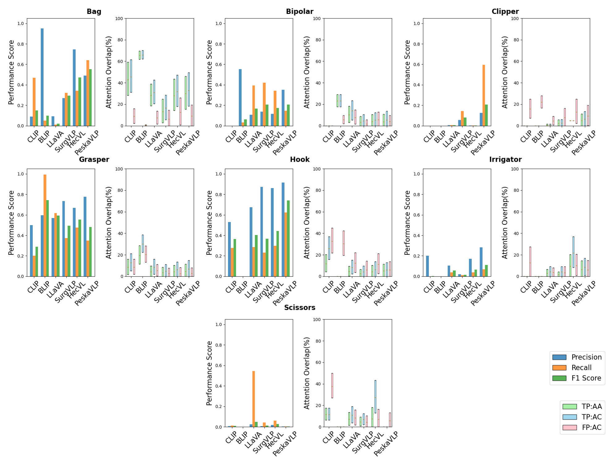
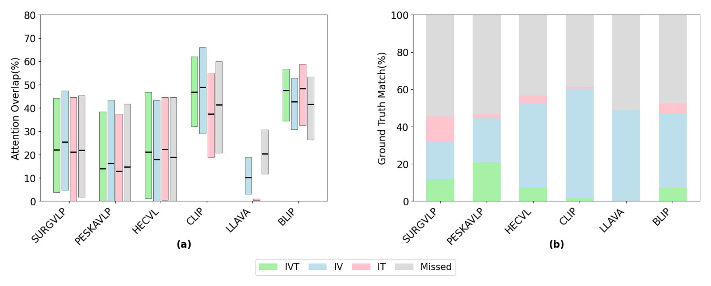
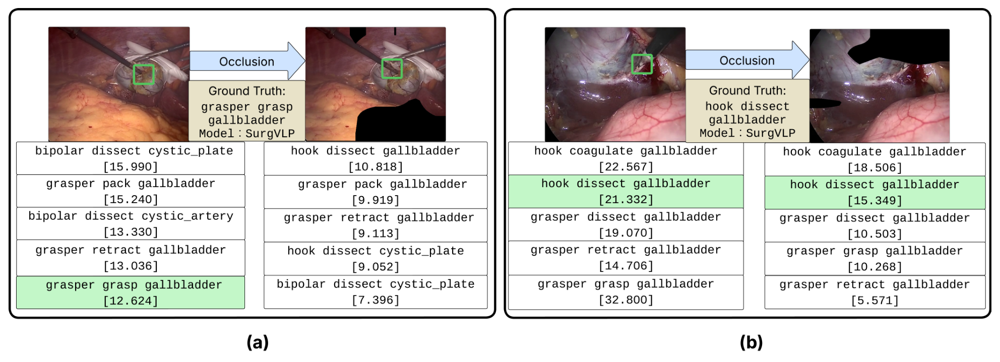
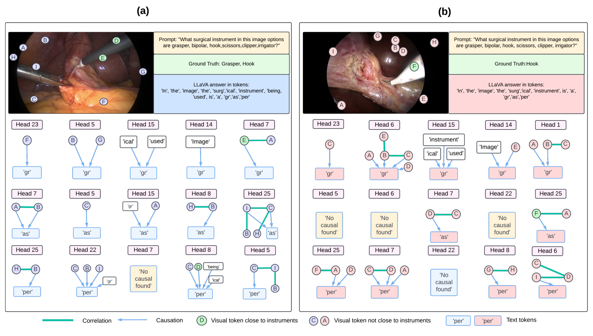

## 1. 背景与动机

**手术视觉语言模型的准确率已经被评测过,但没人检查它答对时看的是不是器械本身。** 此前唯一的手术基准由 Rau 等人完成,结论是手术模型表现差,器械识别精度在零样本和 5 样本下都低于 60%,但它只报告标准指标。

作者把问题拆成两组:答对时注意力是否落在临床相关区域(A-i),是否存在没看对区域却答对的巧合(A-ii);答错时是看错了区域(B-i),还是看对了却认不出(B-ii)。

*论文原图编号：Figure 1。同一句抓钳提示下,SurgVLP 分数最高(1.000),热图大片落在两把抓钳的框外。*

:::highlights
- 缺口在"为什么错",而不是"错多少"。
:::

## 2. 核心观点速览

论文的做法是在标准指标旁边,再量一量模型答对时注意力落在哪里。

- 指标:AA、AC 衡量前 20% 注意力像素落在器械框内的比例;RAS 把运动区域也算进参考区域。
- 数据:不采集新数据,用 Cholec80BBox 的 5 个视频和 CholecT45 的两个带框视频。
- 结果:PeskaVLP 电钩 F1 0.7410,TP_AA 只有 6.6%;遮挡 SurgVLP 高注意力区域后 28.2% 的帧失去正确三元组。

**边界:没有框面积的随机基线,没有随机遮挡对照,热图方法随主干不同。**

:::data
- 六个模型:三个通用(CLIP、BLIP、LLaVA),三个手术(SurgVLP、HecVL、PeskaVLP)
- 三元组评测只用 5,957 帧,来自两个视频
:::

## 3. 数据与任务

两个数据集都来自胆囊切除术。Cholec80BBox 有 5 个视频、51.7K 帧和器械框,用于七类器械分类;CholecT45 有 45 个视频、90.5K 帧和帧级三元组,但只有 VID42、VID43 带框,所以三元组评测只用这两个视频。

*论文原图编号：Table 1。三个手术模型都是对比学习、用手术视频训练;LLaVA 是生成式模型。*

**本文没有发布新数据。** 新增的只有光流自动生成的运动掩码,仓库给的是生成脚本而不是掩码文件。

下一节看三个指标怎么算。

## 4. 指标与交互区域

对比模型的相似度超过第 90 百分位即算预测,三元组取前 5。热图取最高的 20% 像素,论文设 τ=0.8:

$$AA=\frac{|\mathcal{A}_\tau\cap\mathcal{G}_{\hat c}|}{|\mathcal{A}_\tau|},\qquad AC=\frac{|\mathcal{A}_\tau\cap\mathcal{G}_{all}|}{|\mathcal{A}_\tau|}$$

动作发生在器械与组织接触处,单靠器械框不够。作者用 RAFT 光流估计相邻帧运动,减去相机平移、俯仰、缩放、旋转的拟合流,再取阈值 γ=0.8 得到运动掩码。

> [!figure] Figure 2 交互区域提取流程
> 建议位置：指标与交互区域
> 放置原因：它是 RAS 指标参考区域的来源。
> 当前状态：保留占位；自动视觉质量检查拒绝了该裁剪。

**运动掩码没有人工核验,它是否真对应交互区域,论文未说明。**

## 5. 器械分类:准确与对位的背离

*论文原图编号：Figure 3。F1 与三种注意力对齐指标。*

| 模型 | 标本袋 F1 | 标本袋 TP_AC | 电钩 F1 | 电钩 TP_AA |
|---|---|---|---|---|
| BLIP | 0.10 | 66.9 | 0.00 | 无真阳性 |
| PeskaVLP | 0.55 | 36.9 | 0.74 | 6.6 |

**手术模型 F1 更高,注意力对齐更低。** 作者据此回答 A-i 与 B-ii。但抓钳一列例外:BLIP 抓钳 F1 0.74 最高,图 7 显示它召回接近 1.0、精度约 0.6,更像几乎每帧都预测抓钳。

*论文原图编号：Figure 7。精度、召回分解。*

正文写 PeskaVLP 双极电凝 F1 为 0.7899、冲洗器为 0.7962,图中对应格子是 0.21 和 0.11,只有电钩一致。

:::data
- BLIP 标本袋 TP_AC 66.9%,抓钳 TP_AC 32.1%
- PeskaVLP 电钩 TP_AC 7.6%
:::

## 6. 三元组与遮挡

*论文原图编号：Figure 4。左为 RAS 箱线图,右为匹配档比例。*

CLIP 的器械-动作匹配 59.1%,三项全对只有 1.4%;LLaVA 分别是 48.9% 和 0.0%。PeskaVLP 三项全对 20.8% 领先。**通用模型能猜器械和动作,答不对目标组织。**

*论文原图编号：Figure 6。SurgVLP 遮挡样例。*

遮挡 SurgVLP 高注意力区域后,28.2% 原本完全匹配的帧失去匹配,剩余匹配的相似度平均降 9.87。论文未说明同面积随机遮挡的对照结果,所以这还不能和"任意涂黑都扰乱预测"区分。

## 7. LLaVA 的因果图

*论文原图编号：Figure 5。LLaVA 的因果图样例。*

注意力法下六个子词词元的文本占比都在 0.913 以上;CLEANN 下只有 cutting 文本主导(77.6%),其余五个视觉主导。**附录说两种方法都检测到文本依赖,表中数字不支持。**

## 8. 深入分析

- **框面积**:标本袋框大,各模型 TP_AC 最低也有 19.4%;各类框面积比例论文未说明,无法给出随机基线。
- **热图方法**:手术模型都是残差网络主干,用梯度热图;CLIP 是视觉变换器,用注意力回传。对齐差有多少来自方法差异,论文未分开。
- **样本**:三元组只来自两台手术,单次运行,没有置信区间。

## @takeaways
- 准确率之外报告"答对时注意力在不在目标框内",能发现靠背景答对的模型。
- 光流减相机运动可以低成本生成交互区域,但需要人工抽检。
- 本文没有新数据;CholecT45 需向 CAMMA 申请,Cholec80BBox 的框标注下载渠道论文未给出。

## @strengths
- 把可解释性做成可算的指标,而不只放热图样例。
- 按匹配档拆分三元组结果,区分器械、动作、目标三处失败。

## @weaknesses
- 缺随机基线、随机遮挡对照和阈值敏感性分析。
- 正文数字与图 3 不一致;附录表 2 的结论与数字相反。
- 只覆盖胆囊切除术和两项任务。

## @questions
- 用同一热图方法、同一主干比较,手术模型的对齐差距还在吗?
- 随机遮挡同面积区域时,SurgVLP 丢失率是多少?
