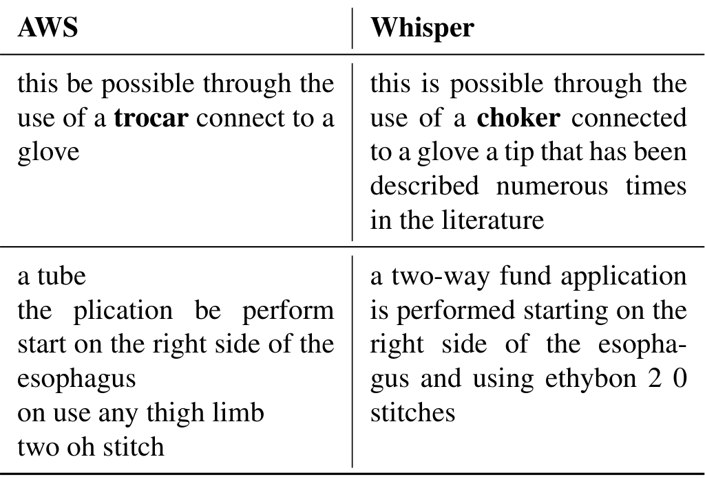
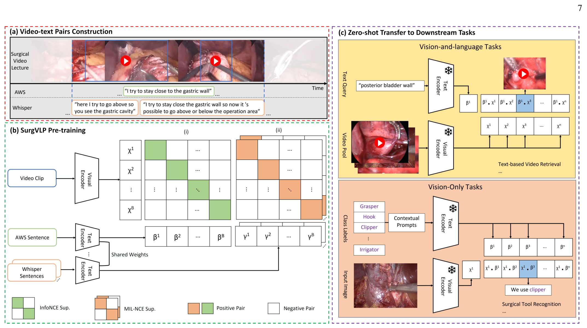
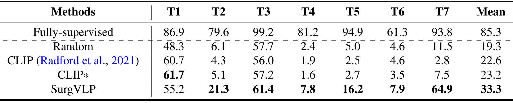

## 1. 背景与动机

**手术视觉模型离不开专家标注，而语言这条监督线几乎没人用过。**
已有方法多是任务专用的全监督模型，只在单中心、单术式的数据上验证，只能预测固定类别。

通用视觉领域靠海量图文对训练 `CLIP`，可以零样本迁移。手术领域没有这种配对数据，人工逐段叙述的成本也承受不起。

作者看中的是开放平台上的手术讲座：讲者边放视频边解说，语音就是现成的文本。难点是这份文本很脏：术语专业，讲者会离题，描述常与画面不同步，语音识别还会把术语认错。

:::highlights
- 讲座语音是免费的监督，但噪声大，不能直接当标签。
:::

## 2. 核心观点速览

**两个各有缺陷的语音转写合在一起，比任何一个单独用都更适合当监督信号。**

- 医学转写（`AWS Medical Transcribe`）术语准但断句差，用来决定在哪里采片段。
- 通用转写（`Whisper`）断句好但术语常错，用来决定片段的边界。
- 医学转写句走一对一对比损失，通用转写句走一对多对比损失，以容忍说话和画面不同步。

零样本阶段识别 F1 均值为 `24.0`，同数据微调的 `CLIP*` 为 `11.5`，全监督为 `67.3`。这意味着它明显强于通用模型，但远不能替代标注。

:::data
- 预训练：`1,326` 个讲座，`25,578` 个片段-文本对
- 阶段识别 F1：SurgVLP `24.0`，CLIP* `11.5`，全监督 `67.3`
:::

## 3. 数据：讲座怎样变成训练对

问题是：没有人工标注，训练对从哪来？

作者在 `Websurg` 抓取 `1,124` 个讲座，在 `EAES` 和 `YouTube` 人工收集 `202` 个，共 `1,326` 个。两路转写都按停顿断句并去掉无名词无动词的句子；医学转写句另做置信度过滤（阈值 `0.4`）和手术关键词过滤。

结果是医学转写句稀疏而准，通用转写句稠密而顺。最终得到 `25,578` 个片段-文本对。

*论文原图编号：Table 1。同一段音频的两种转写：医学转写认对了套管针，通用转写认错；第二例通用转写句子完整，医学转写支离破碎。*

原始视频与转写是否公开，论文未说明，这限制了在同一数据上复现。

:::data
- 置信度阈值 `0.4`；每片段配 1 句医学转写、2 句通用转写
:::

## 4. 方法：采样分工与两种损失

问题是：两份质量不同的文本，怎样各尽其用？

**采样分工**：先采一句医学转写句，保证片段里有术语；再找时间上重叠的通用转写句，在其合并边界内取中心点，长出最长 `10` 秒的随机长度片段。

**编码**：每片段取 `4` 帧送入 `ResNet-50` 后平均池化；文本用医学语料预训练的 `BioClinicalBert`，两路文本共享权重，向量维度都是 `768`。

*论文原图编号：Fig. 2。左上为双转写片段构建，左下为两种对比损失的预训练，右侧为冻结编码器后的零样本检索与识别。*

**损失**：医学转写句用 `InfoNCE`，即批内只有一句正样本；通用转写句用 `MIL-NCE`，即正样本是一组句子、任一句匹配即可。两者各占一半：

$$\mathcal{L} = \epsilon\,\mathcal{L}_{\text{InfoNCE}} + (1-\epsilon)\,\mathcal{L}_{\text{MIL-NCE}},\quad \epsilon=0.5$$

批大小 `80`，温度 `0.3`，约 `3` 天、`4` 张 `A100`。

:::highlights
- 新意在数据侧的分工，两种损失本身都是已有方法。
:::

## 5. 零样本怎么用

**分类时把类别名改写成句子。** 例如工具“钩”写成“我用钩去分离”，阶段写成包含器械、解剖与动作的描述句，三元组用“我用某器械对某目标做某动作”模板。

原因有两个：阶段名本身含义模糊，而预训练文本是完整句子，单个词很少出现。提示词消融显示这套改写在三项任务上都优于直接用类名和 `CLIP` 默认模板。

检索与定位直接比较文本和片段的余弦相似度。视频描述则只用文本训练解码器，推理时把视频向量当文本向量喂入；解码器结构论文未说明。

## 6. 结果说了什么

**视觉-语言任务上，SurgVLP 与通用模型拉开了明显差距。**

| 方法 | 检索 `R@10` | 检索中位秩 | 定位 `R@10` |
|---|---|---|---|
| `CLIP` | 2.1 | 256 | 13.9 |
| `CLIP*` | 2.3 | 244 | 15.3 |
| SurgVLP | 16.1 | 70 | 29.7 |

`CLIP*` 用了同样的数据，检索几乎没有进步。所以收益不只来自数据，还来自文本编码器或训练目标。

**纯视觉任务上，它好于通用模型，但离全监督差一半以上。**

| 任务 | 全监督 | `CLIP*` | SurgVLP |
|---|---|---|---|
| 工具识别 mean AP | 85.3 | 23.2 | 33.3 |
| 阶段识别 F1 | 67.3 | 11.5 | 24.0 |
| 三元组 `AP_ivt` | 30.8 | 3.7 | 7.0 |

*论文原图编号：Table 8。零样本工具识别逐类 AP；标本袋达到 64.9，剪刀与冲洗吸引器不到 8。*

标本袋识别 `64.9` 最好，剪刀与冲洗吸引器几乎认不出，作者解释为讲座里很少提到它们。描述任务 `BLEU-4` 只有 `0.12`，绝对值很低，说明生成的描述与真值措辞重合有限。

:::data
- 检索 `R@10`：SurgVLP `16.1`，CLIP* `2.3`
- 三元组 `AP_ivt`：SurgVLP `7.0`，全监督 `30.8`
:::

## 7. 消融：收益来自哪个设计

| 设置 | 阶段 AP | 三元组 AP | 检索 `R@10` |
|---|---|---|---|
| 仅医学转写 | 25.5 | 11.0 | 21.6 |
| 仅通用转写 | 23.5 | 9.1 | 14.4 |
| 双视图 | 26.7 | 10.3 | 25.1 |
| 固定 10 秒 | 17.3 | 9.0 | 18.8 |
| 1 帧 | 19.7 | 9.5 | 18.1 |

**双视图在阶段和检索上最好，三元组上却是只用医学转写更好。** 作者的解释是三元组只需关键词匹配，术语准确的那一路已经够用。

随机片段长度优于任一固定长度，固定 `10` 秒最差，因为冗余帧与文本无关。消融在验证集上做，用平均精度而非主结果的 F1，为何改指标论文未说明；每组只跑一次，`1` 个点左右的差异可能在波动之内。

## 8. 为什么有效，哪些解释还没排除

**我的判断：双视图的收益可能有相当部分来自更好的片段边界，而不只是损失。** 只用一路转写时，片段切分改按该路时间戳，切分规则和损失同时变了，现有实验分不开两者。

同样，SurgVLP 与 `CLIP*` 的差距可能主要来自医学文本编码器。论文没有做“通用视觉塔加医学文本塔”之类的对照，`CLIP*` 的微调设置也未说明。

文本编码器实验中 `BioClinicalBert` 相似度 `0.86`，`CLIP` 文本塔 `0.69`。但它测的是同一时段转写句和元数据句能否被拉近，不是下游精度。

:::highlights
- 切分规则与损失、文本编码器与训练目标，两组混杂都没有拆开。
:::

## 9. 结果没说什么

- 跨术式的识别迁移没测：纯视觉评测全部是腹腔镜胆囊切除。
- 少样本或线性探测没测：能省多少标注，论文只在未来工作里提及。
- 显著性只覆盖阶段识别：三个种子 t 检验得 t 值 `5.03`、p 值 `0.0037`，其余任务都是单次结果。
- 检索测试查询经临床协作者纠正，训练文本未纠正，测试条件比训练干净。
- 工具与阶段表的均值列：`CLIP` 工具识别均值 `22.6`，而七类算术平均约 `19.0`，均值口径论文未说明。

## 10. 复现要注意什么

关键词过滤表、停顿符号列表和通用转写模型版本文中没给，片段构建要看代码。医学转写依赖商业服务，换用开源模型时转写误差模式会变，双视图的分工可能需要重新验证。

零样本分类高度依赖手写提示句，换一套提示结果会变；比较不同模型时应固定提示。

## @takeaways
- 领域语音噪声大时，可以用两个错误模式不同的转写互为增强视图，一个定位、一个定边界。
- 零样本手术分类要把类名改写成与预训练文本分布一致的句子。
- SurgVLP 是预训练起点，不是可直接部署的识别器。

## @strengths
- 免人工标注地构建了 `25,578` 对手术视频-文本数据，方案可迁移到其他有解说的视频领域。
- 设立了 `CLIP*` 这个同数据对照，能部分区分数据收益和方法收益。
- 如实报告了负面结果：三元组上双视图不如单视图，部分类别低于基线。

## @weaknesses
- 关键对照缺失：切分规则与损失、文本编码器与训练目标都混在一起。
- 纯视觉评测只有胆囊切除，没有少样本实验。
- 大多数结果没有方差，消融差值小。

## @questions
- 固定切分规则只换损失，双视图还有多少收益？
- 换用 `ViT` 或加入时序建模后，结论是否保留？
- 把一对多损失的正样本窗口向后平移以对齐“先说后做”，定位能否改善？
