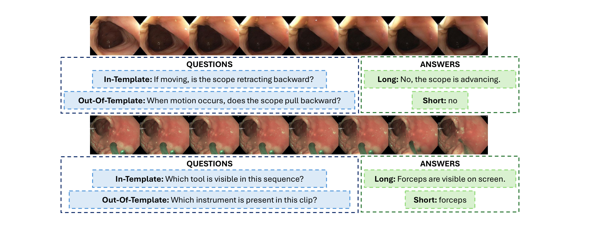
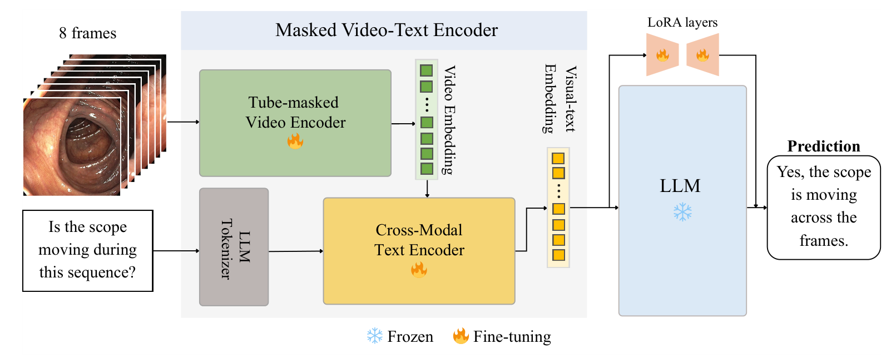
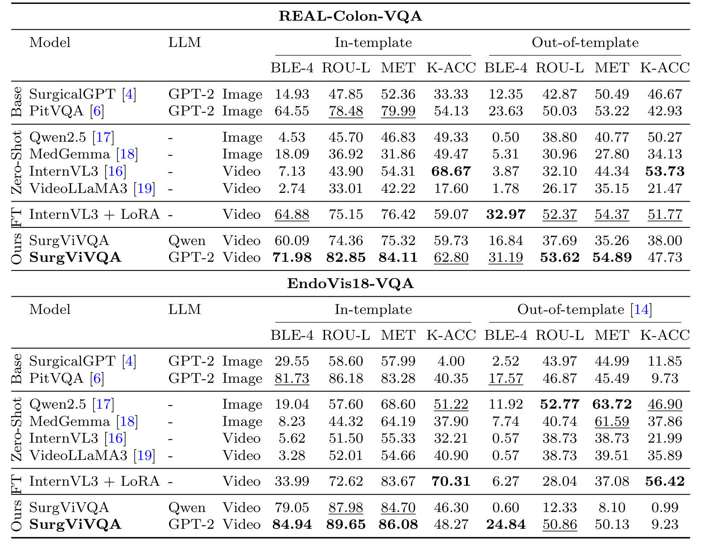
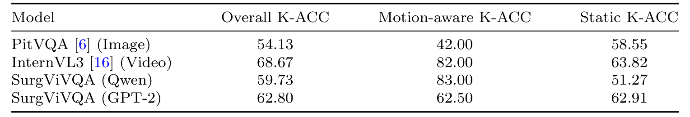
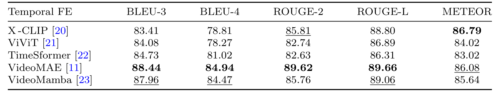
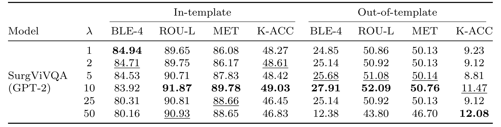

## 1. 背景与动机

**手术问答模型至今都只看一帧,而"内镜在前进还是后退""病灶往哪漂"这类问题必须跨帧才能回答。** SurgicalGPT 和 PitVQA 都是单帧图像加 GPT-2 解码器。

数据集也一样。EndoVis18-VQA、PitVQA、Kvasir-VQA、SSG-VQA 多数没有时间标注,测试题与训练题措辞几乎相同,模型可能只靠题面就能答对。

作者还想知道:用 LoRA 微调一个通用视频大模型是否就够了。

:::highlights
- 缺口有两层:模型只看单帧,数据集的题面又太模板化。
:::

## 2. 核心观点速览

论文的做法分三步:

- 数据:在 6 段结肠镜录像上逐帧标注,生成 5200 条与约 0.93 秒片段绑定的问答,每题有模板题和改写题两种问法、长短两种答案。
- 模型:VideoMAE 视频编码器经 BLIP 交叉注意力与问题融合,再由 LoRA 微调的 GPT-2 或 Qwen 生成答案。
- 评测:与两个图像基线、四个零样本大模型、一个 LoRA 微调的 InternVL3 比较,再按运动类与静态类分层。

**主结果:结肠镜数据上关键词准确率从 PitVQA 的 54.13 提到 62.80。边界:EndoVis18-VQA 上不如微调的 InternVL3(48.27 对 70.31),改写题上降到 9.23。**

:::data
- 5200 条问答,训练 4450,测试 750,20 类问题 6 个领域
- 8 帧,每 4 帧取 1 帧,约 0.93 秒
:::

## 3. 数据是怎么做的

REAL-Colon 是公开的真实结肠镜视频数据集,病灶部位、大小、病理来自临床核实标签。作者在其上逐帧补标内镜运动、器械、可见度、遮挡、冲洗和照明模式,由两名非临床标注员完成,内镜专家监督,第三人裁决分歧。标注一致性指标,论文未说明。

片段规则有两条:

- 30 fps 视频每 4 帧取 1 帧,取 8 帧。
- 条件在多数帧持续存在,才把题目分给该片段。

*论文原图编号：Fig 2。两条样本:每条有 8 帧片段、模板题与改写题、长答案与短答案。*

题目分布偏向操作记录(46.15%)和运动(31.73%),尺寸与诊断各只有 2.88%。训练测试按视频还是随机划分,论文未说明;GitHub 代码用前 5 段录像训练、第 6 段测试。

:::highlights
- 多数帧持续规则让片段标签反映一段时间的状态,而不是某一帧的偶然状态。
- 测试集只来自 1 段录像。
:::

下一节看模型结构。

## 4. 模型怎样把 8 帧和问题变成答案

SurgViVQA 分三步:

1. VideoMAE 把 8 帧切成时空立方体词元,训练时按管状方式掩码,即同一位置的所有时刻一起遮住,迫使模型从语义上下文而不是相邻帧推断。
2. 问题经 BLIP 交叉注意力文本编码器,每个问题词元对全部视频特征做注意力。
3. 融合结果送入冻结的 GPT-2 或 Qwen,只训练 LoRA 适配器,自回归生成答案。

*论文原图编号：Fig 1。SurgViVQA 结构:管状掩码视频编码器、跨模态文本编码器、带 LoRA 层的冻结 LLM。*

训练 60 轮,学习率 $2\times10^{-7}$。可选的关键词加权损失把答案中关键词词元的损失乘以 λ:

$$\mathcal{L}_{WBCE}=\frac{1}{N}\sum_{i=1}^{N} w_i\,\mathrm{BCE}(y_i,\hat{y}_i),\quad w_i=\lambda\ (i\in K),\ 1\ (\text{其他})$$

Qwen 的型号、LoRA 秩、批大小,论文未说明,这使 Qwen 版本为何不稳定无法追查。

下一节看主结果。

## 5. 主结果说了什么

关键词准确率 K-ACC 看答案里有没有正确术语;BLEU-4、METEOR 看措辞与参考答案的重合。

| 数据集与设置 | PitVQA | InternVL3 + LoRA | SurgViVQA GPT-2 |
|---|---|---|---|
| 结肠镜 模板内 K-ACC | 54.13 | 59.07 | 62.80 |
| 结肠镜 模板外 K-ACC | 42.93 | 51.77 | 47.73 |
| 肾切除 模板内 K-ACC | 40.35 | 70.31 | 48.27 |
| 肾切除 模板外 K-ACC | 9.73 | 56.42 | 9.23 |

*论文原图编号：Table 2。两个数据集上全部模型在模板内与模板外的四项指标。*

**相对图像基线,SurgViVQA 在模板内确实更好,但相对微调的 InternVL3,它只在结肠镜模板内更好。** 作者"更均衡"的说法依赖 BLEU-4 等句式指标。零样本 InternVL3 的结肠镜模板内 K-ACC 是 68.67,全表最高,BLEU-4 却只有 7.13,说明它答对了关键词,只是措辞不同。

改写题上 Qwen 版本在肾切除数据上 K-ACC 0.99,几乎完全失效,零样本 Qwen2.5-VL 反而有 46.90。

:::highlights
- 句式指标高不等于事实对;以 K-ACC 看,专用架构没有全面胜过微调的通用视频模型。
:::

下一节看最能说明时序作用的分层结果。

## 6. 视频输入到底帮了哪类题

| 模型 | 运动类 K-ACC | 静态类 K-ACC |
|---|---|---|
| PitVQA(图像) | 42.00 | 58.55 |
| InternVL3(视频) | 82.00 | 63.82 |
| SurgViVQA Qwen | 83.00 | 51.27 |
| SurgViVQA GPT-2 | 62.50 | 62.91 |

*论文原图编号：Table 3。结肠镜模板内 K-ACC 按运动类与静态类分层。*

**运动类题上视频模型比图像模型高约 40 个点,这是全文最清楚的时序证据。** 但同一架构换解码器后运动类相差约 20 个点,GPT-2 版本运动类与静态类几乎一样,所以收益不全来自视频编码器。两类题各有多少道、多数类基线是多少,论文未说明。

下一节看两项消融。

## 7. 两项消融

时序编码器(肾切除数据,模板内,同一 GPT-2):

| 编码器 | BLEU-4 | METEOR |
|---|---|---|
| X-CLIP | 78.81 | 86.79 |
| TimeSformer | 81.02 | 83.02 |
| VideoMamba | 84.47 | 85.64 |
| VideoMAE | 84.94 | 86.08 |

*论文原图编号：Table 4。五种时序编码器接 GPT-2 的语言指标。*

VideoMAE 的 BLEU-4 最高,但只比 VideoMamba 高 0.47,METEOR 还低于 X-CLIP。这张表没有 K-ACC,也没有在结肠镜数据上做,原因论文未说明。

关键词加权:λ=10 相对 λ=1,模板内 K-ACC 从 48.27 到 49.03,模板外从 9.23 到 11.47。主表数字与 λ=1 一致,说明主结果没用加权。

*论文原图编号：Table 5。不同 λ 下 SurgViVQA GPT-2 在肾切除数据上的全部指标。*

:::data
- 编码器之间 BLEU-4 最大差 6.67(84.94 对 78.27)
- λ=50 时模板外 BLEU-4 降到 12.38
:::

下一节讨论结果没有说明的部分。

## 8. 结果没说什么

- **没有分开多帧信息和更强编码器。** SurgViVQA 相对 PitVQA 同时换了视觉编码器、文本编码器和解码器适配方式,没有"同一模型只输入 1 帧"的对照。
- **没有简单基线。** 我统计 GitHub 标注:模板内只有 20 种固定问句,短答案为 no 的 2004 条、yes 的 1296 条。多数类或纯文本基线可能已经不低。
- **"对改写更鲁棒"不成立于关键词层面。** 改写题只有 20 种固定改写,肾切除数据上 K-ACC 降到个位数。
- **单一测试录像。** 结论只在 1 段录像上测过,没有方差。

## 9. 数据能不能拿到,复现要注意什么

- 问答标注在 GitHub 仓库 madratak/SurgViVQA 公开,两份文件各 5200 行,含帧编号、问题、类别、长短答案;仓库说明写 18 类,文件里实际是 20 类。
- 标注不含图像,帧要从 REAL-Colon 原始数据自行抽取;我访问 figshare 页面时返回 403,未能确认下载条件。
- id 字段只有 3750 个不同值,应以视频编号加帧编号作主键。
- 模型权重在 Hugging Face 公开。
- K-ACC 依赖关键词提取脚本,与其他论文比较前要统一关键词表。

## @takeaways
- 8 帧短片段在运动类题上明显胜过单帧,这一点证据清楚。
- 专用小模型的优势主要在句式指标上,按关键词准确率并不全面领先。
- REAL-Colon-VQA 标注公开、视频需另取,题面只有 20 种,适合做时序探针,不适合单独证明语言泛化。

## @strengths
- 运动类与静态类分层报告,直接回答"视频帮了什么"。
- 同一题提供模板题与改写题,能测题面依赖。
- 标注、代码、权重都已公开。

## @weaknesses
- 只有 6 段录像、1 种术式,测试集 1 段录像。
- 缺少单帧对照、多数类基线和纯文本基线。
- 编码器消融只在肾切除数据上做,没有 K-ACC。

## @questions
- SurgViVQA 只输入 1 帧时,运动类 K-ACC 会掉多少?
- 6 段录像留一交叉验证,结果方差有多大?
- 为什么同一架构下 Qwen 与 GPT-2 在运动类题上相差约 20 个点?
