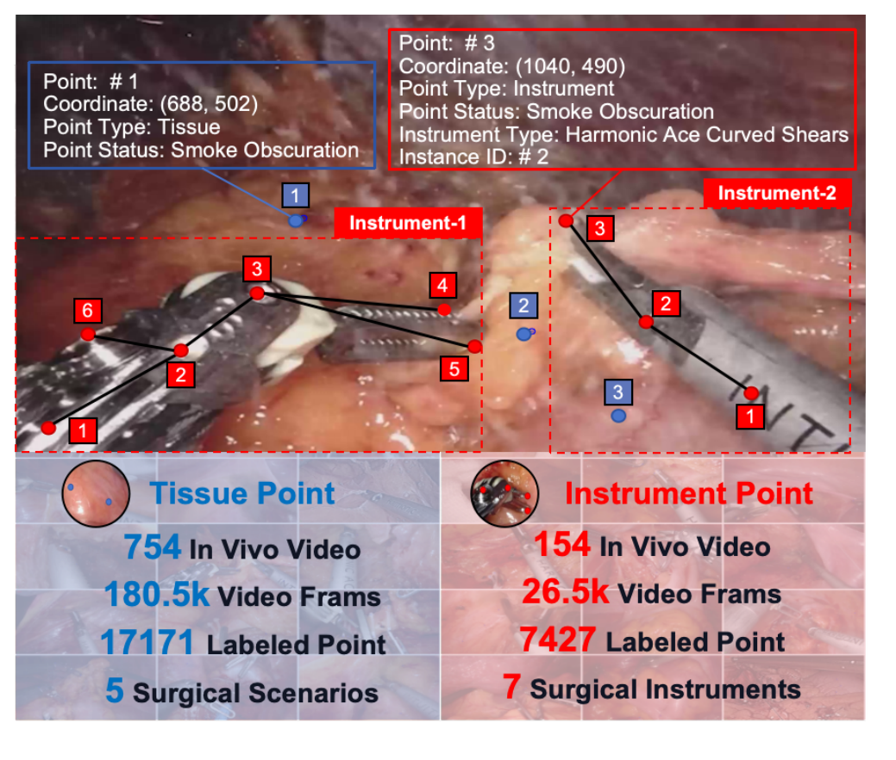
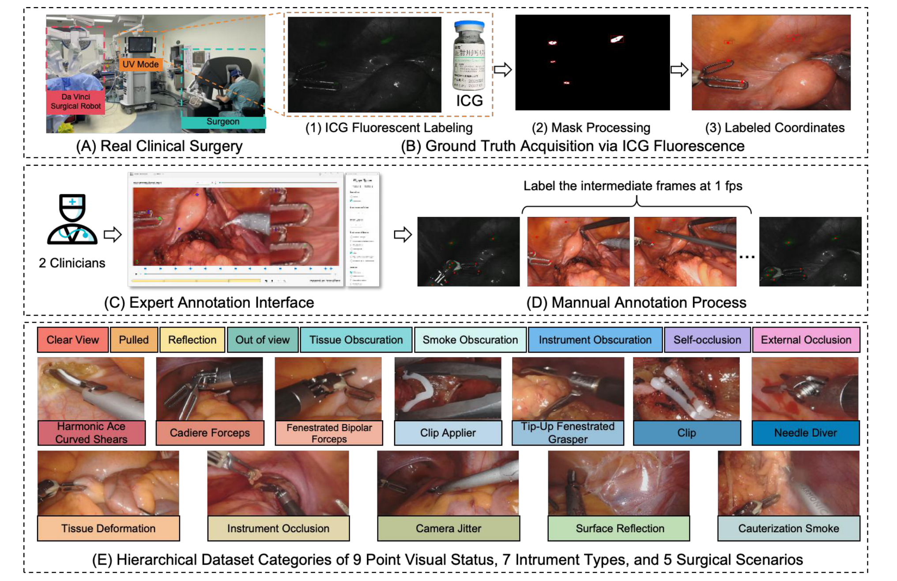
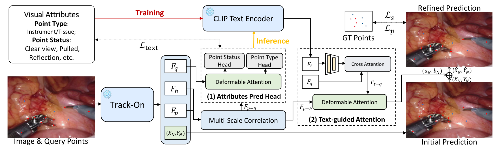
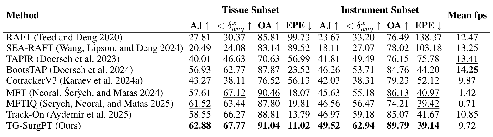
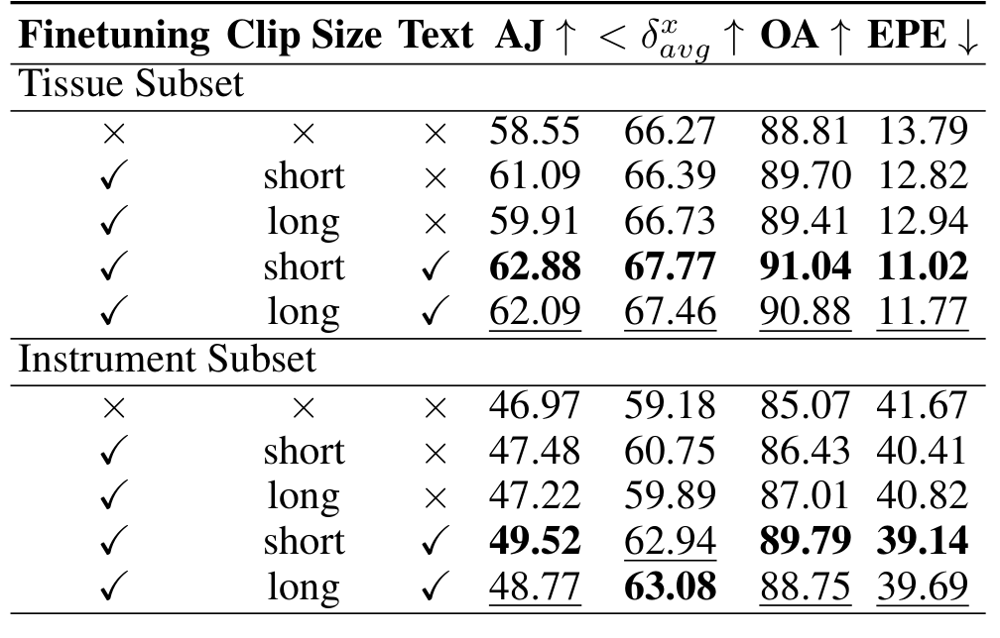
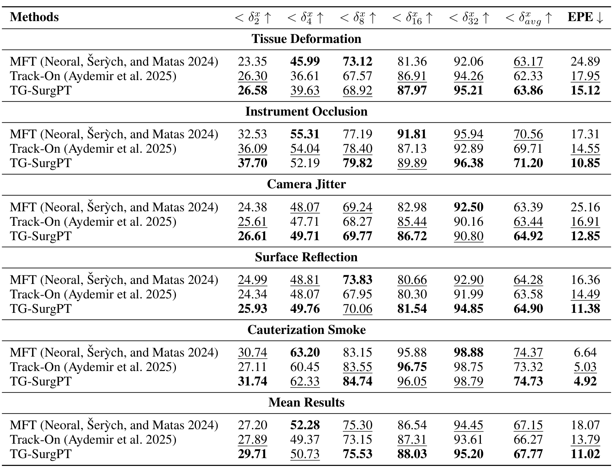
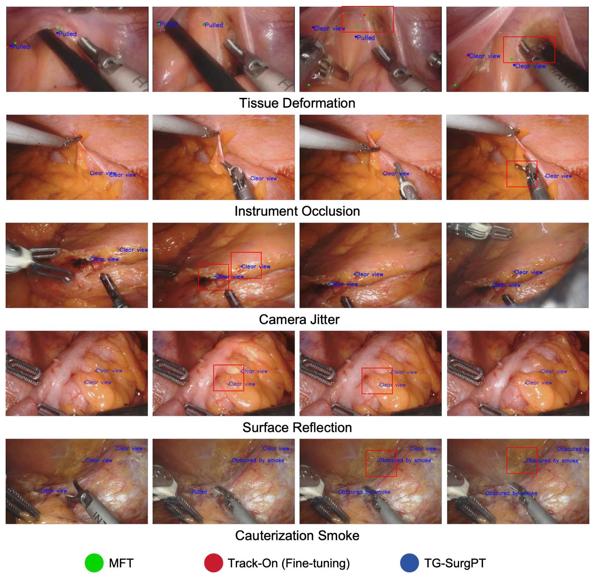
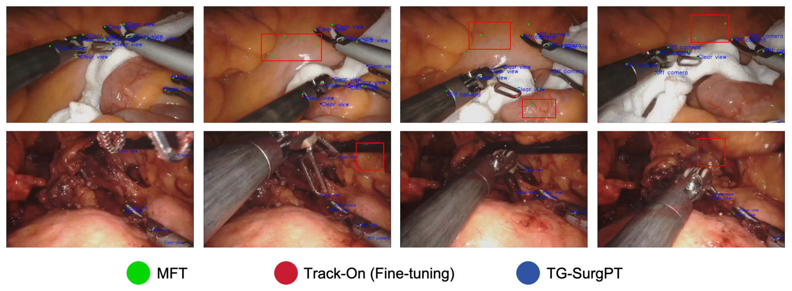
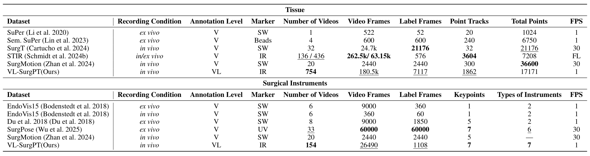

---
tags:
  - papers/手术数据集
aliases:
  - "VL-SurgPT"
  - "TG-SurgPT"
  - "视觉语言手术点跟踪数据集"
date: 2025-11-15
arxiv_id: 2511.12026
---

# Bridging Vision and Language for Robust Context-Aware Surgical Point Tracking: The VL-SurgPT Dataset and Benchmark

## 核心信息

- 标题: Bridging Vision and Language for Robust Context-Aware Surgical Point Tracking: The VL-SurgPT Dataset and Benchmark
- 标题翻译: 连接视觉与语言,实现鲁棒的上下文感知手术点跟踪:VL-SurgPT 数据集与基准
- 作者: Rulin Zhou, Wenlong He, An Wang, Jianhang Zhang, Xuanhui Zeng, Xi Zhang, Chaowei Zhu, Haijun Hu, Hongliang Ren
- 机构: 香港中文大学; 深圳市人民医院胃肠外科; 香港大学; 深圳大学; 香港中文大学深圳研究院
- 发表时间: 2025-11-15(arXiv v1)
- 发表渠道: AAAI 2026(论文首页版权行写明 AAAI 2026);arXiv 预印本 cs.CV
- arXiv: 2511.12026
- 论文链接: https://arxiv.org/abs/2511.12026
- 代码 / 项目: https://szupc.github.io/VL-SurgPT/(项目页);代码链接 https://anonymous.4open.science/r/VL-SurgPT-code-35CE 截至 2026-11-08 返回仓库已过期
- 数据 / 资源: https://huggingface.co/datasets/zhourulin88888/VL-SurgPT(项目页"Dataset"按钮先指向 OneDrive 共享文件夹,匿名访问返回 403;Hugging Face 仓库公开、未设访问申请)
- 论文类型: 数据集论文(benchmark_or_dataset),附一个文本引导的基线方法

## 原文摘要翻译

由于手术环境视觉条件复杂,包括烟雾遮挡、镜面反光和组织形变,精确的点跟踪仍然困难。现有手术跟踪数据集提供坐标信息,却缺少理解跟踪失败机制所需的语义上下文。

我们提出 VL-SurgPT,第一个把视觉跟踪与手术场景中点状态的文字描述连接起来的大规模多模态数据集。数据集包含 908 个在体视频片段,其中 754 个用于组织跟踪(五种困难场景下共 17,171 个标注点),154 个用于器械跟踪(覆盖七类器械,带详细关键点标注)。

我们用八种最先进的跟踪方法建立了完整基准,并提出 TG-SurgPT,一种利用语义描述提升视觉困难条件下鲁棒性的文本引导跟踪方法。实验结果表明,引入点状态信息能显著提高跟踪精度和可靠性,在传统纯视觉方法表现不佳的不利视觉场景中尤其明显。

通过连接视觉与语言两种模态,VL-SurgPT 能支撑上下文感知跟踪系统的开发,这对推进在术中困难条件下仍能保持性能的计算机辅助手术应用至关重要。

## 创新点

1. 给每个跟踪点加状态标签。除坐标外,每个点带"清晰可见、被牵拉、反光、烟雾遮挡"等 9 种状态之一。已有手术跟踪数据集只给坐标,无法按失败原因拆分误差,这是本数据集与 STIR、SurgMotion 的主要区别。
2. 在体采集并用荧光标记定真值。数据来自 20 台达芬奇 Xi 胃肠手术。术中用吲哚菁绿(ICG)标点,在紫外荧光模式下记录片段首帧和末帧的点位,中间帧由医生手标。这比离体实验室数据更接近临床。
3. 组织与器械同在一个数据集。组织子集按 5 种困难场景组织,器械子集覆盖 7 类器械的关键点,可以在同一协议下比较两类目标。
4. 一个能用稀疏真实标注训练的文本引导基线。TG-SurgPT 冻结 Track-On主干,只学一个由状态文本引导的坐标修正量,推理时状态由模型自己预测。

## 一句话总结

VL-SurgPT 用 20 台达芬奇胃肠手术做出 908 个带逐点状态标签的在体跟踪片段;在它上面,冻结 Track-On加文本引导修正的 TG-SurgPT 把组织 AJ 从 58.55 提到 62.88、器械 AJ 从 46.97 提到 49.52,但组织子集上一半以上的增益来自在本数据上微调本身,文本单独带来的增益在两个子集上都约 2 个点。

## 研究问题

**难点在于:手术画面里的点经常被烟雾、反光、器械和形变干扰,而现有数据集只告诉你点在哪,不告诉你点当时处在什么状态。** 通用点跟踪方法在 TAP-Vid 等基准上表现很好,搬到手术视频上会明显退化。

已有手术跟踪数据集各有缺口:

- SuPer、Semantic SuPer 是离体数据,标注量小。
- SurgT 是在体数据,但标的是框,不是连续点轨迹。
- STIR 用红外标记定位,但只有序列首末端点。
- SurgPose 用紫外标记标器械关键点,但在实验室离体环境。
- SurgMotion 同时标组织和器械点,但只有坐标。

作者的假设是:如果模型知道一个点此刻是"被烟雾遮住"还是"被器械挡住",就能更好地处理这种情况。要检验这个假设,先要有带状态标签的数据。

### 核心观点速览

论文的答案是:做一个带逐点状态文字的在体数据集,再在现成跟踪器上加一个读状态文字的修正头。

- 数据:908 个片段,组织 754 个(17,171 个可见点,5 种场景),器械 154 个(7 类器械);每个点带类型和 9 种状态之一。
- 真值:ICG 荧光给首末帧锚点,中间帧由 2 名医生按每秒 1 帧手标。
- 方法:冻结 Track-On和 CLIP 文本编码器,先从视觉特征预测点状态,再用状态文本经交叉注意力输出坐标修正量。
- 结果:组织 AJ 62.88、器械 AJ 49.52,在表 1 全部四项指标上第一,速度 9.72 fps。
- 边界:**基线未在本数据上微调;文本的净增益约 2 个点,且与额外的状态分类监督混在一起;单中心、单术式。**

下一节看数据从哪里来、标了什么。

## 数据与任务定义

这一节回答:视频怎么来、真值怎么定、两个子集各有多少。

### 数据来源

数据来自深圳市人民医院胃肠外科的在体机器人手术,全部用达芬奇 Xi 系统完成,术式包括根治性胃切除、胃肠肿瘤根治切除、直肠癌根治切除和根治性结肠切除。作者先收集 20 台手术约 33 小时视频,按清晰度、伪影和与跟踪难点的相关性筛选,留下 115 分钟用于标注。伦理批件号 LL-KY-2023121-01。

### 任务拆分

数据分成两个子集,任务都是给定首帧查询点,在后续帧输出每个点的坐标和可见性。

| 子集 | 片段 | 视频帧 | 标注帧 | 查询点轨迹 | 可见标注点 | 组织方式 |
|---|---|---|---|---|---|---|
| 组织 | 754 | 180.5k | 7,117 | 1,862 | 17,171 | 5 种场景 |
| 器械(正文) | 154 | 26,490 | 1,108 | 论文未说明 | 7,427(图 1) | 7 类器械 |
| 器械(补充材料表 4) | 307 | 论文未说明 | 2,232 | 1,029 | 7,427 | 7 类器械 |

组织子集的 5 种场景是组织形变(TD)、器械遮挡(IO)、镜头抖动(CJ)、表面反光(SR)和电灼烟雾(CS)。补充材料表 4 给出每种场景 122 到 187 个片段、1,228 到 1,743 个标注帧,与正文"每种约 120 个片段以上"一致。

**器械子集的规模有两套口径。** 正文和表 3 写 154 个片段、1,108 个标注帧,补充材料写 307 个"按器械计"的片段和 2,232 帧。我的判断是:一个片段里出现两件器械时,表 4 按器械各计一次,所以数目约翻倍;论文没有解释这一差异。

7 类器械是超声刀弯剪、Cadiere 钳、有孔双极钳、施夹钳、夹子、上翘有孔抓钳和持针器。单关节器械标 4 个关键点,多关节器械标 5 个主关键点加 2 个辅助点,沿用 SurgPose 的约定;施夹钳和夹子作为一个整体标注。

### 标注/筛选协议

每个标注点带四类信息:

- 二维坐标 $(x, y)$,点不可见时为 null。
- 点类型:组织或器械。
- 点状态:从 9 个词的预定义词表中选一个,即清晰可见、被牵拉、反光、组织遮挡、烟雾遮挡、器械遮挡、出视野、外部遮挡、自遮挡。
- 器械点另有器械类型和实例编号,用来区分同一帧里的多件器械。

状态词表按点类型分开使用。组织点用 7 种(清晰、牵拉、反光、组织遮挡、烟雾遮挡、器械遮挡、出视野),器械点用 4 种(清晰、自遮挡、外部遮挡、出视野),这与 TG-SurgPT 状态头输出 $7 \times N$ 或 $4 \times N$ 的设计对应。

组织点选在临床上有意义且外观稳定的位置,例如血管与暗色组织的交界,做法类似 SurgT。

状态分布方面,组织点以清晰和牵拉为主,反光与镜头抖动各影响 18% 以上的点,烟雾遮挡占 24.5%。器械点约三分之一处于不利状态,其中夹子和持针器的受损比例分别为 33.6% 和 21.2%。

*论文原图编号：Figure 1。数据集总览:上半部分示意一个组织点和一个器械点的完整标签(坐标、类型、状态、器械类型、实例号),下半部分是两个子集的规模。放在这里是因为它直观给出单个点的标签格式。*

下一节看这些真值是怎么采到的,以及 TG-SurgPT 怎样使用状态标签。

## 方法主线

这一节回答:真值怎样在活体手术里拿到,评测怎么做,文本引导基线怎样工作。

### 构建流程

在体手术不能像离体实验那样反复重复同一动作,所以作者只在每个短片段的两端取荧光真值:

1. 术前在器械的尖端、关节、杆部涂 ICG,每件器械 2 到 7 个点;术中由医生用蘸 ICG 的持针器在组织表面点 2 到 4 个点。
2. 打开达芬奇的紫外荧光模式,器械和组织保持静止,记录 ICG 点坐标作为首帧查询点。
3. 切回白光,正常操作 5 到 10 秒。
4. 再次切到荧光模式并保持静止,记录末帧坐标。荧光点通过对紫外画面做二值阈值分割提取。

术后,2 名有经验的临床医生用自制工具,从首帧 ICG 点出发,在白光段按每秒 1 帧逐帧手标坐标,用末帧 ICG 点核对终点,同时给每个点打类型和状态标签。

**真值质量因此分两层。** 首末帧坐标来自荧光,可靠性高;中间帧坐标是人工判断,而 AJ 和位置准确率都在中间帧上计算。两名医生之间的一致性论文未说明。

*论文原图编号：Figure 2。数据采集与标注流程,依次为达芬奇手术场景、荧光取真值的三步(荧光标记、掩码处理、坐标)、标注界面、按每秒 1 帧标注中间帧,以及 9 种状态、7 类器械、5 种场景示例。放在这里是因为它是采集与标注流程的唯一总图。*

### 评测协议

数据按 4:1 划分训练和测试,组织子集按场景分层,器械子集按器械类型分层。划分是否按手术或患者隔离,论文未说明;754 个片段只来自 20 台手术,若按片段随机划分,同一台手术的画面会同时出现在训练和测试中。

所有输入帧缩放到 720×480,在单张 RTX 4090 上用 PyTorch 2.6 运行。指标沿用 TAP-Vid 和 STIR:

- 平均位置准确率 $<\delta^x_{avg}$:可见点中,预测落在真值 2、4、8、16、32 像素以内的比例,对五个阈值取平均。

$$<\delta^x_{avg} = \frac{1}{|K|}\sum_{k\in K}\frac{1}{|V|}\sum_{(i,t)\in V}\mathbb{1}\left[\lVert \hat p_i^{(t)} - p_i^{(t)}\rVert_2 \le k\right],\quad K=\{2,4,8,16,32\}$$

- 平均 Jaccard(AJ):每个阈值下真阳性数除以真阳性、假阳性、假阴性之和,再对阈值取平均,同时惩罚位置错误和可见性错误。
- 遮挡准确率(OA):可见性预测与真值一致的比例。
- 终点误差(EPE):序列末帧预测点与 ICG 真值的欧氏距离,单位像素。
- 推理速度(fps)。

补充材料写明 $<\delta^x_{avg}$ 假设输入为 256×256,而实验输入是 720×480。像素阈值和 EPE 在哪个分辨率下计算,论文未说明,这会影响与其他数据集上数字的直接比较。

### Baseline 设置

八个视觉基线分两类。光流类有 RAFT、SEA-RAFT。

点跟踪类有 TAPIR、BootsTAP、CoTracker3、MFT、MFTIQ 和 Track-On。

全部使用官方实现和原作者默认参数,**没有在本数据集上微调**。只有 Track-On在消融里给出了微调版本。

### 机制流程

TG-SurgPT 在 Track-On上加一条文本分支。Track-On是一个带记忆的在线 Transformer 点跟踪器。

1. 输入视频帧和查询点,冻结的 Track-On输出四样东西:查询点特征 $F_q$、当前帧稠密特征 $F_h$、每个点的粗粒度块匹配位置 $F_p$、初始坐标 $(X_N, Y_N)$。
2. 属性预测头把 $F_p$ 与 $F_h$ 经多尺度相关融合成 $F_{p\text{-}h}$,以 $F_q$ 为查询做多尺度可变形注意力,再由两个分类头输出点类型和点状态。
3. 训练时用真值状态文本,推理时用第 2 步预测的状态。点类型和点状态两段文字送入冻结的 CLIP 文本编码器,得到两个 512 维文本特征 $F_t$。它经线性投影后作为键和值,以查询点特征作为查询做交叉注意力,得到文本增强特征 $F_{t\text{-}q}$。
4. 文本增强特征与融合视觉特征再经一层可变形注意力,输出每个点的坐标修正量,加到初始坐标上作为最终预测:

$$(\hat X_N, \hat Y_N) = (X_N + a_N,\ Y_N + b_N)$$

*论文原图编号：Figure 3。TG-SurgPT 结构:冻结的 Track-On与 CLIP 文本编码器,(1) 属性预测头,(2) 文本引导注意力,输出对初始预测的修正量。放在这里是因为它对应上面四步。*

**这个设计只学一个残差修正。** 主干冻结,所以能用稀疏的真实标注训练,不需要 Track-On原本依赖的 MOVi-F 稠密合成数据(每段 25 帧采样 2048 个点)。代价是上限受主干限制。

训练损失在有真值的帧上累加三项:

$$\mathcal{L} = \sum_{t\in T}\Big[\underbrace{H_\delta(\hat p_t - p_t)}_{\mathcal{L}_p} + \underbrace{\lVert \Delta^2 \hat p_t\rVert_1}_{\mathcal{L}_s} + \underbrace{\mathcal{L}_{CE}(\hat s_t, s_t)}_{\mathcal{L}_{text}}\Big]$$

第一项是 Huber 距离损失;第二项惩罚轨迹的二阶差分,让轨迹平滑;第三项是状态分类交叉熵。三项的权重、Huber 阈值、学习率、训练轮数和训练片段采样方式,论文均未说明。点类型头被描述为"输出 $2\times N$ 向量,表示每个点的空间位置",与它作为类型分类器的用途不符,可能是笔误。

下一节看这些设计在表里换来了多少。

## 关键结果

这一节回答:基线差多少,文本到底贡献多少,哪些场景最难。

### 基线表现

*论文原图编号：Table 1。八个视觉基线与 TG-SurgPT 在组织和器械子集上的 AJ、位置准确率、OA、EPE 和平均 fps。放在这里是因为它是全文主结果。*

| 方法 | 组织 AJ | 组织位置准确率 | 组织 EPE | 器械 AJ | 器械位置准确率 | 器械 EPE | 速度 |
|---|---|---|---|---|---|---|---|
| RAFT | 27.81 | 30.37 | 99.73 | 23.67 | 33.20 | 138.37 | 12.47 |
| BootsTAP | 56.93 | 62.77 | 23.52 | 46.26 | 53.71 | 44.20 | 14.25 |
| MFT | 57.61 | 67.12 | 18.07 | 45.63 | 55.18 | 40.97 | 1.42 |
| MFTIQ | 61.52 | 63.44 | 19.81 | 46.56 | 56.47 | 39.42 | 0.71 |
| Track-On | 58.55 | 66.27 | 13.79 | 46.97 | 59.18 | 41.67 | 10.85 |
| TG-SurgPT | 62.88 | 67.77 | 11.02 | 49.52 | 62.94 | 39.14 | 9.72 |

读这张表要注意三点:

- 光流类方法 AJ 都低于 30,EPE 在 89 到 139 像素,说明逐帧光流在手术长时跟踪上会累积漂移。
- 视觉基线里,MFTIQ 的组织 AJ 最高(61.52),MFT 的组织位置准确率与遮挡准确率最高,但两者每秒只处理 1.42 和 0.71 帧。Track-On每秒 10.85 帧,精度接近,是速度与精度最平衡的基线。
- **TG-SurgPT 在四项精度指标上全部第一,但速度 9.72 fps 不是第一。** 正文说的"器械 AJ 提升 5.4%、位置准确率提升 6.4%"是相对 Track-On的相对增幅,绝对值分别是 2.55 和 3.76 个点。

器械 EPE 普遍在 39 到 44 像素,约为组织的 3 倍以上。论文没有分析原因;我的推断是器械点更常出视野或自遮挡,末帧误差被少数丢失点拉高。

### 消融到底说明了什么

*论文原图编号：Table 2。是否微调、短片段(31 帧)或长片段(181 帧)、是否加文本三个因素的消融。放在这里是因为它是拆分微调与文本贡献的唯一证据。*

| 设置 | 组织 AJ | 组织 EPE | 器械 AJ | 器械 OA |
|---|---|---|---|---|
| Track-On不微调 | 58.55 | 13.79 | 46.97 | 85.07 |
| 微调,短片段,无文本 | 61.09 | 12.82 | 47.48 | 86.43 |
| 微调,长片段,无文本 | 59.91 | 12.94 | 47.22 | 87.01 |
| 微调,短片段,有文本 | 62.88 | 11.02 | 49.52 | 89.79 |
| 微调,长片段,有文本 | 62.09 | 11.77 | 48.77 | 88.75 |

**这张表把 TG-SurgPT 相对 Track-On的增益拆成了两段。** 组织 AJ 共涨 4.33 个点,其中微调贡献 2.54、文本贡献 1.79;器械 AJ 共涨 2.55 个点,微调只贡献 0.51,文本贡献 2.04。所以在组织上微调是主要来源,在器械上文本是主要来源。

短片段在 AJ 和 EPE 上普遍优于长片段,作者解释为短时间窗噪声更小。长片段在器械位置准确率(63.08)上反而最好,这一点论文没有讨论。

论文写的 +2.9%、-14.0%、+4.3%、+3.9% 都是相对增幅。组织 OA 的 +1.3% 按表中数字算应为约 1.5%(89.70 到 91.04),小有出入。

"无文本"变体是否仍保留属性预测头和状态分类损失,论文未说明。如果没有保留,文本行同时多了一项状态监督,1.79 和 2.04 个点里有多少来自文本语义本身,无法从这张表分离。

### 难度分布

> [!figure] Figure 5 五种场景下各方法的位置准确率
> 建议位置：关键结果
> 放置原因：它给出九个方法在五种场景下的 $<\delta^x_{avg}$ 与均值柱,是场景难度排序的依据。
> 当前状态：保留占位；自动裁剪未找到可用候选(asset_candidate_missing),与图 4 同处第 6 页的右半部分,结论见下文与表 5。

按九个方法的均值,组织形变最难,电灼烟雾反而最容易(均值 58.62%)。作者解释为烟雾带来可被注意力利用的时间模式和边缘特征,这只是推测,论文没有实验检验。我的另一种解释是:烟雾场景的片段可能运动较少,作者没有说明各场景的运动幅度。

*论文原图编号：Table 5。MFT、Track-On、TG-SurgPT 在五种场景下各像素阈值的准确率、平均准确率和 EPE。放在这里是因为它是"文本在困难场景收益最大"这一说法的定量依据。*

| 场景 | MFT 准确率 / 终点误差 | Track-On准确率 / 终点误差 | TG-SurgPT 准确率 / 终点误差 |
|---|---|---|---|
| 组织形变 | 63.17 / 24.89 | 62.33 / 17.95 | 63.86 / 15.12 |
| 器械遮挡 | 70.56 / 17.31 | 69.71 / 14.55 | 71.20 / 10.85 |
| 镜头抖动 | 63.39 / 25.16 | 63.44 / 16.91 | 64.92 / 12.85 |
| 表面反光 | 64.28 / 16.36 | 63.58 / 14.49 | 64.90 / 11.38 |
| 电灼烟雾 | 74.37 / 6.64 | 73.32 / 5.03 | 74.73 / 4.92 |

**TG-SurgPT 在每个场景的平均准确率都最高,但领先 MFT 只有 0.36 到 1.53 个点。** 差距主要体现在 EPE:相对 Track-On,器械遮挡下降 3.70 像素,镜头抖动下降 4.06 像素,烟雾下只下降 0.11。在单个阈值上它也不总是第一,例如组织形变的 $<\delta^x_4$ 为 39.63,低于 MFT 的 45.99。

这里的 Track-On是未微调版本,其均值行(66.27、13.79)与表 1 一致。所以表 5 同样混合了微调与文本两种增益,不能单独证明文本在困难场景收益更大。

*论文原图编号：Figure 9。五种组织场景下的定性对比,绿、红、蓝分别为 MFT、微调后的 Track-On、TG-SurgPT,红框标出差异区域。放在这里是因为它展示数值差异对应的画面。*

> [!figure] Figure 4 微调 Track-On与 TG-SurgPT 的逐帧对比
> 建议位置：关键结果
> 放置原因：它在第 30、60、90、120 帧对比器械和组织点的跟踪结果。
> 当前状态：保留占位；修复裁剪后底部仍带图注文字,修复次数已用尽,属 visual_defect,同类定性结果见图 9 与图 10。

*论文原图编号：Figure 10。器械关键点在器械交叉、快速运动、烟雾和血液干扰下的定性对比。放在这里是因为它是器械子集唯一的定性结果。*

### 失败或不稳定设置

> [!figure] Figure 6 各状态类别的分类准确率
> 建议位置：关键结果
> 放置原因：它给出 TG-SurgPT 预测点状态的逐类准确率,决定推理时文本是否可信。
> 当前状态：保留占位；修复裁剪后底部仍带图注文字,修复次数已用尽,属 visual_defect,数字已转写到下表。

| 子集 | 清晰 | 牵拉 | 反光 | 组织遮挡 | 烟雾遮挡 | 器械遮挡 | 出视野 | 自遮挡 | 外部遮挡 | 均值 |
|---|---|---|---|---|---|---|---|---|---|---|
| 组织 | 0.785 | 0.851 | 0.763 | 0.607 | 0.628 | 0.572 | 0.744 | — | — | 0.707 |
| 器械 | 0.774 | — | — | — | — | — | 0.481 | 0.653 | 0.659 | 0.642 |

**推理时喂给文本分支的状态,有约三成是错的。** 组织的三种遮挡类别都在 0.57 到 0.63,器械的出视野只有 0.481。即使这样,文本仍带来正增益;推理时改用真值状态能涨到多少,论文未说明,所以无法判断文本分支的上限。

速度上,TG-SurgPT 比 Track-On慢约 1.1 fps,作者承认 9.72 fps 尚未达到临床实时要求。

这些数字说明提升存在且方向一致。下一节讨论它们能证明到什么程度。

## 深度分析

这一节回答:数据集真正测到了什么,TG-SurgPT 的优势有多少站得住。

### benchmark 真正测到了什么

VL-SurgPT 测的是在体手术短片段(5 到 10 秒)里,从首帧查询点出发的二维点跟踪,外加逐点状态分类。它的长处是能按状态和场景拆分误差,例如单独看"器械遮挡"下哪个方法掉得最多。

它没有测长时跟踪。片段只有几秒,荧光真值只在两端,中间帧依赖人工。AJ 和位置准确率反映的是方法与医生手标轨迹的一致程度,EPE 才对应荧光真值。

文本标签是从 9 个词的封闭词表中选一个,本质上是一个逐点的分类标签。论文称之为"文本描述",但它不包含自由语言信息。用 CLIP 编码这些标签,与给每个类别学一个嵌入向量相比是否更好,论文没有做对照。

### 主张与证据的距离

论文最强的主张是"引入点状态能显著提升跟踪"。逐条看证据:

- 支持:同为短片段微调,加文本使组织 AJ 涨 1.79、器械 AJ 涨 2.04,EPE 和 OA 同向改善,两个子集方向一致。
- 削弱:八个基线都未在本数据上微调,表 1 的领先有一部分是"训练过 vs 没训练过"。与公平对照(微调后的 Track-On)相比,组织 AJ 的差距从 4.33 缩到 1.79。
- 未排除:状态分类损失作为额外监督、文本分支增加的参数量,都可能带来增益;全部结果是单次运行,没有方差,1 到 2 个点的差异是否稳定无法判断。

**所以能确认的是:在冻结 Track-On上加状态监督和文本修正头,在本数据上有小而一致的提升。** 不能确认的是:语言本身是提升的来源,或者这一做法能迁移到其他主干。

### 适用边界

*论文原图编号：Table 3。与已有组织跟踪和器械关键点数据集在规模、采集条件、标记方式与标注层级上的对比。放在这里是因为它是"首个视觉语言手术点跟踪数据集"这一定位的依据。*

与已有数据集相比,VL-SurgPT 的定位是"在体、有状态标签、组织与器械兼有"。它不是在所有维度上最大:

- 组织总点数 17,171,少于 SurgMotion 的 36,600 和 SurgT 的 21,176;STIR 的视频帧数也更多。
- 器械标注帧 1,108,远少于离体的 SurgPose(60,000)。
- 标注频率为每秒 1 帧,低于 SurgT、SurgMotion 的 30 fps,不适合评测逐帧的高频运动。

表 3 中 VL-SurgPT 的标记方式写作 IR(红外),而正文写的是 ICG 在紫外荧光模式下显影,两处说法不一致。

适合用它的场景:在体手术点跟踪的分状态评测、在稀疏标注上微调跟踪器、训练逐点可见性与遮挡原因分类。不适合的场景:长时跟踪、三维跟踪、跨医院或非达芬奇平台的泛化评测。

下一节把这些边界逐条列为局限。

## 局限

- 来源单一。一家医院、一种机器人平台、四类胃肠根治术,作者在结论中也承认这一点。腹腔镜、眼科、神经外科等场景的外观差异不在覆盖范围内。
- 真值不均匀。只有首末帧有荧光锚点,中间帧靠两名医生手标,双人一致性论文未说明。
- 划分未说明是否按手术隔离。754 个片段来自 20 台手术,按片段划分会让测试集与训练集共享同一台手术的组织外观,可能高估微调方法。
- 规模口径不一致。器械子集在正文为 154 个片段、1,108 个标注帧,在补充材料为 307 个片段、2,232 帧;标记方式在表 3 与正文分别写红外和紫外。
- 比较不对等。基线全部用默认参数、不微调;只有 Track-On有微调对照。
- 训练细节缺失。损失权重、学习率、训练轮数、片段采样方式论文未说明,代码仓库已过期,复现 TG-SurgPT 目前缺少依据。
- 文本作用未分离。无文本变体是否保留状态预测头和状态损失,论文未说明;因此不能把约 2 个点的增益归于语言语义。
- 速度。9.72 fps 未达实时。
- 统计。全部为单次运行,没有方差或显著性检验。

## 我的笔记

**我会把它当作"带逐点干扰标签的在体短片段跟踪测试集"来用,而不是视觉语言数据集。**

可以直接复制的做法:

- 用逐点状态分层报告误差。即使不做文本引导,也可以统计某方法在烟雾遮挡点、器械遮挡点上的误差,比按整段场景统计更细。
- 在冻结主干上学残差修正。只有稀疏真实标注时,这是微调跟踪器的低成本方案。
- 荧光两端锚点加中间手标。这是在体手术取真值的可行折中,复制时应同时报告人工一致性。

使用前要检查的:

- 划分。按手术编号(若能从目录推出)重新划分训练测试,避免同一台手术同时出现在两边。
- 分辨率。确认计算像素阈值和终点误差时的分辨率,再与 STIR、SurgMotion 上的数字比较。
- 器械规模。按自己下载的文件重新统计片段数和标注帧,不要直接引用 154 或 307 中的一个。

要避免的:

- 不要只和未微调的基线比较。新方法应同时报告在同一训练集上微调后的视觉基线,否则会高估新模态的收益。
- 不要把约 2 个点的文本增益写成"语言理解提升跟踪",它与额外的状态监督没有分开。

数据获取(2026-11-08 核查):

- Hugging Face 数据集 zhourulin88888/VL-SurgPT 公开,非受限访问,共 908 个视频片段和 1,817 个标注文件。组织目录下 5 个子目录的片段数为 139、140、166、122、187,与表 4 五种场景一一对应;器械目录下有 154 个片段。
- 每个片段有坐标文件(按帧号存坐标)和状态文件(逐点类型、器械名、状态)。抽查一个器械片段,标注帧为第 0、30、60、90、120、123 帧,即约每 30 帧一帧;状态值中有一处拼写为 "Eternal Occlusion"。
- 仓库没有数据卡、许可证和训练测试划分文件,论文的 4:1 划分无法从发布数据复现。
- 项目页的 Dataset 按钮指向 OneDrive 共享文件夹,匿名访问被拒;Code 按钮指向的匿名仓库已过期。

后续问题:

- 推理时用真值状态替代预测状态,TG-SurgPT 的上限是多少?
- 把 CLIP 文本嵌入换成可学习的类别嵌入,增益是否保留?
- 其他基线(MFT、BootsTAP)在本数据上微调后,与 TG-SurgPT 的差距还剩多少?

## 引用

- Aydemir et al. (2025). Track-On: Transformer-based online point tracking with memory. ICLR.
- Doersch et al. (2022). TAP-Vid: A benchmark for tracking any point in a video. NeurIPS.
- Doersch et al. (2023). TAPIR: Tracking any point with per-frame initialization and temporal refinement. ICCV.
- Doersch et al. (2024). BootsTAP: Bootstrapped training for tracking-any-point. ACCV.
- Karaev et al. (2024). CoTracker3: Simpler and better point tracking by pseudo-labelling real videos. arXiv:2410.11831.
- Neoral, Šerých, and Matas (2024). MFT: Long-term tracking of every pixel. WACV.
- Schmidt et al. (2024). Surgical tattoos in infrared: A dataset for quantifying tissue tracking and mapping. IEEE Transactions on Medical Imaging.
- Cartucho et al. (2024). SurgT challenge: Benchmark of soft-tissue trackers for robotic surgery. Medical Image Analysis.
- Wu et al. (2025). SurgPose: A dataset for articulated robotic surgical tool pose estimation and tracking. arXiv:2502.11534.
- Zhan et al. (2024). Tracking everything in robotic-assisted surgery (SurgMotion). arXiv:2409.19821.
- Radford et al. (2021). Learning transferable visual models from natural language supervision. ICML.
