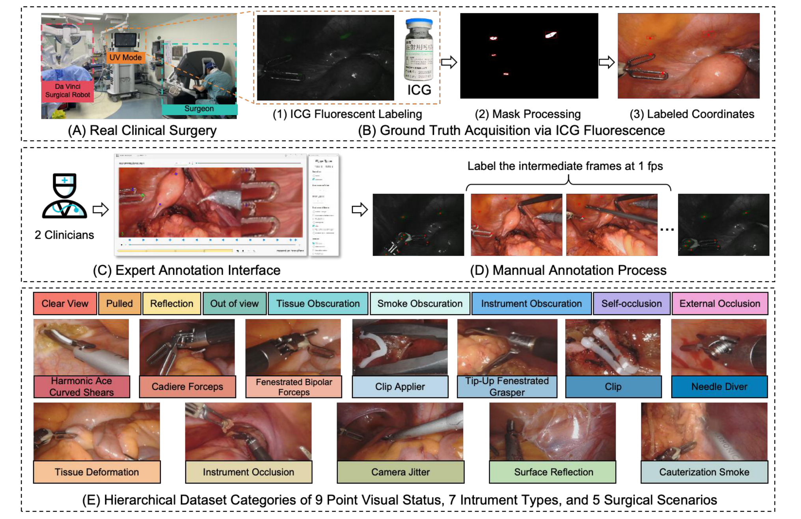
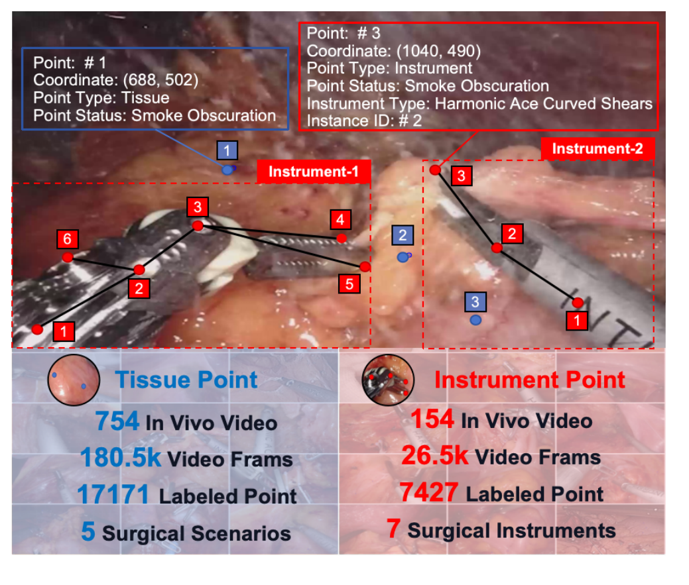
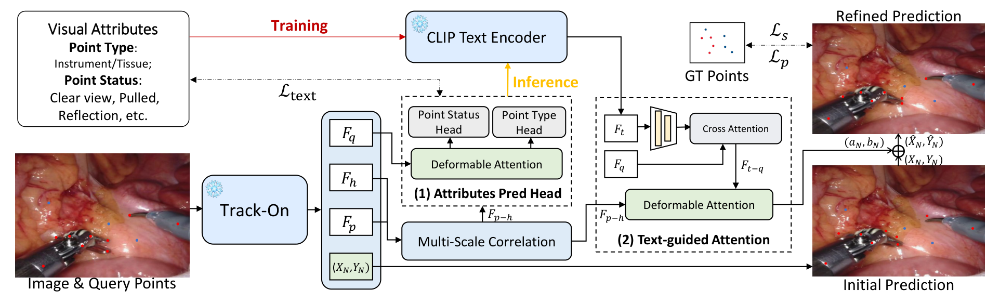
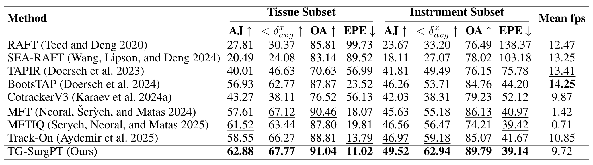
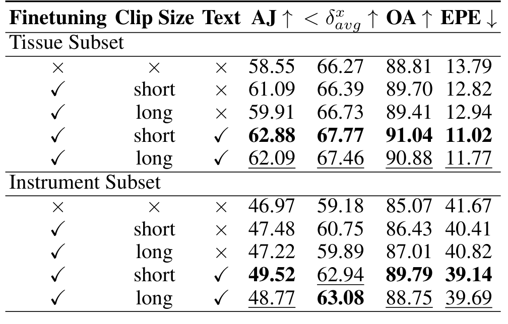
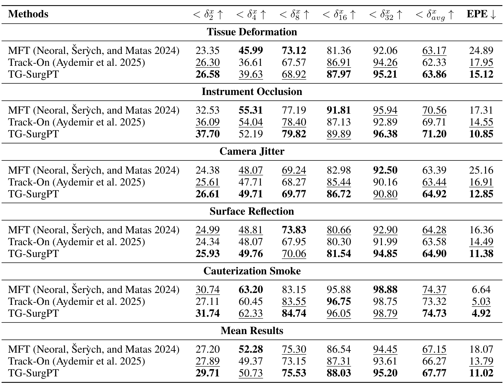
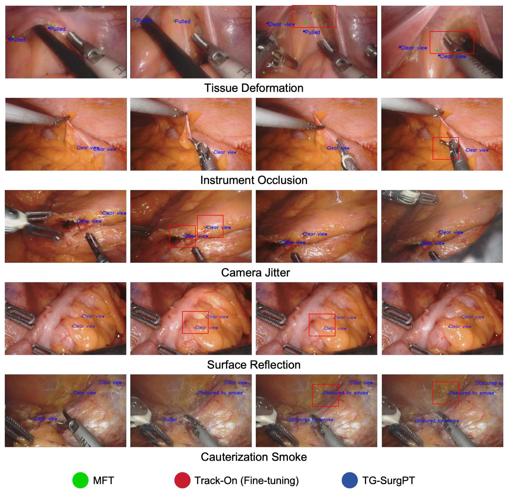
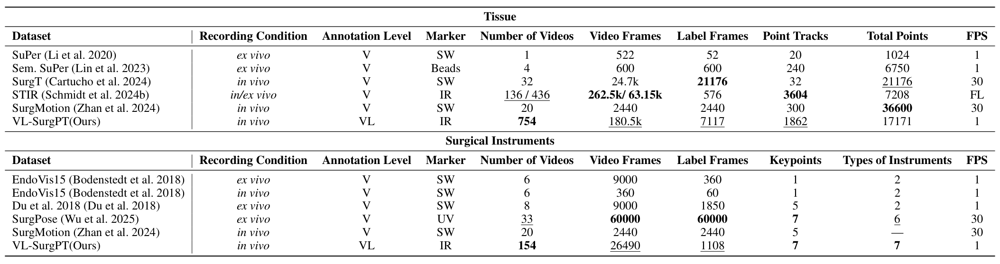

## 1. 背景与动机

**手术画面里的点常被烟雾、反光、器械和形变干扰,而现有数据集只告诉你点在哪,不告诉你点当时处在什么状态。** 通用点跟踪器在 TAP-Vid 上表现很好,搬到手术视频上明显退化。

已有手术跟踪数据集各缺一块:SuPer 是离体数据,SurgT 标的是框,STIR 只有首末端点,SurgPose 在实验室环境,SurgMotion 只有坐标。没有一个能告诉研究者"这个点是因为什么跟丢的"。

作者的假设是:如果模型知道一个点此刻被什么干扰,就能更好地处理它。要检验这个假设,先要有带状态标签的数据。

:::highlights
- 缺口在标签类型:已有数据集只有坐标,没有逐点的干扰原因。
:::

## 2. 核心观点速览

论文做了两件事:一个带逐点状态标签的在体数据集,和一个读状态标签的跟踪基线。

- 数据:908 个片段,组织 754 个(17,171 个可见点,5 种场景),器械 154 个(7 类器械),每个点带 9 种状态之一。
- 真值:吲哚菁绿(ICG)荧光给首末帧锚点,中间帧由 2 名医生按每秒 1 帧手标。
- 方法:冻结 Track-On 和 CLIP 文本编码器,先预测点状态,再用状态文本输出坐标修正量。
- 结果:组织 AJ 62.88、器械 AJ 49.52,四项精度指标第一,速度 9.72 fps。

**边界:基线没有在本数据上微调;文本的净增益约 2 个点,和额外的状态监督混在一起;只有一家医院、一种平台。**

:::data
- 908 个片段,其中组织 754 个、器械 154 个
- 20 台手术约 33 小时视频,筛到 115 分钟
:::

## 3. 真值怎么在活体手术里拿到

在体手术不能反复做同一个动作,所以作者只在每个短片段两端取荧光真值:

1. 术前在器械尖端、关节、杆部涂 ICG,术中在组织表面点 2 到 4 个点。
2. 切到荧光模式并保持静止,记录首帧坐标。
3. 切回白光正常操作 5 到 10 秒。
4. 再切到荧光模式,记录末帧坐标。

中间帧由两名医生按每秒 1 帧手标,同时给每个点打类型和状态标签。

*论文原图编号：Figure 2。数据采集与标注流程:手术场景、荧光取真值三步、标注界面、中间帧标注,以及 9 种状态、7 类器械、5 种场景示例。*

**真值因此分两层。** 末帧终点误差(EPE)对应荧光真值,可靠;AJ 和位置准确率在中间帧上算,反映的是与医生手标的一致程度。两名医生之间的一致性论文未说明。

:::highlights
- 只有首末帧有荧光锚点,中间帧真值是人工判断。
:::

下一节看两个子集各有多少。

## 4. 两个子集与状态标签

| 子集 | 片段 | 标注帧 | 可见标注点 | 组织方式 |
|---|---|---|---|---|
| 组织 | 754 | 7,117 | 17,171 | 5 种场景 |
| 器械(正文) | 154 | 1,108 | 7,427 | 7 类器械 |
| 器械(补充材料表 4) | 307 | 2,232 | 7,427 | 7 类器械 |

器械子集有两套口径,论文没有解释。我的判断是表 4 按器械计数,一个片段里有两件器械就算两次。

*论文原图编号：Figure 1。单个组织点和器械点的完整标签,以及两个子集的规模。*

状态从 9 个词的封闭词表中选:清晰、牵拉、反光、组织遮挡、烟雾遮挡、器械遮挡、出视野、外部遮挡、自遮挡。**所以这里的"文本"本质上是分类标签,不是自由语言描述。**

:::data
- 组织烟雾遮挡占 24.5%,器械点约三分之一处于不利状态
:::

## 5. TG-SurgPT 怎样用状态标签

TG-SurgPT 是在冻结的 Track-On 上加的一个修正头:

1. Track-On 输出查询点特征、帧特征、粗匹配位置和初始坐标。
2. 属性预测头从视觉特征预测点类型和点状态。
3. 状态文字经冻结的 CLIP 文本编码器变成特征,与查询点特征做交叉注意力。
4. 再经一层可变形注意力输出坐标修正量,加到初始坐标上。

*论文原图编号：Figure 3。TG-SurgPT 结构:冻结的 Track-On 与 CLIP 文本编码器、属性预测头、文本引导注意力。*

训练时用真值状态,推理时用模型自己预测的状态。损失是距离损失、轨迹平滑损失和状态分类损失三项之和,权重和训练超参论文未说明。

**主干冻结,所以能用稀疏的真实标注训练;代价是只能在主干输出上做小幅修正。**

下一节看这个修正换来了多少。

## 6. 主结果:谁在前面

*论文原图编号：Table 1。八个视觉基线与 TG-SurgPT 在两个子集上的四项指标和速度。*

| 方法 | 组织 AJ | 组织 EPE | 器械 AJ | 速度 |
|---|---|---|---|---|
| RAFT | 27.81 | 99.73 | 23.67 | 12.47 |
| MFTIQ | 61.52 | 19.81 | 46.56 | 0.71 |
| Track-On | 58.55 | 13.79 | 46.97 | 10.85 |
| TG-SurgPT | 62.88 | 11.02 | 49.52 | 9.72 |

- 光流类方法 AJ 都低于 30,说明逐帧光流在手术跟踪上会累积漂移。
- MFT 和 MFTIQ 精度高,但每秒只处理 1.42 和 0.71 帧。
- TG-SurgPT 四项精度第一,但比 Track-On 慢。

**这张表的比较不对等:八个基线都用默认参数,没有在本数据上训练,而 TG-SurgPT 训练过。**

:::data
- 组织 AJ 58.55 到 62.88,器械 AJ 46.97 到 49.52
:::

## 7. 消融:微调和文本各贡献多少

*论文原图编号：Table 2。是否微调、短或长片段、是否加文本的消融。*

| 设置 | 组织 AJ | 器械 AJ |
|---|---|---|
| Track-On 不微调 | 58.55 | 46.97 |
| 微调,短片段,无文本 | 61.09 | 47.48 |
| 微调,短片段,有文本 | 62.88 | 49.52 |

**这张表把总增益拆成两段。** 组织上微调贡献 2.54、文本贡献 1.79;器械上微调只贡献 0.51,文本贡献 2.04。

短片段(31 帧)普遍好于长片段(181 帧)。"无文本"变体是否仍保留状态预测头和状态损失,论文未说明。如果没保留,文本那一行同时多了一项监督,约 2 个点里有多少来自语言本身无法分开。

:::highlights
- 文本的净增益在两个子集上都约 2 个点。
:::

下一节看哪些场景最难。

## 8. 场景与状态:难在哪里

*论文原图编号：Table 5。MFT、Track-On、TG-SurgPT 在五种组织场景下的准确率和终点误差。*

TG-SurgPT 在五种场景的平均准确率都最高,但领先 MFT 只有 0.36 到 1.53 个点。差距主要体现在终点误差:器械遮挡下比 Track-On 低 3.70 像素,烟雾下只低 0.11。表 5 的 Track-On 是未微调版本,所以这里同样混着微调的增益。

按九个方法的均值,组织形变最难,电灼烟雾反而最容易(58.62%)。作者解释为烟雾带来可用的时间模式,但没有实验检验。

*论文原图编号：Figure 9。五种组织场景下 MFT、微调 Track-On 与 TG-SurgPT 的定性对比。*

状态预测并不准:组织三种遮挡类别的准确率在 0.572 到 0.628,器械出视野只有 0.481,均值分别为 0.707 和 0.642。**推理时喂给文本分支的状态约三成是错的。** 改用真值状态能涨多少,论文未说明。

:::data
- 状态分类均值:组织 0.707,器械 0.642
:::

## 9. 结果没说什么

- 没说语言是增益来源。9 词封闭词表等价于类别标签,论文没有用可学习类别嵌入替换 CLIP 文本做对照。
- 没说 TG-SurgPT 优于所有方法。只有 Track-On 有微调对照,其他基线微调后差距多大未知。
- 没说结果稳定。全部单次运行,1 到 2 个点的差异没有方差支撑。
- 没说能推广。一家医院、达芬奇 Xi、四类胃肠根治术。

*论文原图编号：Table 3。与已有组织跟踪和器械关键点数据集的规模与标注层级对比。*

数据集也不是在所有维度上最大:组织总点数 17,171 少于 SurgMotion 和 SurgT,器械标注帧远少于离体的 SurgPose。它的独特之处是"在体、有状态标签、组织与器械兼有"。

:::highlights
- 能确认的是在冻结主干上加状态监督和修正头有小而一致的提升。
:::

## 10. 复现与数据获取

数据在 Hugging Face 公开(zhourulin88888/VL-SurgPT),非受限访问,共 908 个视频片段,目录结构与表 4 的五种场景一一对应。每个片段有坐标文件和状态文件。

复现前要注意:

- 仓库没有许可证和训练测试划分文件,论文的 4:1 划分无法复现;划分是否按手术隔离论文未说明。
- 代码仓库已过期,训练超参论文未说明。
- 指标在哪个分辨率下计算论文未说明,与其他数据集比较前要统一。
- 抽查的状态文件中有一处拼写为 "Eternal Occlusion",使用前要清洗词表。

## @takeaways
- 把它当作带逐点干扰标签的在体短片段跟踪测试集来用。
- 文本引导的净增益约 2 个点,未与额外状态监督分离。
- 比较新方法时要同时报告微调后的视觉基线。
- 数据公开可下载,但没有官方划分和许可证。

## @strengths
- 在体手术数据,首末帧有荧光真值。
- 逐点状态标签,可以按干扰类型拆分误差。
- 组织与器械同一协议。
- 消融把微调和文本两段增益分开报告。

## @weaknesses
- 单中心、单平台、单一术式类别。
- 基线未微调,主表比较不对等。
- 器械规模两套口径,标记方式在表 3 与正文不一致。
- 训练细节和标注一致性论文未说明。

## @questions
- 推理时用真值状态,TG-SurgPT 的上限是多少?
- 用可学习类别嵌入替换 CLIP 文本,增益是否保留?
- 所有基线微调后与 TG-SurgPT 的差距还剩多少?
- 按手术划分训练测试后结果是否变化?
